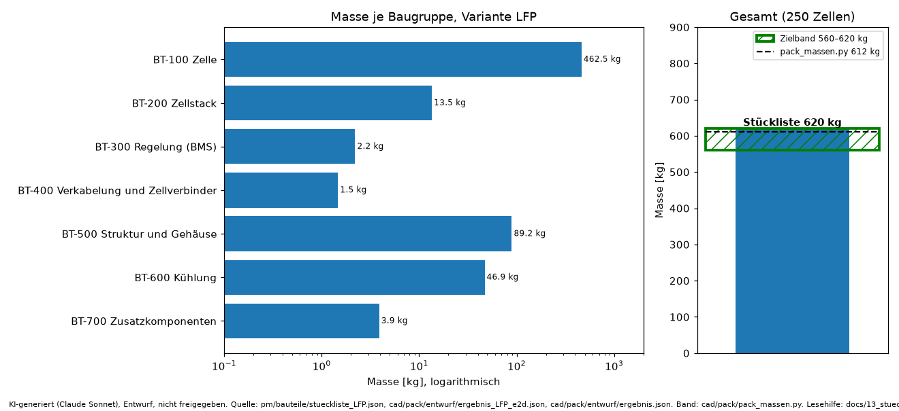

| Dok.-Nr. | BAT-DOC-13 | Version | 0.2 | Status | Entwurf |
|---|---|---|---|---|---|
| Titel | Stückliste Konstruktionsstand – Variante LFP | Ersteller | Claude Sonnet (KI), pm/bauteile/stueckliste_v2.py | Prüfer | Opus (Stichprobe), Mensch offen |

> **KI-generiert.** Nicht von Hand bearbeiten, `python3 pm/bauteile/stueckliste_v2.py --variante LFP` schreibt die Datei neu. Entwurf, nicht freigegeben. Mengen und Massen aus dem CAD (Stand e2d (Detailstand), neu erzeugt 2026-11-18), Quelle `cad/pack/entwurf/ergebnis_LFP_e2d.json`.
> **Kosten:** Spalten leer, werden von der Kostenrechnung gefüllt (`pm/kosten/`). Keine Preise in diesem Dokument.

**Zellen:** 250 (Soll 250), Energie 73.92 kWh (Rechnung aus Akte BT-100). **Masse Stückliste:** 619.80 kg; `pack_massen.py` (`cad/pack/entwurf/ergebnis.json`): 611.89 kg; Abweichung +1.29 % (≤ 2 %). Gegen die CAD-Summe E2 (`cad/pack/entwurf/ergebnis_LFP_e2d.json`): -0.1242 %. Der Unterschied zu `pack_massen.py` kommt aus den E2-Teilen und der längeren Wanne (Stand E2 gegen G4); ohne E2-Teile 613.22 kg.

Art: K Kaufteil, E Eigenteil. „offen“: keine CAD-Menge und keine Akte, nichts geschätzt.

## BT-100 Zelle

| Pos. | BT | Benennung | Menge LFP | Masse je [kg] | Masse ges. [kg] | Art | Werkstoff | Kosten je [€] | Kosten ges. [€] | Quelle | Bemerkung |
|---|---|---|---|---|---|---|---|---|---|---|---|
| 100.1 | BT-100 Zelle | Zelle (prismatisch, Blade-Querschnitt, verkürzt, LFP) | 250 | 1,850 | 462,500 | K | Zelle (Masse aus Akte, Hüllkörper) | | | cad/pack/entwurf/ergebnis_LFP_e2d.json gruppen.Zellen; Zellmasse parameter_LFP.json BT-100 masse_g = 1850.0 |  |

## BT-200 Zellstack

| Pos. | BT | Benennung | Menge LFP | Masse je [kg] | Masse ges. [kg] | Art | Werkstoff | Kosten je [€] | Kosten ges. [€] | Quelle | Bemerkung |
|---|---|---|---|---|---|---|---|---|---|---|---|
| 200.1 | BT-210 Zellreihe | Zellreihe zwischen Querträgern (Cell-to-Pack, ohne Module) | offen | offen | offen | E | offen | | | pm/bauteile/stueckliste.json (nur Benennung) | nicht im CAD, keine Akte mit Menge: offen |
| 200.2 | BT-220 Zwischenlage | Zwischenlage zwischen Zellen (Wärme- und Brandschutz, Quellausgleich) | offen | offen | offen | K | offen | | | pm/bauteile/stueckliste.json (nur Benennung) | nicht im CAD, keine Akte mit Menge: offen |
| 200.3 | BT-230 Wärmeleitmaterial | Wärmeleitmaterial / Pad Zelle-Kühlplatte | 2 | 6,765 | 13,529 | K | Pad | | | cad/pack/entwurf/ergebnis_LFP_e2d.json gruppen.Pad |  |
| 200.4 | BT-240 Verspannung | Verspannung der Zellreihen (Endplatte/Band) | offen | offen | offen | E | offen | | | pm/bauteile/stueckliste.json (nur Benennung) | nicht im CAD, keine Akte mit Menge: offen |

## BT-300 Regelung (BMS)

| Pos. | BT | Benennung | Menge LFP | Masse je [kg] | Masse ges. [kg] | Art | Werkstoff | Kosten je [€] | Kosten ges. [€] | Quelle | Bemerkung |
|---|---|---|---|---|---|---|---|---|---|---|---|
| 300.1 | BT-310 BMS-Hauptsteuergerät | BMS-Platine | 1 | 0,400 | 0,400 | K | E2 Teil (Masse ERW-E2 N1) | | | cad/pack/entwurf/ergebnis_LFP_e2d.json annahmen A_e2_*; Summe geprüft gegen Gruppe E2_Schaltbox_Inhalt |  |
| 300.2 | BT-320 Zellüberwachung | Zellüberwachung CMU (Platine) | 14 | 0,080 | 1,120 | K | E2 Teil (Masse ERW-E2 N1) | | | cad/pack/entwurf/ergebnis_LFP_e2d.json gruppen.E2_CMU | Zuordnung nach Name BT-320, Opus bestätigen |
| 300.3 | BT-330 Temperaturfühler Zelle | Temperaturfühler Zelle | offen | offen | offen | K | offen | | | pm/bauteile/stueckliste.json (nur Benennung) | nicht im CAD, keine Akte mit Menge: offen |
| 300.4 | BT-340 Strommessung | Shunt (Strommessung) | 1 | 0,100 | 0,100 | K | E2 Teil (Masse ERW-E2 N1) | | | cad/pack/entwurf/ergebnis_LFP_e2d.json annahmen A_e2_*; Summe geprüft gegen Gruppe E2_Schaltbox_Inhalt |  |
| 300.5 | BT-350 Isolationswächter | Isolationswächter | offen | offen | offen | K | offen | | | pm/bauteile/stueckliste.json (nur Benennung) | nicht im CAD, keine Akte mit Menge: offen |
| 300.6 | BT-360 Messleitungen | Flexleiterplatte FPC Zelle -> CMU | 14 | 0,042 | 0,590 | K | FPC (Masse ERW-E2 N1) | | | cad/pack/entwurf/ergebnis_LFP_e2d.json gruppen.E2_FPC | Zuordnung nach Name (300.6 nennt Flexleiterplatte), Opus bestätigen |

## BT-400 Verkabelung und Zellverbinder

| Pos. | BT | Benennung | Menge LFP | Masse je [kg] | Masse ges. [kg] | Art | Werkstoff | Kosten je [€] | Kosten ges. [€] | Quelle | Bemerkung |
|---|---|---|---|---|---|---|---|---|---|---|---|
| 400.1 | BT-410 Zellverbinder | Zellverbinder (Zellabgriff, Plus und Minus je Zelle) | offen | offen | offen | E | offen | | | pm/bauteile/stueckliste.json (nur Benennung) | nicht im CAD, keine Akte mit Menge: offen |
| 400.2 | BT-420 Reihenverbinder | Zellverbinder = Reihenverbinder (p = 1) | 130 | 0,008 | 1,003 | E | Al | | | cad/pack/entwurf/ergebnis_LFP_e2d.json gruppen.Zellverbinder |  |
| 400.3 | BT-430 HV-Hauptleitung | HV-Leitung im Pack | 8 | 0,059 | 0,475 | K | Cu (Leiter, Isolierung ohne Wert) | | | cad/pack/entwurf/ergebnis_LFP_e2d.json gruppen.E2_HV_Leitung |  |

## BT-500 Struktur und Gehäuse

| Pos. | BT | Benennung | Menge LFP | Masse je [kg] | Masse ges. [kg] | Art | Werkstoff | Kosten je [€] | Kosten ges. [€] | Quelle | Bemerkung |
|---|---|---|---|---|---|---|---|---|---|---|---|
| 500.1 | BT-510 Gehäusewanne | Gehäusewanne (im CAD: Boden) | 1 | 23,745 | 23,745 | E | Al | | | cad/pack/entwurf/ergebnis_LFP_e2d.json gruppen.Boden |  |
| 500.2 | BT-520 Deckel mit Dichtung | Deckel (Dichtung nicht im CAD) | 1 | 15,796 | 15,796 | E | Al | | | cad/pack/entwurf/ergebnis_LFP_e2d.json gruppen.Deckel |  |
| 500.3 | BT-530 Querträger | Querträger | 3 | 1,387 | 4,161 | E | Al | | | cad/pack/entwurf/ergebnis_LFP_e2d.json gruppen.Quertraeger |  |
| 500.4 | BT-540 Seitenrahmen | Seitenrahmen / Crashprofil | 1 | 21,792 | 21,792 | E | Al (Vollprofil, Obergrenze) | | | cad/pack/entwurf/ergebnis_LFP_e2d.json gruppen.Seitenrahmen |  |
| 500.5 | BT-550 Unterfahrschutz | Unterfahrschutz | 1 | 23,745 | 23,745 | E | Al | | | cad/pack/entwurf/ergebnis_LFP_e2d.json gruppen.Unterfahrschutz |  |
| 500.6 | BT-560 Befestigungspunkte | Befestigungspunkte am Fahrzeug | offen | offen | offen | E | offen | | | pm/bauteile/stueckliste.json (nur Benennung) | nicht im CAD, keine Akte mit Menge: offen |
| 500.7 | BT-570 Druckausgleichselement | Druckausgleichselement (atmend, wasserdicht) | offen | offen | offen | K | offen | | | pm/bauteile/stueckliste.json (nur Benennung) | nicht im CAD, keine Akte mit Menge: offen |

## BT-600 Kühlung

| Pos. | BT | Benennung | Menge LFP | Masse je [kg] | Masse ges. [kg] | Art | Werkstoff | Kosten je [€] | Kosten ges. [€] | Quelle | Bemerkung |
|---|---|---|---|---|---|---|---|---|---|---|---|
| 600.1 | BT-610 Kühlplatte | Kühlplatte | 2 | 23,471 | 46,943 | E | Al (Vollmaterial, Obergrenze) | | | cad/pack/entwurf/ergebnis_LFP_e2d.json gruppen.Kuehlplatte |  |
| 600.2 | BT-620 Verteiler und Sammler | Verteiler und Sammler | offen | offen | offen | E | offen | | | pm/bauteile/stueckliste.json (nur Benennung) | nicht im CAD, keine Akte mit Menge: offen |
| 600.3 | BT-630 Kühlmittelanschlüsse | Kühlmittelanschlüsse Ein/Aus | offen | offen | offen | K | offen | | | pm/bauteile/stueckliste.json (nur Benennung) | nicht im CAD, keine Akte mit Menge: offen |
| 600.4 | BT-640 Temperaturfühler Kühlmittel | Temperaturfühler Kühlmittel | offen | offen | offen | K | offen | | | pm/bauteile/stueckliste.json (nur Benennung) | nicht im CAD, keine Akte mit Menge: offen |
| 600.5 | BT-650 Kühlmittel | Kühlmittel Wasser-Glykol | offen | offen | offen | K | offen | | | pm/bauteile/stueckliste.json (nur Benennung) | nicht im CAD, keine Akte mit Menge: offen |
| 600.6 | BT-660 Schnittstelle Fahrzeugkreis | Pumpe, Wärmetauscher/Kältemittelkühler | offen | offen | offen | S | offen | | | pm/bauteile/stueckliste.json (nur Benennung) | nicht im CAD, keine Akte mit Menge: offen |

## BT-700 Zusatzkomponenten

| Pos. | BT | Benennung | Menge LFP | Masse je [kg] | Masse ges. [kg] | Art | Werkstoff | Kosten je [€] | Kosten ges. [€] | Quelle | Bemerkung |
|---|---|---|---|---|---|---|---|---|---|---|---|
| 700.1 | BT-710 Schaltbox | Schaltbox (Gehäuse) | 1 | 1,369 | 1,369 | E | Al | | | cad/pack/entwurf/ergebnis_LFP_e2d.json gruppen.E2_Schaltbox |  |
| 700.1b | BT-710 Schaltbox | Schaltbox-Deckel (e2d) | 2 | 0,299 | 0,598 | E | Al | | | cad/pack/entwurf/ergebnis_LFP_e2d.json gruppen.E2_Schaltbox_Deckel |  |
| 700.2 | BT-711 Hauptschütze | Hauptschütz | 2 | 0,450 | 0,900 | K | E2 Teil (Masse ERW-E2 N1) | | | cad/pack/entwurf/ergebnis_LFP_e2d.json annahmen A_e2_*; Summe geprüft gegen Gruppe E2_Schaltbox_Inhalt |  |
| 700.3 | BT-712 Vorladung | Vorladeschütz und Vorladewiderstand (Widerstandsmasse 0 gesetzt) | 2 | 0,075 | 0,150 | K | E2 Teil (Masse ERW-E2 N1) | | | cad/pack/entwurf/ergebnis_LFP_e2d.json annahmen A_e2_*; Summe geprüft gegen Gruppe E2_Schaltbox_Inhalt |  |
| 700.4 | BT-713 Hauptsicherung | Pyrosicherung und Schmelzsicherung | 2 | 0,125 | 0,250 | K | E2 Teil (Masse ERW-E2 N1) | | | cad/pack/entwurf/ergebnis_LFP_e2d.json annahmen A_e2_*; Summe geprüft gegen Gruppe E2_Schaltbox_Inhalt |  |
| 700.5 | BT-720 Service-Trennstecker | Service-Trennstecker | offen | offen | offen | K | offen | | | pm/bauteile/stueckliste.json (nur Benennung) | nicht im CAD, keine Akte mit Menge: offen |
| 700.6 | BT-730 HV-Steckverbinder | HV-Steckverbinder 250 A und 40 A | 2 | 0,275 | 0,550 | K | E2 Teil (Masse ERW-E2 N1) | | | cad/pack/entwurf/ergebnis_LFP_e2d.json annahmen A_e2_*; Summe geprüft gegen Gruppe E2_Stecker_Sensor |  |
| 700.7 | BT-740 NV-Steckverbinder | NV-Steckverbinder 26-polig | 1 | 0,050 | 0,050 | K | E2 Teil (Masse ERW-E2 N1) | | | cad/pack/entwurf/ergebnis_LFP_e2d.json annahmen A_e2_*; Summe geprüft gegen Gruppe E2_Stecker_Sensor |  |
| 700.8 | BT-750 Pack-Entgasung | Entgasungsventil mit Entgasungskanal | offen | offen | offen | K | offen | | | pm/bauteile/stueckliste.json (nur Benennung) | nicht im CAD, keine Akte mit Menge: offen |
| 700.9 | BT-760 Heizung | Heizung (Kälte, −20 °C laut REQ-P08) | offen | offen | offen | K | offen | | | pm/bauteile/stueckliste.json (nur Benennung) | nicht im CAD, keine Akte mit Menge: offen |
| 700.10 | BT-770 Gas- und Drucksensor | Gas- und Drucksensor | 1 | 0,030 | 0,030 | K | E2 Teil (Masse ERW-E2 N1) | | | cad/pack/entwurf/ergebnis_LFP_e2d.json annahmen A_e2_*; Summe geprüft gegen Gruppe E2_Stecker_Sensor |  |
| 700.11 | BT-780 Kennzeichnung | Kennzeichnung (Typschild, HV-Warnung) | offen | offen | offen | K | offen | | | pm/bauteile/stueckliste.json (nur Benennung) | nicht im CAD, keine Akte mit Menge: offen |

## Fehlende Bauteile in struktur.json (Opus erweitert)

Im CAD gebaut, aber ohne eigenes BT mit Merkmalen. Nicht angelegt, nur aufgelistet.

| CAD-Gruppe | Benennung | Anzahl | Masse [kg] | Quelle |
|---|---|---|---|---|
| E2_Lasche | Plus-/Minus-Lasche (Stromschiene) | 2 | 0,057 | cad/pack/entwurf/ergebnis_LFP_e2d.json |
| E2_Trennbruecke | Service-Trennbrücke (Cu) mit Schrauben | 2 | 0,051 | cad/pack/entwurf/ergebnis_LFP_e2d.json |
| E2_Servicedeckel | Servicedeckel | 1 | 0,050 | cad/pack/entwurf/ergebnis_LFP_e2d.json |
| E2_FPC_Halter | FPC-Halter (Masse offen, 0 gesetzt) | 2 | 0,000 | cad/pack/entwurf/ergebnis_LFP_e2d.json |
| E2_Stromschiene | Stromschienen Cu der Schaltbox (e2d) | 6 | 0,613 | cad/pack/entwurf/ergebnis_LFP_e2d.json |
| (nicht im CAD) | Dichtungen (Deckel, Schaltbox, Servicedeckel) | – | – | Auftrag, kein CAD-Teil |

Diese Massen sind in der Summe oben **nicht** enthalten (keine Position).

## Detailteile aus e2d ohne Masse (nicht in Summe, nicht als Kostenposition gezählt)

| CAD-Gruppe | Benennung | Anzahl | Masse [kg] | Quelle |
|---|---|---|---|---|
| E2_Schraube | Schrauben (e2d, Masse offen) | 84 | 0,000 (offen, 0 gesetzt) | cad/pack/entwurf/ergebnis_LFP_e2d.json |
| E2_Kabelschuh | Kabelschuhe (e2d, Masse offen) | 8 | 0,000 (offen, 0 gesetzt) | cad/pack/entwurf/ergebnis_LFP_e2d.json |
| E2_Clip | Kabelclips (e2d, Masse offen) | 4 | 0,000 (offen, 0 gesetzt) | cad/pack/entwurf/ergebnis_LFP_e2d.json |
| E2_Schrumpfschlauch | Schrumpfschlauch (e2d, Masse offen) | 6 | 0,000 (offen, 0 gesetzt) | cad/pack/entwurf/ergebnis_LFP_e2d.json |
| E2_Dichtung | Dichtungen (e2d, Masse offen) | 3 | 0,000 (offen, 0 gesetzt) | cad/pack/entwurf/ergebnis_LFP_e2d.json |
| E2_Trennbrueckenschraube | Trennbrückenschrauben (e2d, Masse offen) | 6 | 0,000 (offen, 0 gesetzt) | cad/pack/entwurf/ergebnis_LFP_e2d.json |
| E2_FPC_Detail | FPC-Details Tabs/NTC/Stecker (e2d, Masse offen) | 321 | 0,000 (offen, 0 gesetzt) | cad/pack/entwurf/ergebnis_LFP_e2d.json |
| E2_Daisy | Daisy-Chain-Kabel (e2d, Masse offen) | 40 | 0,000 (offen, 0 gesetzt) | cad/pack/entwurf/ergebnis_LFP_e2d.json |

## Widersprüche Akte/E1 gegen CAD (an Opus)

- Zell-/Reihenverbinder: CAD 130 Stück, E1 249 (s-1); CAD: innen stoßen Zellen an (cad/pack/entwurf/ergebnis_LFP_e2d.json), Quelle E1 sim/elektrik/e1_querschnitte/ergebnis.json
- HV-Leitung: CAD 0.4747 kg (8 Stück), E1 1.81 kg (2 x 2024 mm)

## Masse je Baugruppe

| Baugruppe | Masse [kg] |
|---|---|
| BT-100 Zelle | 462,500 |
| BT-200 Zellstack | 13,529 |
| BT-300 Regelung (BMS) | 2,210 |
| BT-400 Verkabelung und Zellverbinder | 1,478 |
| BT-500 Struktur und Gehäuse | 89,240 |
| BT-600 Kühlung | 46,943 |
| BT-700 Zusatzkomponenten | 3,897 |

**Lesehilfe.** Links: Masse jeder Baugruppe des Packs in kg (logarithmische Achse, weil die Zellen alles andere weit übertreffen). Rechts: die Gesamtmasse der Stückliste gegen das grün schraffierte Zielband aus der G4-Erwartung (`cad/pack/pack_massen.py`, Band LFP 560–620 kg, NMC 390–430 kg) und die schwarze Linie `pack_massen.py`. Liegt der Balken im Band, passt die Stückliste zur Erwartung; liegt er darüber, sind es vor allem die Annahmen zu Kühlplatten, Rahmen und Verguss.

---
*KI-generiert (Claude Sonnet, 2026-11-18), Entwurf, nicht freigegeben. 39 Positionen. Dokument BAT-DOC-13, Version 0.2.*
