| Dok.-Nr. | BAT-DOC-16 | Version | 0.1 | Status | Entwurf |
|---|---|---|---|---|---|
| Titel | Ergebnisbilder mit Lesehilfe | Ersteller | Claude Sonnet (KI), Auftrag Opus | Prüfer | – (Opus offen) |

> **KI-generiert.** Entwurf, nicht vom Menschen freigegeben. **Erzeugt von `pm/plan/bilder.py`, nicht von Hand bearbeiten.** Stand: 2026-11-24.

Alle Bilder unter `sim/` und `cad/` mit Lesehilfe für Nicht-Fachleute, Quelle und Vorgang. Zielbänder und Grenzen sind in den Bildern beschriftet; Annahmen sind als solche benannt.

## cad/baukasten/bilder

### g5_LFP_bruecke.png

**Lesehilfe:** Lesehilfe fehlt

- Quelle: `cad/baukasten/ausgabe/ergebnis_LFP.json`
- Vorgang: G5

### g5_LFP_draufsicht.png

**Lesehilfe:** Lesehilfe fehlt

- Quelle: `cad/baukasten/ausgabe/ergebnis_LFP.json`
- Vorgang: G5

### g5_LFP_ecke.png

**Lesehilfe:** Hinterer Rahmen von außen: Verteiler mit Kühlmittelanschlüssen, Fühler, Schlauch mit T-Stück, HV-Leitung und Laschen.

- Quelle: `cad/baukasten/ausgabe/ergebnis_LFP.json`; Lesehilfe: `cad/baukasten/bilder/g5_lesehilfe.md`
- Vorgang: G5

### g5_LFP_explosion.png

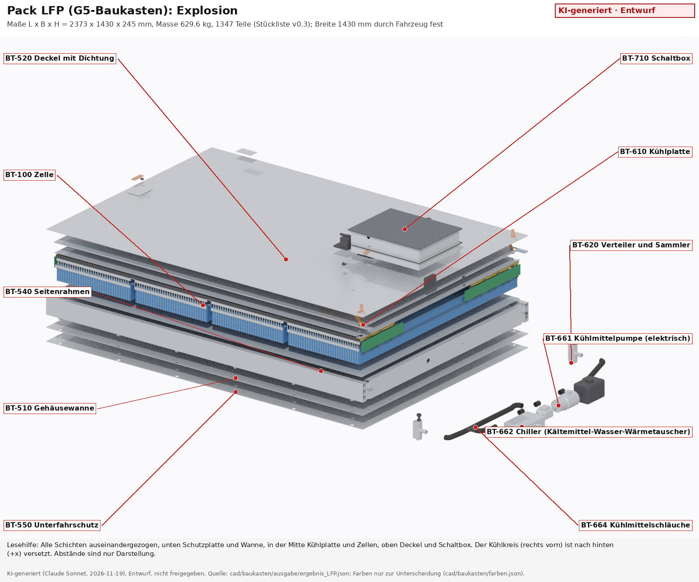

**Lesehilfe:** Alle Schichten auseinandergezogen, von unten Unterfahrschutz, Wanne, Rahmen, Kühlplatte, Pad, Zellen, Pad, Kühlplatte, Deckel, Schaltbox; der Kühlkreis steht nach hinten versetzt. Abstände sind nur Darstellung.

- Quelle: `cad/baukasten/ausgabe/ergebnis_LFP.json`; Lesehilfe: `cad/baukasten/bilder/g5_lesehilfe.md`
- Vorgang: G5

### g5_LFP_gesamt.png

**Lesehilfe:** Das ganze Pack von schräg oben mit Deckel, Schaltbox und dem Kühlkreis außerhalb der Wanne (hinten). Rote Punkte und Kästen nennen das Bauteil.

- Quelle: `cad/baukasten/ausgabe/ergebnis_LFP.json`; Lesehilfe: `cad/baukasten/bilder/g5_lesehilfe.md`
- Vorgang: G5

### g5_LFP_kabelplan.png

**Lesehilfe:** Lesehilfe fehlt

- Quelle: `cad/baukasten/ausgabe/ergebnis_LFP.json`
- Vorgang: G5

### g5_LFP_kuehlkreis.png

**Lesehilfe:** Pumpe, Ausgleichsbehälter, Ventil, Chiller und Schläuche am Pack; Zellen und Elektrik ausgeblendet.

- Quelle: `cad/baukasten/ausgabe/ergebnis_LFP.json`; Lesehilfe: `cad/baukasten/bilder/g5_lesehilfe.md`
- Vorgang: G5

### g5_LFP_schaltbox.png

**Lesehilfe:** Blick in die Schaltbox ohne Deckel: Schütze, Vorladung, Sicherung, Stromschienen, Steuerplatine (grün).

- Quelle: `cad/baukasten/ausgabe/ergebnis_LFP.json`; Lesehilfe: `cad/baukasten/bilder/g5_lesehilfe.md`
- Vorgang: G5

### g5_LFP_schnitt.png

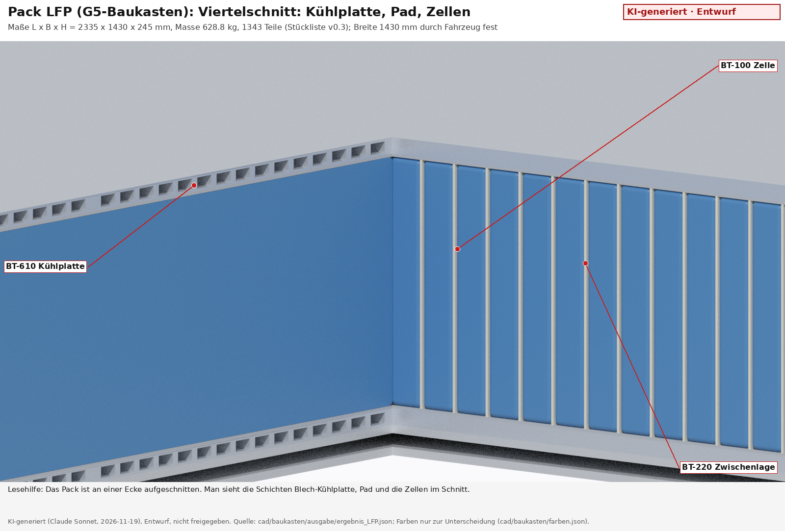

**Lesehilfe:** Ein Viertel des Packs ist weggeschnitten (Schnittflächen gefüllt). Oben und unten Blech-Kühlplatte, deren Öffnungen im Schnitt die Mäanderkanäle sind, dazwischen die Zellen. Farben nur zur Unterscheidung.

- Quelle: `cad/baukasten/ausgabe/ergebnis_LFP.json`; Lesehilfe: `cad/baukasten/bilder/g5_lesehilfe.md`
- Vorgang: G5

### g5_NMC_bruecke.png

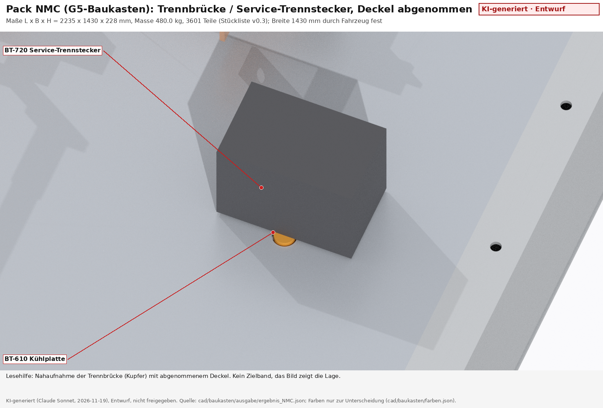

**Lesehilfe:** Lesehilfe fehlt

- Quelle: `cad/baukasten/ausgabe/ergebnis_NMC.json`
- Vorgang: G5

### g5_NMC_draufsicht.png

**Lesehilfe:** Lesehilfe fehlt

- Quelle: `cad/baukasten/ausgabe/ergebnis_NMC.json`
- Vorgang: G5

### g5_NMC_ecke.png

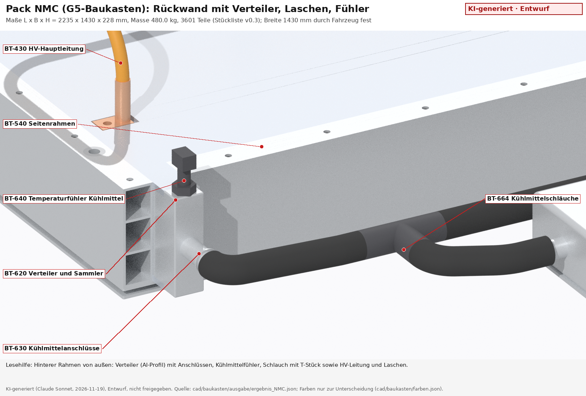

**Lesehilfe:** Hinterer Rahmen von außen: Verteiler mit Kühlmittelanschlüssen, Fühler, Schlauch mit T-Stück, HV-Leitung und Laschen.

- Quelle: `cad/baukasten/ausgabe/ergebnis_NMC.json`; Lesehilfe: `cad/baukasten/bilder/g5_lesehilfe.md`
- Vorgang: G5

### g5_NMC_explosion.png

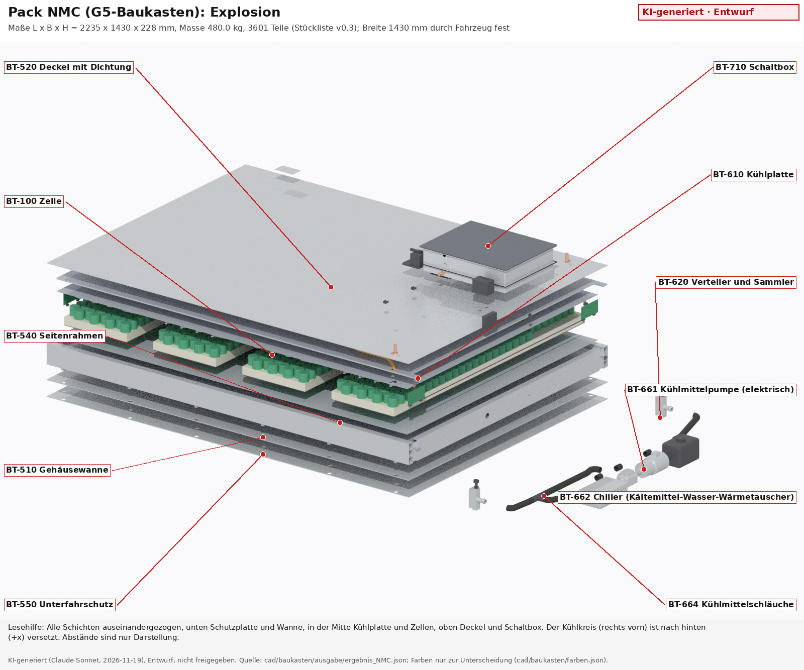

**Lesehilfe:** Alle Schichten auseinandergezogen, von unten Unterfahrschutz, Wanne, Rahmen, Kühlplatte, Pad, Zellen, Pad, Kühlplatte, Deckel, Schaltbox; der Kühlkreis steht nach hinten versetzt. Abstände sind nur Darstellung.

- Quelle: `cad/baukasten/ausgabe/ergebnis_NMC.json`; Lesehilfe: `cad/baukasten/bilder/g5_lesehilfe.md`
- Vorgang: G5

### g5_NMC_gesamt.png

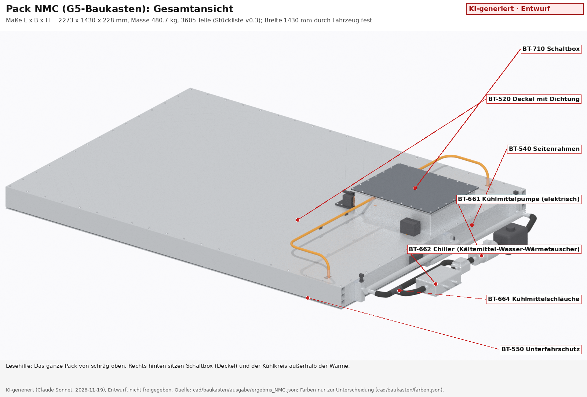

**Lesehilfe:** Das ganze Pack von schräg oben mit Deckel, Schaltbox und dem Kühlkreis außerhalb der Wanne (hinten). Rote Punkte und Kästen nennen das Bauteil.

- Quelle: `cad/baukasten/ausgabe/ergebnis_NMC.json`; Lesehilfe: `cad/baukasten/bilder/g5_lesehilfe.md`
- Vorgang: G5

### g5_NMC_kabelplan.png

**Lesehilfe:** Lesehilfe fehlt

- Quelle: `cad/baukasten/ausgabe/ergebnis_NMC.json`
- Vorgang: G5

### g5_NMC_kuehlkreis.png

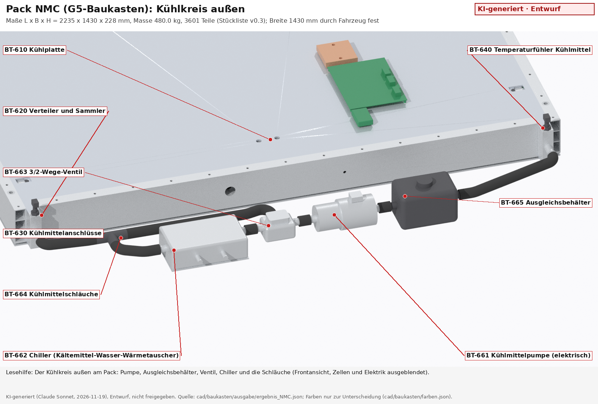

**Lesehilfe:** Pumpe, Ausgleichsbehälter, Ventil, Chiller und Schläuche am Pack; Zellen und Elektrik ausgeblendet.

- Quelle: `cad/baukasten/ausgabe/ergebnis_NMC.json`; Lesehilfe: `cad/baukasten/bilder/g5_lesehilfe.md`
- Vorgang: G5

### g5_NMC_schaltbox.png

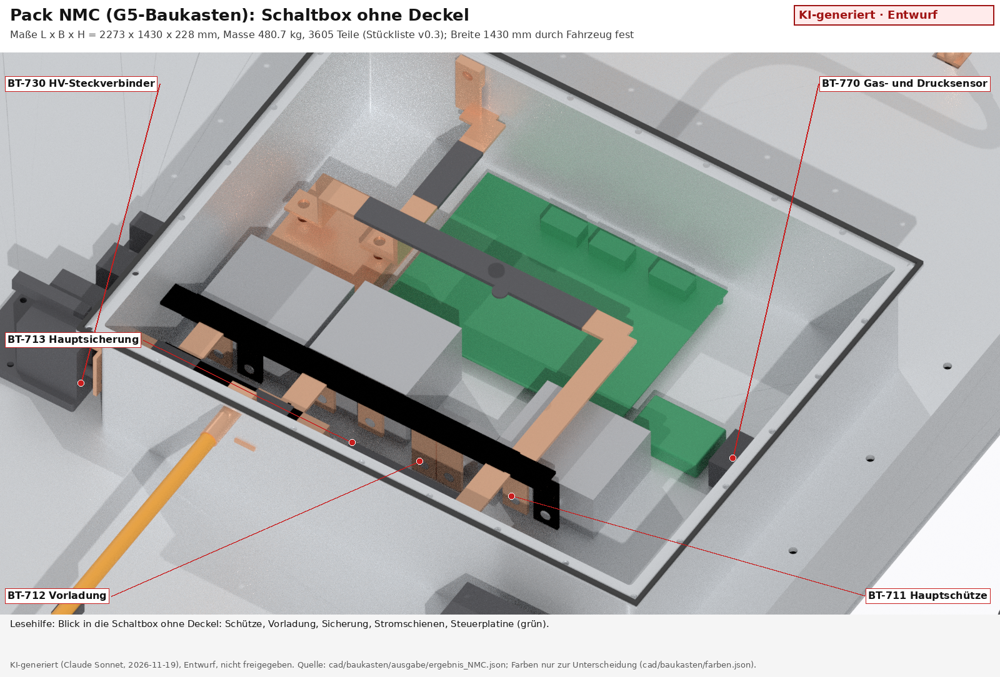

**Lesehilfe:** Blick in die Schaltbox ohne Deckel: Schütze, Vorladung, Sicherung, Stromschienen, Steuerplatine (grün).

- Quelle: `cad/baukasten/ausgabe/ergebnis_NMC.json`; Lesehilfe: `cad/baukasten/bilder/g5_lesehilfe.md`
- Vorgang: G5

### g5_NMC_schnitt.png

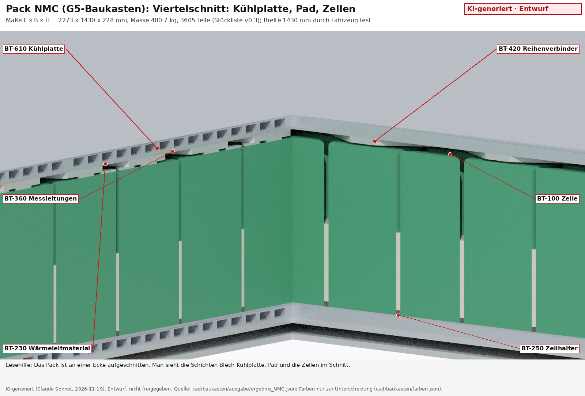

**Lesehilfe:** Ein Viertel des Packs ist weggeschnitten (Schnittflächen gefüllt). Oben und unten Blech-Kühlplatte, deren Öffnungen im Schnitt die Mäanderkanäle sind, dazwischen die Zellen. Farben nur zur Unterscheidung.

- Quelle: `cad/baukasten/ausgabe/ergebnis_NMC.json`; Lesehilfe: `cad/baukasten/bilder/g5_lesehilfe.md`
- Vorgang: G5

### kuehlplatte_maeander_schnitt.png

**Lesehilfe:** Draufsicht auf die untere Kühlplatte in Wassermitte. Die Platte besteht aus zwei getrennten Mäandern zu je 4 Bahnen (Trennsteg rot gestrichelt). Hinten liegen zwei Rohre übereinander: Verteilerrohr (blau, kaltes Wasser hinein) und Sammelrohr (violett schraffiert, warmes Wasser ab). Die Ausschnitte rechts zeigen die Blöcke und Stutzen hinten sowie den Trennsteg vorn. Gegenläufige Durchströmung der oberen Platte ist nicht abgebildet.

- Quelle: `ergebnis.json fehlt`; Lesehilfe: `cad/baukasten/bilder/g5_lesehilfe.md`
- Vorgang: G5

### roh_g5_LFP_bruecke.png

**Lesehilfe:** Lesehilfe fehlt

- Quelle: `ergebnis.json fehlt`
- Vorgang: G5

### roh_g5_LFP_draufsicht.png

**Lesehilfe:** Lesehilfe fehlt

- Quelle: `ergebnis.json fehlt`
- Vorgang: G5

### roh_g5_LFP_ecke.png

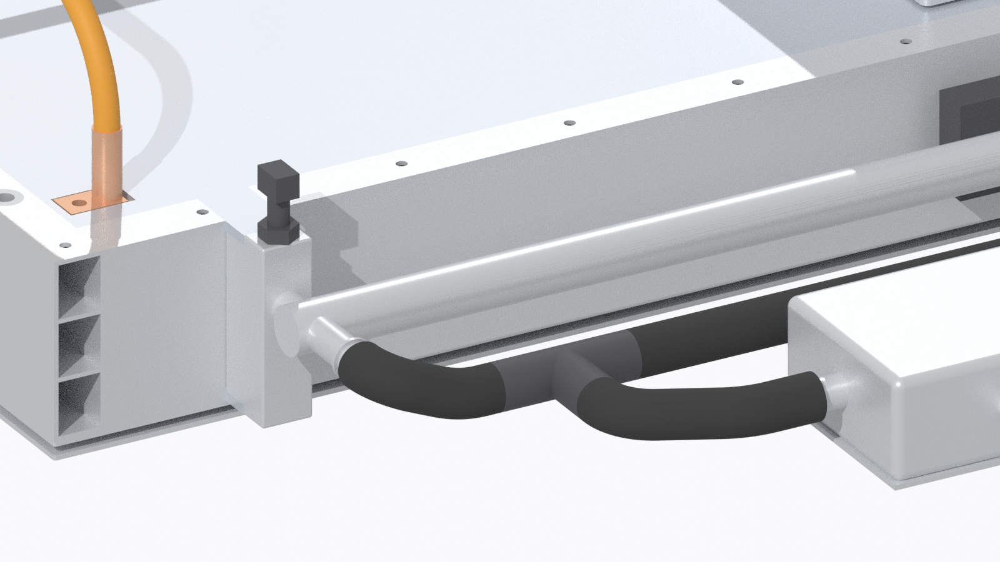

**Lesehilfe:** Lesehilfe fehlt

- Quelle: `ergebnis.json fehlt`
- Vorgang: G5

### roh_g5_LFP_explosion.png

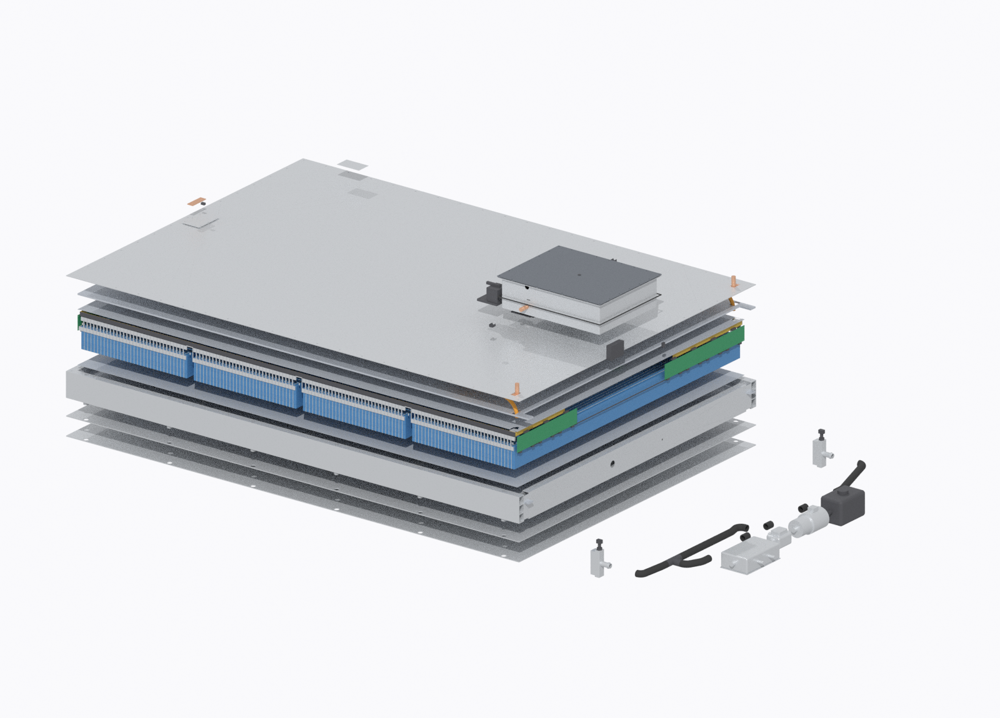

**Lesehilfe:** Lesehilfe fehlt

- Quelle: `ergebnis.json fehlt`
- Vorgang: G5

### roh_g5_LFP_gesamt.png

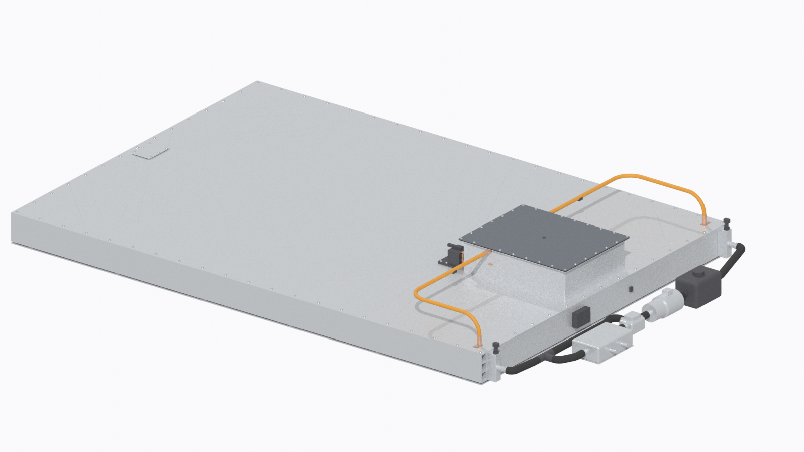

**Lesehilfe:** Lesehilfe fehlt

- Quelle: `ergebnis.json fehlt`
- Vorgang: G5

### roh_g5_LFP_kabelplan.png

**Lesehilfe:** Lesehilfe fehlt

- Quelle: `ergebnis.json fehlt`
- Vorgang: G5

### roh_g5_LFP_kuehlkreis.png

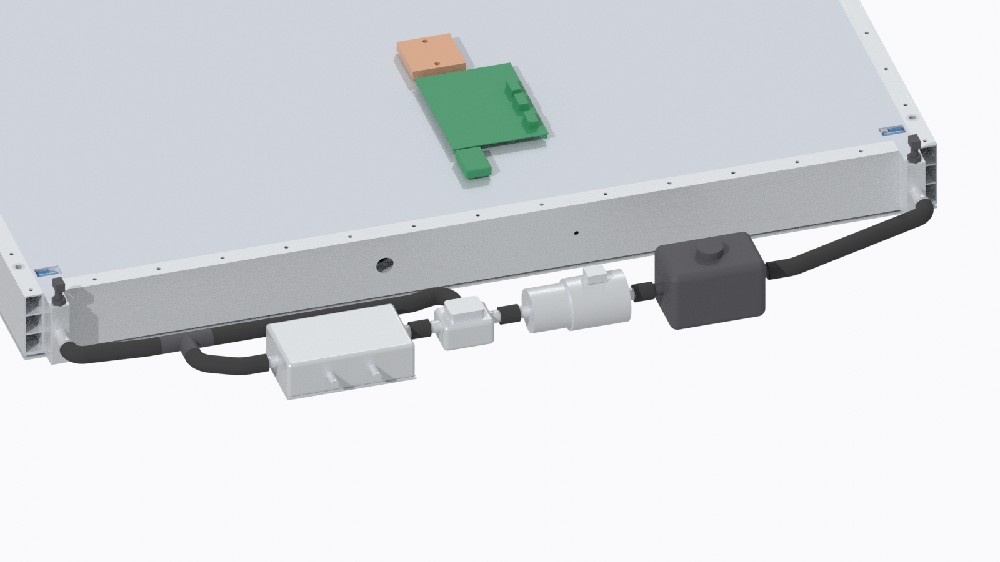

**Lesehilfe:** Lesehilfe fehlt

- Quelle: `ergebnis.json fehlt`
- Vorgang: G5

### roh_g5_LFP_schaltbox.png

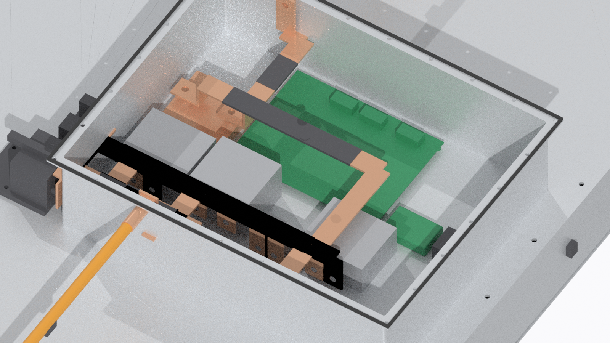

**Lesehilfe:** Lesehilfe fehlt

- Quelle: `ergebnis.json fehlt`
- Vorgang: G5

### roh_g5_LFP_schnitt.png

**Lesehilfe:** Lesehilfe fehlt

- Quelle: `ergebnis.json fehlt`
- Vorgang: G5

### roh_g5_NMC_bruecke.png

**Lesehilfe:** Lesehilfe fehlt

- Quelle: `ergebnis.json fehlt`
- Vorgang: G5

### roh_g5_NMC_draufsicht.png

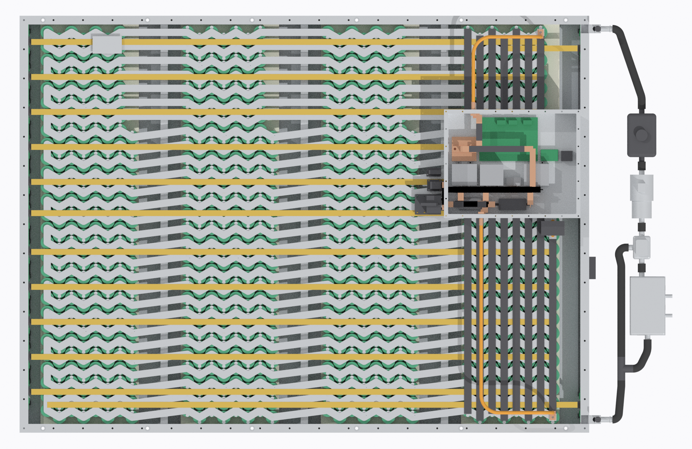

**Lesehilfe:** Lesehilfe fehlt

- Quelle: `ergebnis.json fehlt`
- Vorgang: G5

### roh_g5_NMC_ecke.png

**Lesehilfe:** Lesehilfe fehlt

- Quelle: `ergebnis.json fehlt`
- Vorgang: G5

### roh_g5_NMC_explosion.png

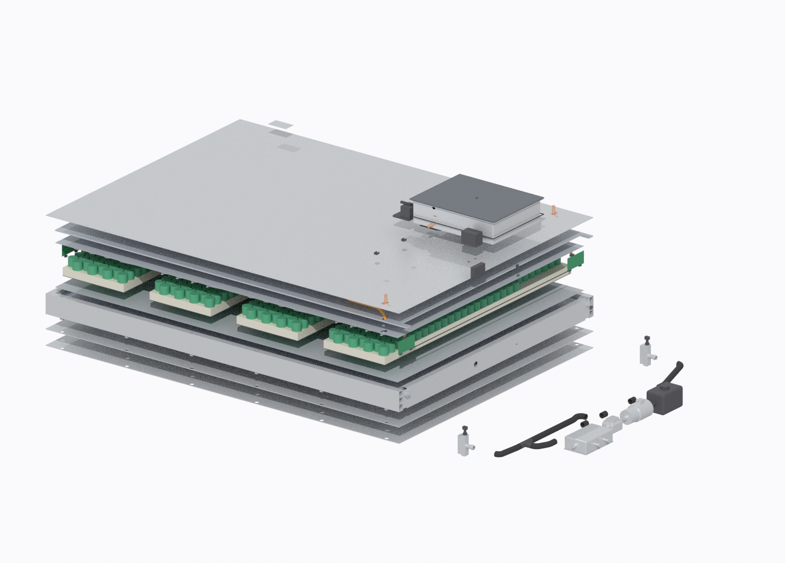

**Lesehilfe:** Lesehilfe fehlt

- Quelle: `ergebnis.json fehlt`
- Vorgang: G5

### roh_g5_NMC_gesamt.png

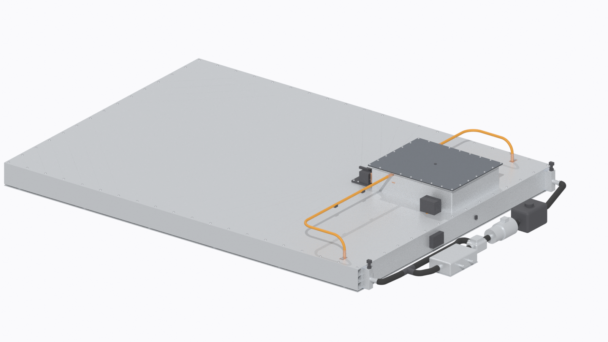

**Lesehilfe:** Lesehilfe fehlt

- Quelle: `ergebnis.json fehlt`
- Vorgang: G5

### roh_g5_NMC_kabelplan.png

**Lesehilfe:** Lesehilfe fehlt

- Quelle: `ergebnis.json fehlt`
- Vorgang: G5

### roh_g5_NMC_kuehlkreis.png

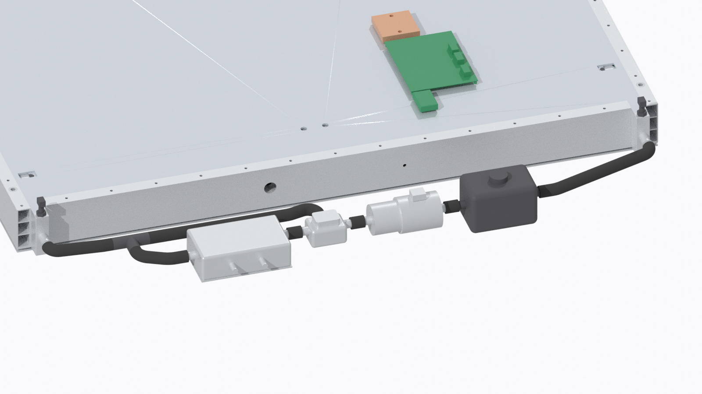

**Lesehilfe:** Lesehilfe fehlt

- Quelle: `ergebnis.json fehlt`
- Vorgang: G5

### roh_g5_NMC_schaltbox.png

**Lesehilfe:** Lesehilfe fehlt

- Quelle: `ergebnis.json fehlt`
- Vorgang: G5

### roh_g5_NMC_schnitt.png

**Lesehilfe:** Lesehilfe fehlt

- Quelle: `ergebnis.json fehlt`
- Vorgang: G5

## cad/pack/entwurf

### pack_LFP_ecke.png

**Lesehilfe:** Derselbe Viertelschnitt, Blick auf die Schnittfläche an der Außenwand: LFP zeigt dort die Zellverbinder (kurze Kupfer-/Alu-Laschen am äußeren Zellende), NMC Zellträger, Verguss, Abgriffe und Gruppenverbinder.

- Quelle: `cad/pack/entwurf/ergebnis.json`; Lesehilfe: `cad/pack/entwurf/pack_lesehilfe.md`
- Vorgang: G4

### pack_LFP_explosion.png

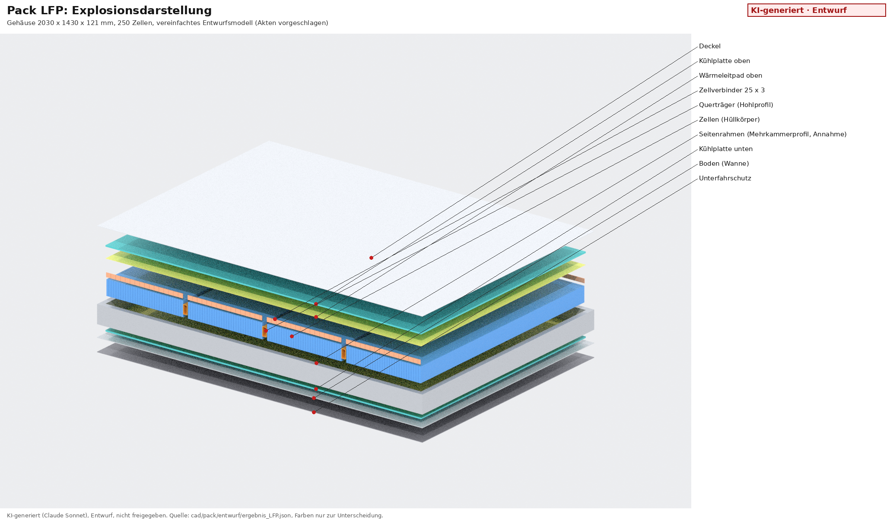

**Lesehilfe:** Alle Schichten auseinandergezogen, von unten Unterfahrschutz, Boden, Kühlplatte, Pad, Zellen mit Querträgern und Verbindern, Pad, Kühlplatte, Deckel. Abstände sind nur Darstellung. Die Linien zeigen auf das beschriftete Teil.

- Quelle: `cad/pack/entwurf/ergebnis.json`; Lesehilfe: `cad/pack/entwurf/pack_lesehilfe.md`
- Vorgang: G4

### pack_LFP_gesamt.png

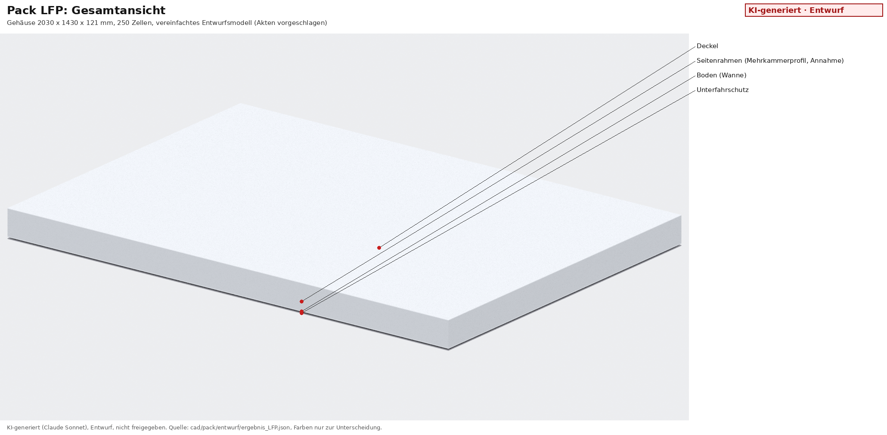

**Lesehilfe:** Blick schräg von oben auf das geschlossene Gehäuse (Deckel, Rahmen, Unterfahrschutz). Maße im Titel aus dem Modell.

- Quelle: `cad/pack/entwurf/ergebnis.json`; Lesehilfe: `cad/pack/entwurf/pack_lesehilfe.md`
- Vorgang: G4

### pack_LFP_laengs.png

**Lesehilfe:** Schnitt in Längsrichtung durch die Mitte (halbe Breite). Zu sehen sind die Zellschicht zwischen den Kühlplatten und die drei Querträger als Hohlprofile. Der schwarze Balken ist 200 mm lang.

- Quelle: `cad/pack/entwurf/ergebnis.json`; Lesehilfe: `cad/pack/entwurf/pack_lesehilfe.md`
- Vorgang: G4

### pack_LFP_quer.png

**Lesehilfe:** Schnitt quer durch einen Querträger: das orange Hohlprofil läuft über die ganze Breite, darüber und darunter Kühlplatten. Balken 200 mm.

- Quelle: `cad/pack/entwurf/ergebnis.json`; Lesehilfe: `cad/pack/entwurf/pack_lesehilfe.md`
- Vorgang: G4

### pack_LFP_schnitt.png

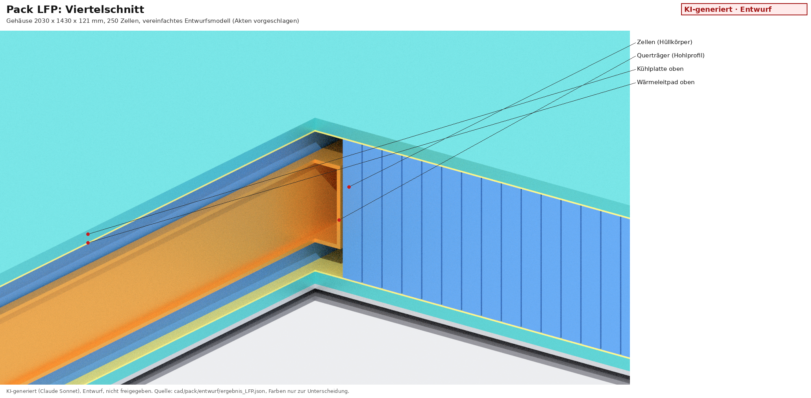

**Lesehilfe:** Viertelschnitt: ein Viertel des Packs ist weggeschnitten, man sieht Zellen, Querträger und Plattenschichten im Inneren; der Deckel ist weggelassen.

- Quelle: `cad/pack/entwurf/ergebnis.json`; Lesehilfe: `cad/pack/entwurf/pack_lesehilfe.md`
- Vorgang: G4

### pack_NMC_ecke.png

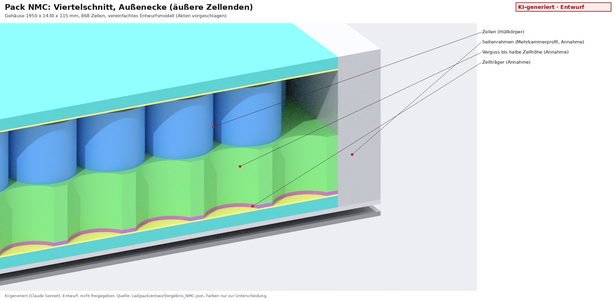

**Lesehilfe:** Derselbe Viertelschnitt, Blick auf die Schnittfläche an der Außenwand: LFP zeigt dort die Zellverbinder (kurze Kupfer-/Alu-Laschen am äußeren Zellende), NMC Zellträger, Verguss, Abgriffe und Gruppenverbinder.

- Quelle: `cad/pack/entwurf/ergebnis.json`; Lesehilfe: `cad/pack/entwurf/pack_lesehilfe.md`
- Vorgang: G4

### pack_NMC_explosion.png

**Lesehilfe:** Alle Schichten auseinandergezogen, von unten Unterfahrschutz, Boden, Kühlplatte, Pad, Zellen mit Querträgern und Verbindern, Pad, Kühlplatte, Deckel. Abstände sind nur Darstellung. Die Linien zeigen auf das beschriftete Teil.

- Quelle: `cad/pack/entwurf/ergebnis.json`; Lesehilfe: `cad/pack/entwurf/pack_lesehilfe.md`
- Vorgang: G4

### pack_NMC_gesamt.png

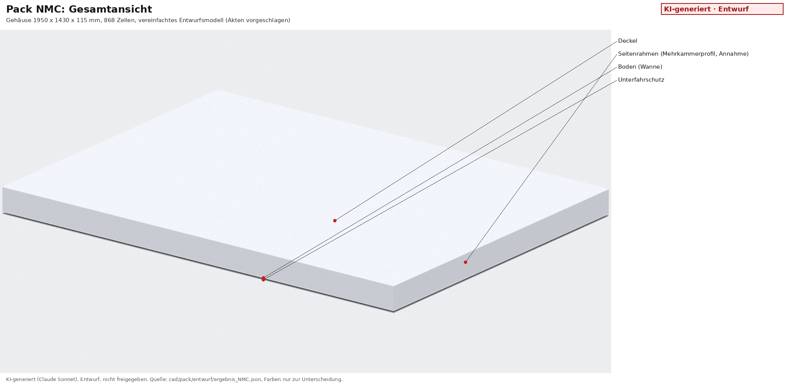

**Lesehilfe:** Blick schräg von oben auf das geschlossene Gehäuse (Deckel, Rahmen, Unterfahrschutz). Maße im Titel aus dem Modell.

- Quelle: `cad/pack/entwurf/ergebnis.json`; Lesehilfe: `cad/pack/entwurf/pack_lesehilfe.md`
- Vorgang: G4

### pack_NMC_laengs.png

**Lesehilfe:** Schnitt in Längsrichtung durch die Mitte (halbe Breite). Zu sehen sind die Zellschicht zwischen den Kühlplatten und die drei Querträger als Hohlprofile. Der schwarze Balken ist 200 mm lang.

- Quelle: `cad/pack/entwurf/ergebnis.json`; Lesehilfe: `cad/pack/entwurf/pack_lesehilfe.md`
- Vorgang: G4

### pack_NMC_quer.png

**Lesehilfe:** Schnitt quer durch einen Querträger: das orange Hohlprofil läuft über die ganze Breite, darüber und darunter Kühlplatten. Balken 200 mm.

- Quelle: `cad/pack/entwurf/ergebnis.json`; Lesehilfe: `cad/pack/entwurf/pack_lesehilfe.md`
- Vorgang: G4

### pack_NMC_schnitt.png

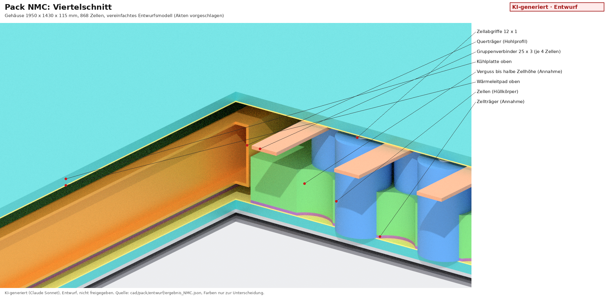

**Lesehilfe:** Viertelschnitt: ein Viertel des Packs ist weggeschnitten, man sieht Zellen, Querträger und Plattenschichten im Inneren; der Deckel ist weggelassen.

- Quelle: `cad/pack/entwurf/ergebnis.json`; Lesehilfe: `cad/pack/entwurf/pack_lesehilfe.md`
- Vorgang: G4

### pack_massen.png

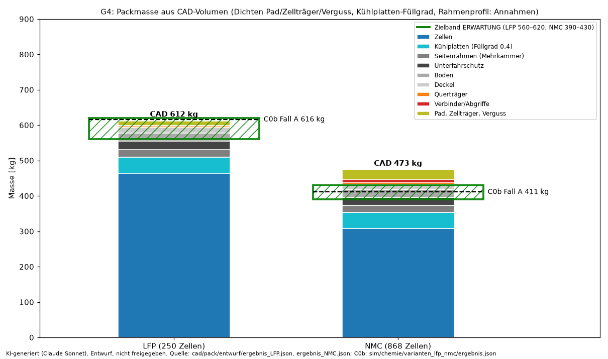

**Lesehilfe:** Zwei gestapelte Säulen: links der LFP-Pack, rechts der NMC-Pack, jeweils aus den Massen der Bauteile im CAD (Zellen blau, Kühlplatten türkis, Rahmen und Wanne grau, Querträger orange). Das grün schraffierte Rechteck ist das Zielband aus der Erwartung, die gestrichelte schwarze Linie die Masse aus der Chemierechnung C0b. LFP liegt bei 612 kg, NMC bei 473 kg. Liegt die Säule über dem Band, sind die Platten im Modell zu schwer angesetzt (Kühlplatten mit Füllgrad 0,4 und Mehrkammer-Rahmen sind Annahmen).

- Quelle: `cad/pack/entwurf/ergebnis.json`; Lesehilfe: `cad/pack/entwurf/pack_lesehilfe.md`
- Vorgang: G4

## cad/zelle/entwurf/detail

### LFP_explosion.png

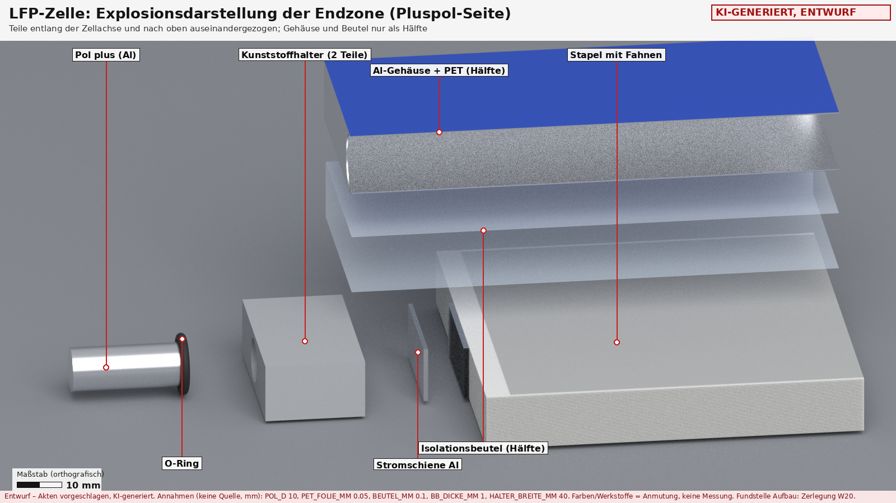

**Lesehilfe:** Explosionsbild der Endzone: Die Teile sind in Richtung der Zellachse und nach oben auseinandergezogen (Pol mit O-Ring links außen, dann Halter, Stromschiene, Stapelende; darüber Isolationsbeutel und Gehäuse mit Folie, beide nur als Hälfte, damit man hineinsieht). Der Kunststoffhalter besteht aus zwei Hälften, die hier zusammenliegen. Der Balken ist 10 mm lang. So sieht man, in welcher Reihenfolge die Zelle montiert wird.

- Quelle: `cad/zelle/entwurf/detail/ergebnis_detail.json`; Lesehilfe: `cad/zelle/entwurf/detail/detail_lesehilfe.md`
- Vorgang: G2

### LFP_gesamt.png

**Lesehilfe:** Die LFP-Zelle von außen: ein flacher Aluminiumkörper mit blauer PET-Schutzfolie. An den kurzen Enden sitzen die Pole (Plus Aluminium, Minus Kupfer), am Plusende das Ventil für den Überdruck und am Minusende der Gummistopfen der Füllöffnung. Der Balken ist 100 mm lang. Es ist dasselbe Modell, das in den anderen Bildern aufgeschnitten wird.

- Quelle: `cad/zelle/entwurf/detail/ergebnis_detail.json`; Lesehilfe: `cad/zelle/entwurf/detail/detail_lesehilfe.md`
- Vorgang: G2

### LFP_schnitt.png

**Lesehilfe:** Längsschnitt durch das Plusende: Die Zelle ist hier in der Mitte aufgeschnitten. Rechts sieht man den Stapel aus 38 Kathoden, 39 Anoden und 78 Separatorlagen, zusammen 12,48 mm dick in 13,4 mm Innenraum. Links davon laufen die Kathodenfahnen (dünne Alufolien) zur Stromschiene, dann folgen der zweiteilige Kunststoffhalter und der Pol mit O-Ring. Die einzelnen Schichten sind im Gesamtschnitt nur Striche; oben im Bild steht ein Modellausschnitt mit **20-facher Dicke** (Darstellung, keine Messung), in dem Beschichtung, Folie und Separator getrennt zu erkennen sind. Der Balken ist 10 mm lang.

- Quelle: `cad/zelle/entwurf/detail/ergebnis_detail.json`; Lesehilfe: `cad/zelle/entwurf/detail/detail_lesehilfe.md`
- Vorgang: G2

### NMC_ausschnitt.png

**Lesehilfe:** Zoom auf 6 mm am Becherrand desselben Schnitts. Die Pfeile zeigen auf die Lagen: Anode (Kupferfolie 10 µm zwischen zwei Graphitschichten 125 µm), Separator (10 µm), Kathode (Aluminiumfolie 20 µm zwischen zwei Schichten 75 µm). Die Reihenfolge von außen nach innen ist Becher, Separator, Anode, Separator, Kathode. Dünne weiße Linien können Separator oder Aluminiumfolie sein; die Pfeile geben die Lage an (Radius aus den Akten berechnet). Der Balken ist 1 mm lang.

- Quelle: `cad/zelle/entwurf/detail/ergebnis_detail.json`; Lesehilfe: `cad/zelle/entwurf/detail/detail_lesehilfe.md`
- Vorgang: G2

### NMC_draufsicht.png

**Lesehilfe:** Blick von oben auf den Querschnitt durch den Wickel auf halber Höhe: eine **archimedische Spirale** (die Windungen liegen dicht an dicht; der Abstand beträgt 0,45 mm, solange alle vier Bänder wickeln, und wird kleiner, sobald Kathode und Anode enden), in der Mitte der leere Kern Ø 12.5 mm, außen der Stahlbecher. Dunkle Streifen sind Anode und Kathode, helle die Separatoren und Folien. Der Balken ist 10 mm lang.

- Quelle: `cad/zelle/entwurf/detail/ergebnis_detail.json`; Lesehilfe: `cad/zelle/entwurf/detail/detail_lesehilfe.md`
- Vorgang: G2

### NMC_gesamt.png

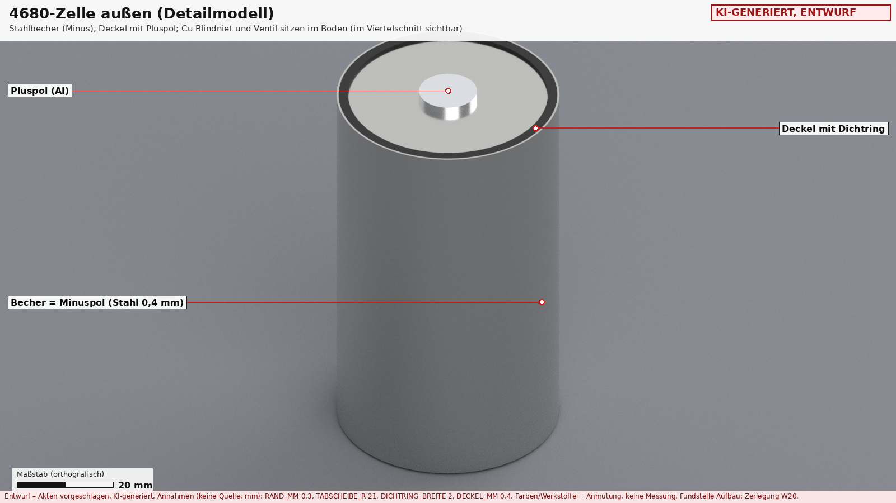

**Lesehilfe:** Die 4680-Rundzelle von außen: ein Stahlbecher (er ist der Minuspol), oben der Deckel mit dem kleinen Pluspol und einem schwarzen Dichtring. Boden, Blindniet und Ventil sind von außen nicht zu sehen, sie erscheinen im Viertelschnitt. Der Balken ist 20 mm lang.

- Quelle: `cad/zelle/entwurf/detail/ergebnis_detail.json`; Lesehilfe: `cad/zelle/entwurf/detail/detail_lesehilfe.md`
- Vorgang: G2

### NMC_viertelschnitt.png

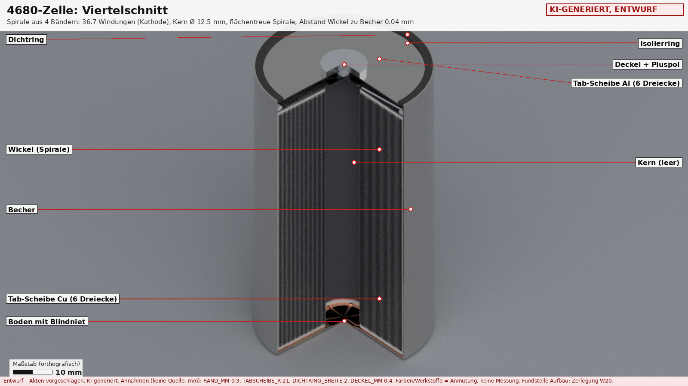

**Lesehilfe:** Ein Viertel der Zelle ist weggeschnitten. Im Inneren sieht man den Wickel (vier Bänder, die zur Spirale aufgerollt sind: 36,7 Windungen der Kathode), in der Mitte den leeren Kern, unten die Kupfer-Tab-Scheibe mit 6 Dreiecken, oben die Aluminium-Tab-Scheibe, darüber Isolierring, Deckel, Dichtring und Pluspol. Der Wickel passt mit 0,04 mm Abstand in den Becher. Der Balken ist 10 mm lang.

- Quelle: `cad/zelle/entwurf/detail/ergebnis_detail.json`; Lesehilfe: `cad/zelle/entwurf/detail/detail_lesehilfe.md`
- Vorgang: G2

## cad/zelle/entwurf/render

### zelle_LFP_render.png

**Lesehilfe:** Die LFP-Zelle liegt flach, mit einer blauen PET-Folie auf den großen Flächen (ENT-023, nur vorgeschlagen) und gebürstetem Aluminium an den beiden Stirnseiten. An den Stirnseiten sitzen die kleinen runden Pole (Plus Aluminium, Minus Kupfer). Der 100-mm-Balken zeigt die Größe. Gehäuse ist nur eine dünne Hülle (Wand 0,3 mm), das Innere ist nicht gezeichnet. Polgröße (Durchmesser 10 mm, Höhe 3 mm) ist eine Annahme ohne Beleg; Metallfarben sind Anmutung.

- Quelle: `cad/zelle/entwurf/ergebnis.json`; Lesehilfe: `cad/zelle/entwurf/render/render_lesehilfe.md`
- Vorgang: G2

### zelle_NMC_render.png

**Lesehilfe:** Die runde 4680-Zelle steht aufrecht; der Becher ist vernickelter Stahl (ENT-028, nur vorgeschlagen), oben sitzt der Deckel mit dem Pluspol aus Aluminium. Der Minuspol ist der Becherrand, kein eigenes Bauteil. Der Balken ist hier nur 20 mm lang, damit er neben der kleinen Zelle sichtbar bleibt. Wand 0,4 mm, Innenraum nicht gezeichnet. Polgröße (Durchmesser 12 mm, Höhe 1 mm) ist eine Annahme ohne Beleg; Silber-Glanz ist Anmutung, keine Messung.

- Quelle: `cad/zelle/entwurf/ergebnis.json`; Lesehilfe: `cad/zelle/entwurf/render/render_lesehilfe.md`
- Vorgang: G2

### zellen_vergleich.png

**Lesehilfe:** Das Bild stellt die flache LFP-Zelle (blau, Blade) und die runde 4680-Zelle (silbern, stehend) im selben Maßstab nebeneinander. Der Balken im Bild ist 100 mm lang und gilt für beide Zellen (Kamera ohne Perspektive, daher exakt maßstäblich). Man sieht, wie viel länger die LFP-Zelle ist, während die runde Zelle klein, aber hoch ist. Farben und Oberflächen sind Anmutung, keine Messung; die Maße stammen aus dem CAD. Die Pole sind Annahmen (siehe unten).

- Quelle: `cad/zelle/entwurf/ergebnis.json`; Lesehilfe: `cad/zelle/entwurf/render/render_lesehilfe.md`
- Vorgang: G2

## cad/zelle/entwurf

### zelle_LFP.png

**Lesehilfe:** Das Bild zeigt eine Batteriezelle vom Typ LFP als flache, lange Platte (Blade). Links die ganze Zelle (Länge maßstäblich, Breite und Dicke zur besseren Sicht vergrößert), rechts das Ende mit dem Pluspol (roter Stummel). Das Gehäuse ist hier nur eine dünne Hülle (Wand 0.3 mm); das Innere ist nicht gezeichnet. Die Polgröße ist eine Annahme, keine belegte Zahl. Der Rechenkasten unten nennt Maße, Volumen (0.832 L) und Energie je Liter (356 Wh/L). Ein Zielband gibt es nicht; Vergleichswert ist die Erwartung 0,832 L. Entwurf: Akten sind noch nicht freigegeben.

- Quelle: `cad/zelle/entwurf/ergebnis.json`; Lesehilfe: `cad/zelle/entwurf/zelle_lesehilfe.md`
- Vorgang: G2

### zelle_NMC.png

**Lesehilfe:** Das Bild zeigt eine runde Zelle (Format 4680, Becher) von der Seite und im Ausschnitt oben. Der rote Kreis oben ist der Pluspol; der Minuspol ist der Rand des Bechers. Das Gehäuse ist nur eine dünne Hülle (Wand 0.4 mm), das Innere ist nicht gezeichnet. Der Pol ist eine Annahme. Der Rechenkasten nennt Maße, Volumen (0.133 L) und Energie je Liter (644 Wh/L); Vergleichswert aus der Erwartung ist 0,133 L. Entwurf, nicht freigegeben.

- Quelle: `cad/zelle/entwurf/ergebnis.json`; Lesehilfe: `cad/zelle/entwurf/zelle_lesehilfe.md`
- Vorgang: G2

## sim/chemie/c1_zellmodell

### dcir.png

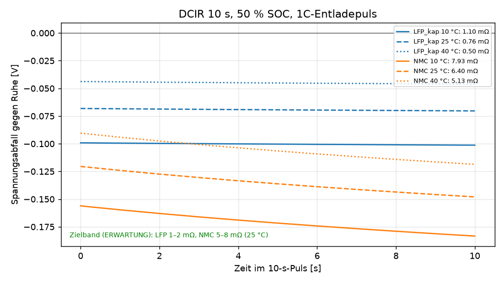

**Lesehilfe:** Lesehilfe fehlt

- Quelle: `sim/chemie/c1_zellmodell/ergebnis.json`
- Vorgang: unbekannt

### ladekurve.png

**Lesehilfe:** Lesehilfe fehlt

- Quelle: `sim/chemie/c1_zellmodell/ergebnis.json`
- Vorgang: unbekannt

### waerme_LFP.png

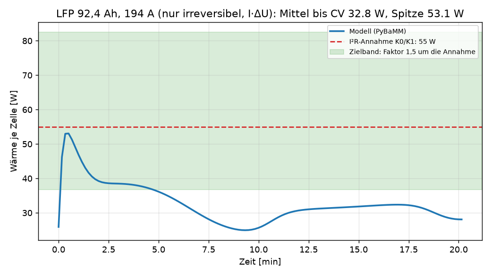

**Lesehilfe:** Lesehilfe fehlt

- Quelle: `sim/chemie/c1_zellmodell/ergebnis.json`
- Vorgang: unbekannt

### waerme_NMC.png

**Lesehilfe:** Lesehilfe fehlt

- Quelle: `sim/chemie/c1_zellmodell/ergebnis.json`
- Vorgang: unbekannt

## sim/chemie/c2_kalibrierung

### blade_widerstand.png

**Lesehilfe:** Lesehilfe fehlt

- Quelle: `ergebnis.json fehlt`
- Vorgang: unbekannt

### dcir_vergleich.png

**Lesehilfe:** Lesehilfe fehlt

- Quelle: `ergebnis.json fehlt`
- Vorgang: unbekannt

### kalibrierung_blade.png

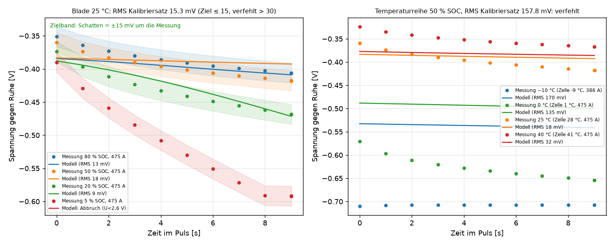

**Lesehilfe:** Lesehilfe fehlt

- Quelle: `ergebnis.json fehlt`
- Vorgang: unbekannt

### schnellladen_4680.png

**Lesehilfe:** Lesehilfe fehlt

- Quelle: `ergebnis.json fehlt`
- Vorgang: unbekannt

### waerme_vergleich.png

**Lesehilfe:** Lesehilfe fehlt

- Quelle: `ergebnis.json fehlt`
- Vorgang: unbekannt

## sim/chemie/varianten_lfp_nmc

### bauraum.png

**Lesehilfe:** Die Balken zeigen, wie viel Energie je Liter Pack-Volumen im vorgegebenen Bauraum untergebracht werden kann (verfügbar). Die schwarze gestrichelte Linie ist die Energiedichte, die für 400 km nötig ist; sie ist das Ziel. Liegt der Balken darüber, passt die Batterie in den Bauraum (grün). Liegt er knapp darunter oder darüber (innerhalb 2 %), ist er gelb, sonst rot. Beim NMC hängt der Wert davon ab, wie viel des Packs wirklich Zelle ist (40 bis 60 %, eine Annahme); der kräftige Teil gilt für 40 %, der schraffierte Teil zeigt den Gewinn bis 60 %. Fall A heißt, 1500 kg sind das ganze Auto, Fall B heißt, 1500 kg sind das Auto ohne Batterie. Aussage: Beim LFP gilt der gemessene Zellwert 160 Wh/kg; der nötige Wert in Fall B (269 Wh/L) gehört ebenfalls zu 160 Wh/kg. Mit LFP ist der Bauraum in Fall A gerade so ausgereizt und in Fall B zu klein; mit NMC bleibt er in beiden Fällen ausreichend, wenn die Annahme zur Volumennutzung stimmt.

- Quelle: `sim/chemie/varianten_lfp_nmc/ergebnis.json`; Lesehilfe: `sim/chemie/varianten_lfp_nmc/bilder_lesehilfe.md`
- Vorgang: C0b

### empfindlichkeit.png

**Lesehilfe:** Jeder blaue Balken zeigt, wie stark sich die Masse des Packs ändert, wenn man nur eine Annahme über ihren Unsicherheitsbereich verschiebt und alle anderen auf dem Mittelwert lässt (Fall B). Der schwarze senkrechte Strich ist die Pack-Masse beim Hauptwert (LFP: gemessener Zellwert 160 Wh/kg, NMC: gemessen); beim LFP steht die Masse für die Bandmitte 185 Wh/kg nur als Zusatz im Bild. Je breiter der Balken, desto mehr hängt das Ergebnis von dieser Annahme ab; die breiteste steht oben. Die rote gestrichelte Linie ist die Grenze von 30 % der Gesamtmasse, eine Annahme und keine Vorschrift. Liegt ein Balken ganz links der Linie, wird die Grenze sicher eingehalten, ragt er darüber, hängt es von der Annahme ab. Beim LFP liegt die Grenze innerhalb der Balken zu Packfaktor und Zellwert (160 bis 210 Wh/kg); auch beim Massenanteil des Verbrauchs (0,3 bis 0,7); beim NMC endet der Balken zum Packfaktor knapp links davon, die Grenze wird also im ganzen Bereich eingehalten; der Zellwert des NMC ist gemessen und hat deshalb keinen Balken.

- Quelle: `sim/chemie/varianten_lfp_nmc/ergebnis.json`; Lesehilfe: `sim/chemie/varianten_lfp_nmc/bilder_lesehilfe.md`
- Vorgang: C0b

### kriterien.png

**Lesehilfe:** Beim LFP gilt der gemessene Zellwert 160 Wh/kg (Hauptwert), die Bandmitte 185 steht nur als Zusatz. Die Tabelle stellt LFP und NMC nebeneinander und zeigt je Kriterium die Zahl und ein Urteil als Ampelfarbe: grün erfüllt, gelb knapp, rot nicht erfüllt, grau unsicher oder kein Urteil. Masse A und B: Die Batterie darf höchstens 30 % der Gesamtmasse wiegen (Annahme); die Spanne ergibt sich aus den Unsicherheiten der Annahmen. Bauraum A und B: verfügbare gegen nötige Energiedichte im Pack. Zyklen: Bandbreite der erreichbaren Ladezyklen gegen den Bedarf von 1000. Zellzahl hat keine Grenze und ist nur zur Information grau. Es gibt bewusst keine Gewichtung und keine Gesamtnote: Welche Zeile wichtiger ist, entscheidet der Mensch.

- Quelle: `sim/chemie/varianten_lfp_nmc/ergebnis.json`; Lesehilfe: `sim/chemie/varianten_lfp_nmc/bilder_lesehilfe.md`
- Vorgang: C0b

### packmasse.png

**Lesehilfe:** Jeder Balken zeigt, wie schwer die Batterie sein müsste, damit das Auto 400 km weit fährt, wenn man die gemessenen Zellwerte nimmt (LFP 616 kg / NMC 411 kg in Fall A, 775 kg / 514 kg in Fall B). Beim LFP ist der Balken der gemessene Zellwert 160 Wh/kg; die gepunkteten Striche zeigen die Bandenden 185 und 210 Wh/kg (Herstellerangaben). Der schwarze Strich am Balken zeigt die Unsicherheit beim Anteil der Zellen am Pack (65 bis 85 %). Die rote gestrichelte Linie ist eine Annahme, keine Vorschrift: die Batterie soll höchstens 30 % der Gesamtmasse wiegen. Liegt der Balken darunter, ist die Annahme eingehalten. Fall A heißt, 1500 kg sind das ganze Auto, Fall B heißt, 1500 kg sind das Auto ohne Batterie.

- Quelle: `sim/chemie/varianten_lfp_nmc/ergebnis.json`; Lesehilfe: `sim/chemie/varianten_lfp_nmc/packmasse_lesehilfe.md`
- Vorgang: C0b

## sim/chemie/vergleich_lfp_nmc

### packmasse.png

**Lesehilfe:** Jeder Balken zeigt, wie schwer die Batterie sein müsste, damit das Auto 400 km weit fährt (Mitte der Datenlage: LFP 499 kg / NMC 464 kg in Fall A, 599 kg / 549 kg in Fall B). Der schwarze Strich am Balken zeigt, wie unsicher das ist: die Zellen können besser oder schlechter sein als angenommen. Die rote gestrichelte Linie ist eine Annahme, keine Vorschrift: die Batterie soll höchstens 30 % der Gesamtmasse wiegen. Liegt der Balken darunter, ist die Annahme eingehalten. Fall A heißt, 1500 kg sind das ganze Auto, Fall B heißt, 1500 kg sind das Auto ohne Batterie.

- Quelle: `sim/chemie/vergleich_lfp_nmc/ergebnis.json`; Lesehilfe: `sim/chemie/vergleich_lfp_nmc/packmasse_lesehilfe.md`
- Vorgang: C0

## sim/elektrik/e1_querschnitte

### querschnitte.png

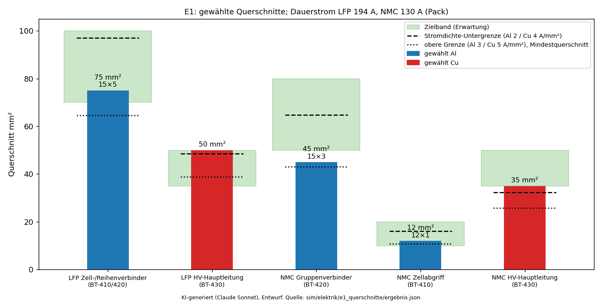

**Lesehilfe:** Je Gruppe von Stromschienen oder Kabeln ein Balken mit dem gewählten Querschnitt in mm² (blau Aluminium, rot Kupfer; die Zahl darüber nennt Fläche und Breite×Dicke). Das grüne Band dahinter ist der erwartete Bereich. Die gestrichelte Linie ist der Querschnitt bei niedriger zulässiger Stromdichte (viel Reserve), die gepunktete der kleinste noch zulässige. Alle Balken außer dem NMC-Gruppenverbinder (45 mm², knapp unter dem Band 50–80) liegen im Band.

- Quelle: `sim/elektrik/e1_querschnitte/ergebnis.json`; Lesehilfe: `sim/elektrik/e1_querschnitte/e1_lesehilfe.md`
- Vorgang: E1

### querschnitte_g5.png

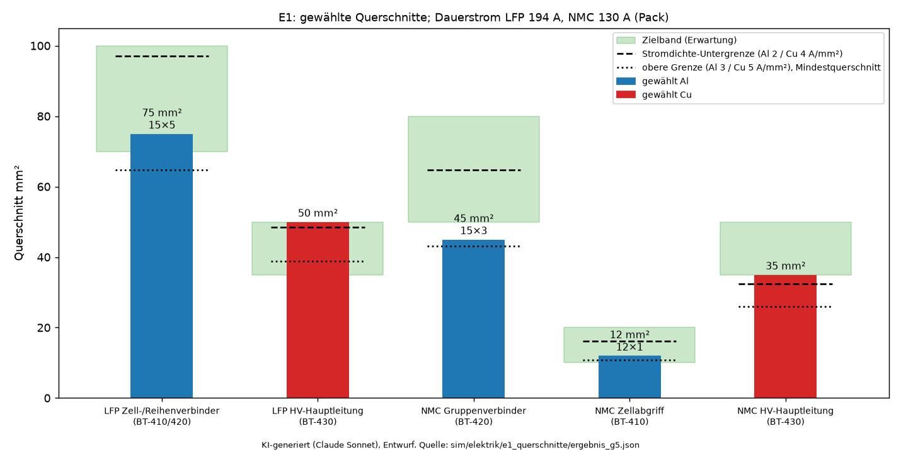

**Lesehilfe:** Lesehilfe fehlt

- Quelle: `sim/elektrik/e1_querschnitte/ergebnis.json`
- Vorgang: E1

### verluste.png

**Lesehilfe:** Wärmeverlust aller Verbinder einer Art in Watt: blau bei Dauerstrom (Laden/Fahren), orange bei 10 s Spitze. Das grüne Band ist das Ziel unter 100 W, die rote Linie die Verfehlt-Grenze 300 W. LFP liegt mit gut 50 W je Art knapp im Band (Summe 105 W), NMC-Gruppenverbinder darüber (255 W; Strom wächst entlang der Sammelstrecke, Verlust nur ein Drittel dort), NMC-Summe 385 W.

- Quelle: `sim/elektrik/e1_querschnitte/ergebnis.json`; Lesehilfe: `sim/elektrik/e1_querschnitte/e1_lesehilfe.md`
- Vorgang: E1

### verluste_g5.png

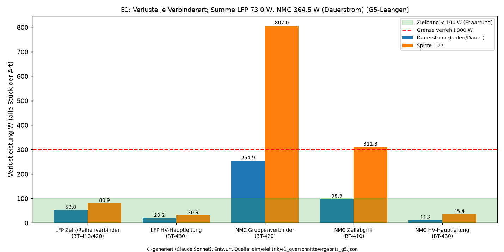

**Lesehilfe:** Lesehilfe fehlt

- Quelle: `sim/elektrik/e1_querschnitte/ergebnis.json`
- Vorgang: E1

## sim/elektrik/e2_elektronik

### e2_LFP_bruecke.png

**Lesehilfe:** Lesehilfe fehlt

- Quelle: `sim/elektrik/e2_elektronik/ergebnis.json`
- Vorgang: unbekannt

### e2_LFP_detail.png

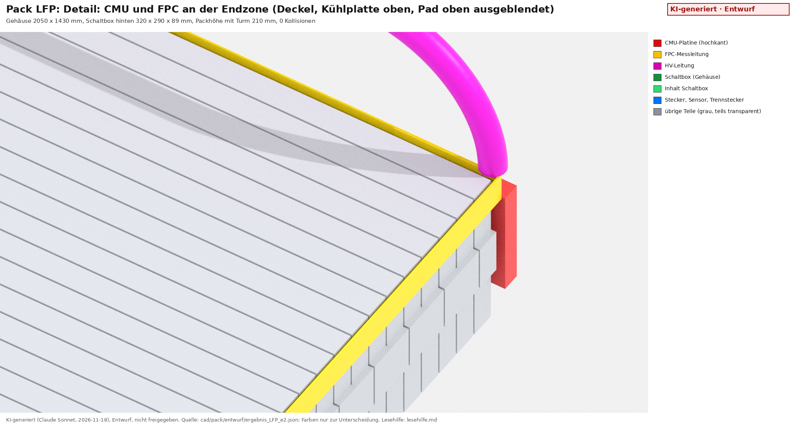

**Lesehilfe:** Lesehilfe fehlt

- Quelle: `sim/elektrik/e2_elektronik/ergebnis.json`
- Vorgang: unbekannt

### e2_LFP_draufsicht.png

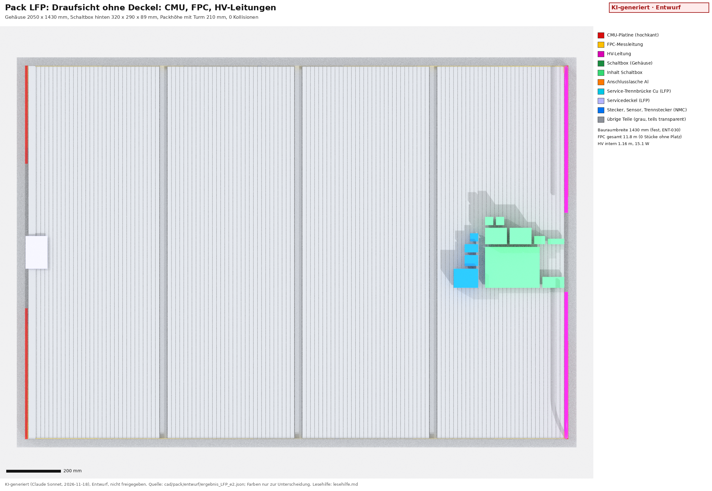

**Lesehilfe:** Lesehilfe fehlt

- Quelle: `sim/elektrik/e2_elektronik/ergebnis.json`
- Vorgang: unbekannt

### e2_LFP_gesamt.png

**Lesehilfe:** Lesehilfe fehlt

- Quelle: `sim/elektrik/e2_elektronik/ergebnis.json`
- Vorgang: unbekannt

### e2_LFP_schnitt.png

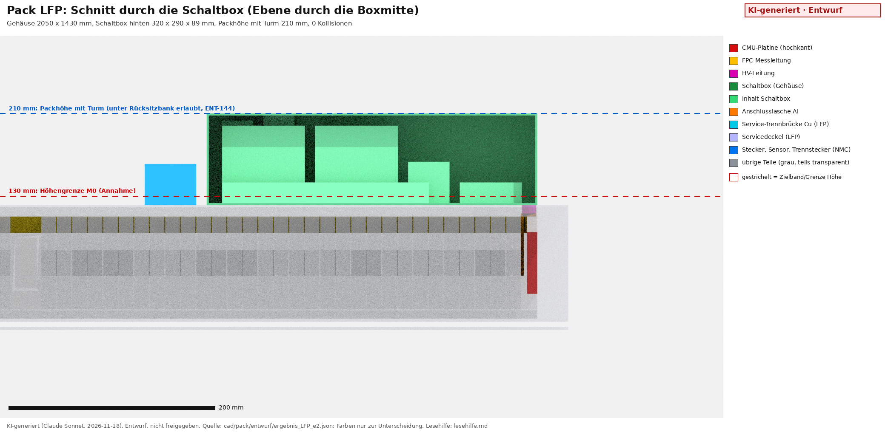

**Lesehilfe:** Lesehilfe fehlt

- Quelle: `sim/elektrik/e2_elektronik/ergebnis.json`
- Vorgang: unbekannt

### e2_NMC_detail.png

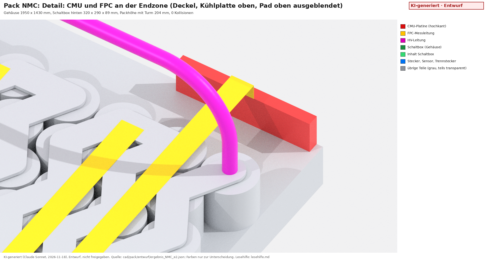

**Lesehilfe:** Lesehilfe fehlt

- Quelle: `sim/elektrik/e2_elektronik/ergebnis.json`
- Vorgang: unbekannt

### e2_NMC_draufsicht.png

**Lesehilfe:** Lesehilfe fehlt

- Quelle: `sim/elektrik/e2_elektronik/ergebnis.json`
- Vorgang: unbekannt

### e2_NMC_gesamt.png

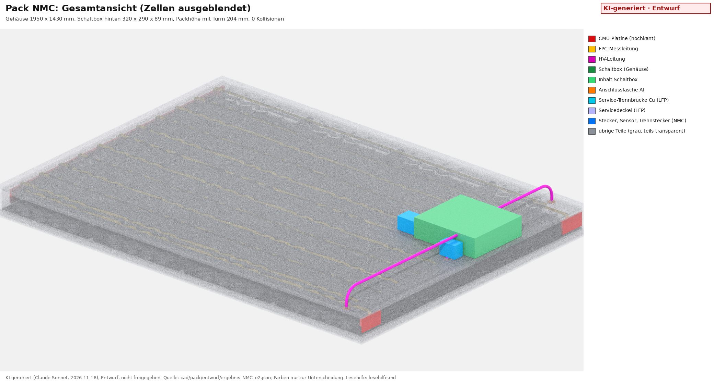

**Lesehilfe:** Lesehilfe fehlt

- Quelle: `sim/elektrik/e2_elektronik/ergebnis.json`
- Vorgang: unbekannt

### e2_NMC_schnitt.png

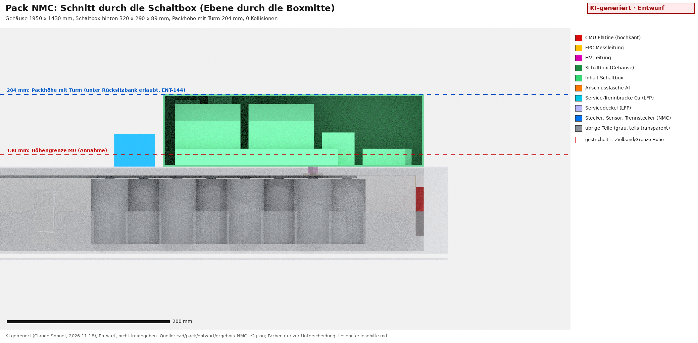

**Lesehilfe:** Lesehilfe fehlt

- Quelle: `sim/elektrik/e2_elektronik/ergebnis.json`
- Vorgang: unbekannt

### e2d_LFP_boxoffen.png

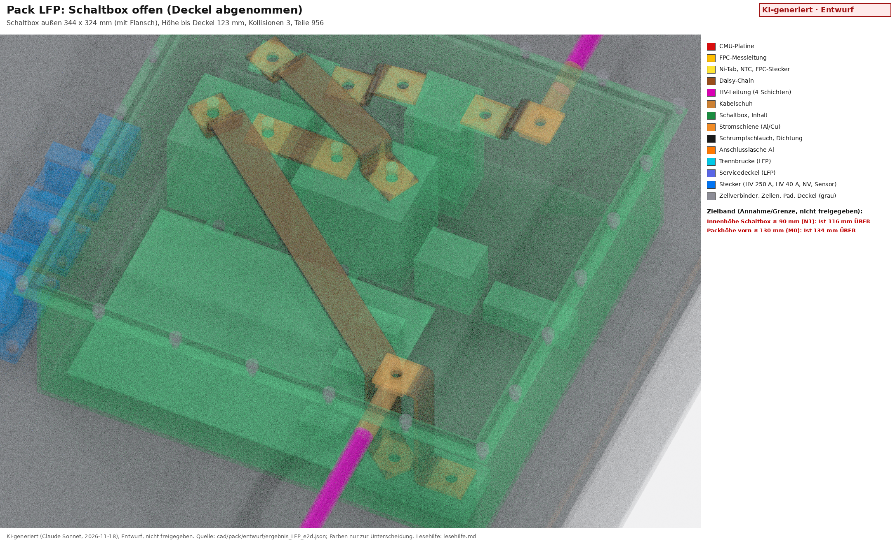

**Lesehilfe:** Lesehilfe fehlt

- Quelle: `sim/elektrik/e2_elektronik/ergebnis.json`
- Vorgang: unbekannt

### e2d_LFP_bruecke_offen.png

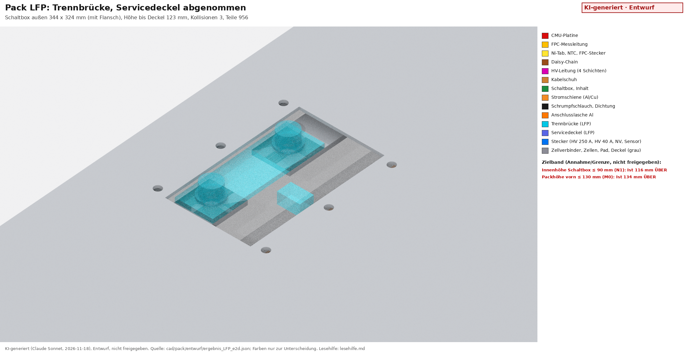

**Lesehilfe:** Lesehilfe fehlt

- Quelle: `sim/elektrik/e2_elektronik/ergebnis.json`
- Vorgang: unbekannt

### e2d_LFP_bruecke_zu.png

**Lesehilfe:** Lesehilfe fehlt

- Quelle: `sim/elektrik/e2_elektronik/ergebnis.json`
- Vorgang: unbekannt

### e2d_LFP_detail.png

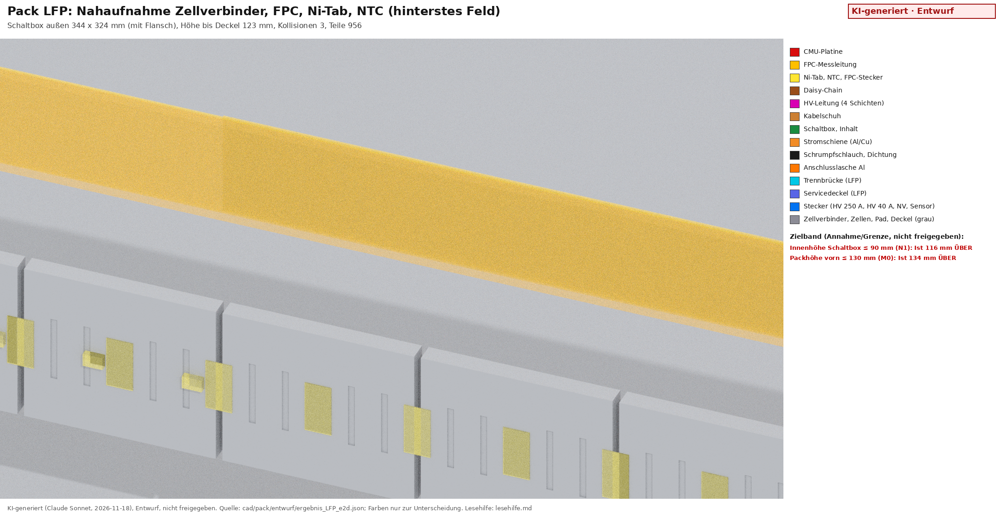

**Lesehilfe:** Lesehilfe fehlt

- Quelle: `sim/elektrik/e2_elektronik/ergebnis.json`
- Vorgang: unbekannt

### e2d_LFP_gesamt.png

**Lesehilfe:** Lesehilfe fehlt

- Quelle: `sim/elektrik/e2_elektronik/ergebnis.json`
- Vorgang: unbekannt

### e2d_LFP_kabel.png

**Lesehilfe:** Lesehilfe fehlt

- Quelle: `sim/elektrik/e2_elektronik/ergebnis.json`
- Vorgang: unbekannt

### e2d_LFP_stecker.png

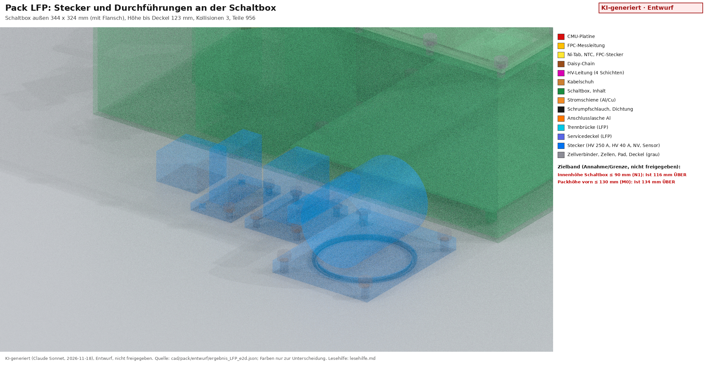

**Lesehilfe:** Lesehilfe fehlt

- Quelle: `sim/elektrik/e2_elektronik/ergebnis.json`
- Vorgang: unbekannt

### e2d_NMC_boxoffen.png

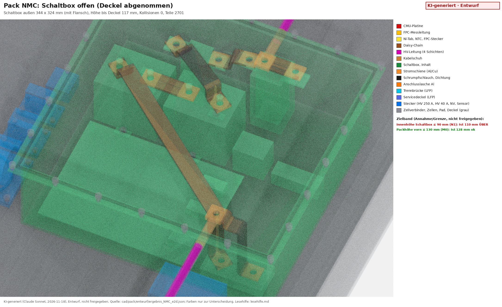

**Lesehilfe:** Lesehilfe fehlt

- Quelle: `sim/elektrik/e2_elektronik/ergebnis.json`
- Vorgang: unbekannt

### e2d_NMC_detail.png

**Lesehilfe:** Lesehilfe fehlt

- Quelle: `sim/elektrik/e2_elektronik/ergebnis.json`
- Vorgang: unbekannt

### e2d_NMC_gesamt.png

**Lesehilfe:** Lesehilfe fehlt

- Quelle: `sim/elektrik/e2_elektronik/ergebnis.json`
- Vorgang: unbekannt

### e2d_NMC_kabel.png

**Lesehilfe:** Lesehilfe fehlt

- Quelle: `sim/elektrik/e2_elektronik/ergebnis.json`
- Vorgang: unbekannt

### e2d_NMC_stecker.png

**Lesehilfe:** Lesehilfe fehlt

- Quelle: `sim/elektrik/e2_elektronik/ergebnis.json`
- Vorgang: unbekannt

### kabelplan_LFP.png

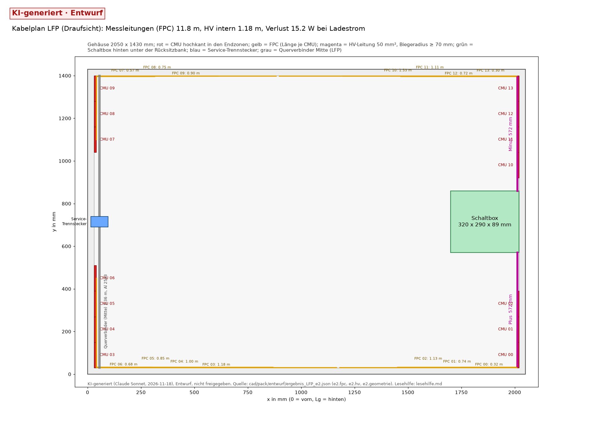

**Lesehilfe:** Lesehilfe fehlt

- Quelle: `sim/elektrik/e2_elektronik/ergebnis.json`
- Vorgang: unbekannt

### kabelplan_NMC.png

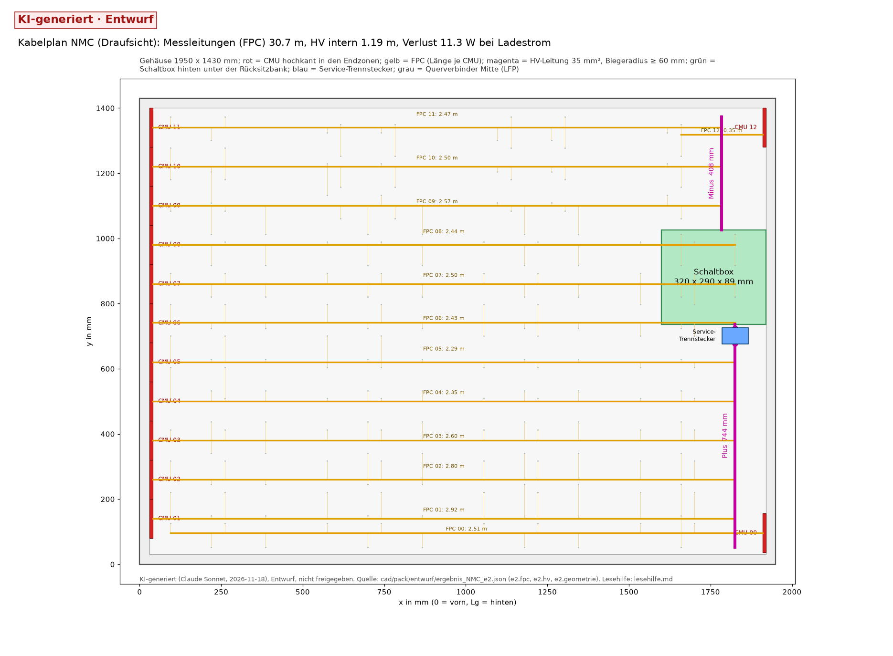

**Lesehilfe:** Lesehilfe fehlt

- Quelle: `sim/elektrik/e2_elektronik/ergebnis.json`
- Vorgang: unbekannt

### schaltbild_LFP.png

**Lesehilfe:** Lesehilfe fehlt

- Quelle: `sim/elektrik/e2_elektronik/ergebnis.json`
- Vorgang: unbekannt

### schaltbild_NMC.png

**Lesehilfe:** Lesehilfe fehlt

- Quelle: `sim/elektrik/e2_elektronik/ergebnis.json`
- Vorgang: unbekannt

## sim/elektrik/e3_platine

### platine_LFP.png

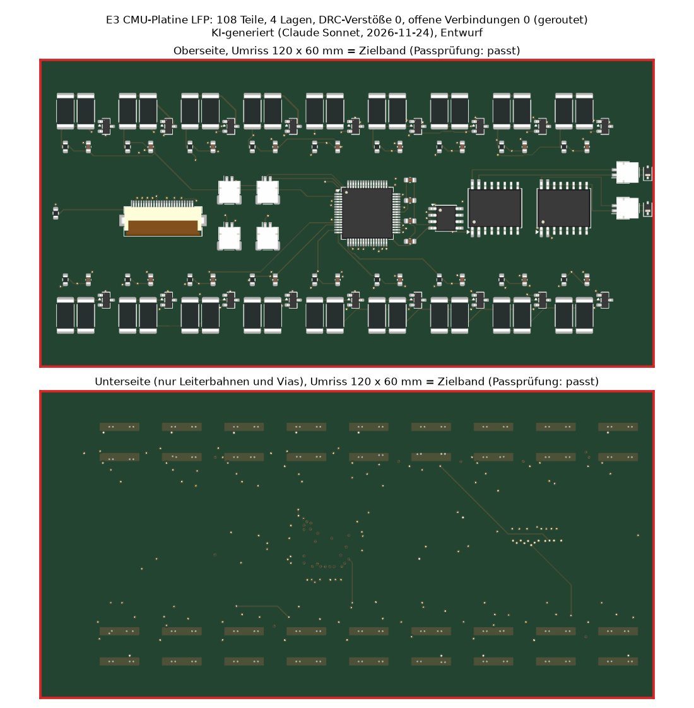

**Lesehilfe:** Die Überwachungsplatine der Variante LFP von oben (Bestückung) und von unten (Kupferflächen und Durchkontaktierungen), in den roten Rahmen = Zielband 120 x 60 mm gezeichnet. Alles liegt innerhalb. Die Platine ist vollständig verdrahtet und geprüft (DRC 0 Verstöße, 0 offene Verbindungen). Unten sind die Kupferflächen unter den Ausgleichswiderständen zu sehen (Wärmeableitung, 144 von 144 Thermovias).

- Quelle: `sim/elektrik/e3_platine/ergebnis_platine.json`; Lesehilfe: `sim/elektrik/e3_platine/lesehilfe.md`
- Vorgang: E3

### platine_LFP_3d_bottom.png

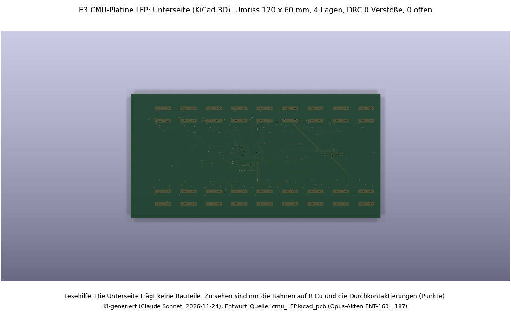

**Lesehilfe:** Unterseite der Platine LFP (KiCad 3D). Unterseite ohne Bauteile; zu sehen sind die Kupferflächen unter den Widerstandspaaren, Bahnen und Via-Punkte. Es gibt kein Zielband, weil es ein Geometriebild ist; der Umriss 120 x 60 mm steht in der Kopfzeile.

- Quelle: `sim/elektrik/e3_platine/ergebnis_platine.json`; Lesehilfe: `sim/elektrik/e3_platine/lesehilfe.md`
- Vorgang: E3

### platine_LFP_3d_iso.png

**Lesehilfe:** Schrägansicht der Platine LFP (KiCad 3D). Die Platine von schräg oben mit Bauteilen, hellen Leiterbahnen und gelben Via-Ringen. Es gibt kein Zielband, weil es ein Geometriebild ist; der Umriss 120 x 60 mm steht in der Kopfzeile.

- Quelle: `sim/elektrik/e3_platine/ergebnis_platine.json`; Lesehilfe: `sim/elektrik/e3_platine/lesehilfe.md`
- Vorgang: E3

### platine_LFP_3d_nah.png

**Lesehilfe:** Nahaufnahme Ausgleichskanal der Platine LFP (KiCad 3D). Ein Ausgleichskanal: zwei große Widerstände (verheizen Ladung), ein kleiner Schalter (FET) und Filterteile; die Vias liegen unter den Widerständen und sind verdeckt. Es gibt kein Zielband, weil es ein Geometriebild ist; der Umriss 120 x 60 mm steht in der Kopfzeile.

- Quelle: `sim/elektrik/e3_platine/ergebnis_platine.json`; Lesehilfe: `sim/elektrik/e3_platine/lesehilfe.md`
- Vorgang: E3

### platine_LFP_3d_top.png

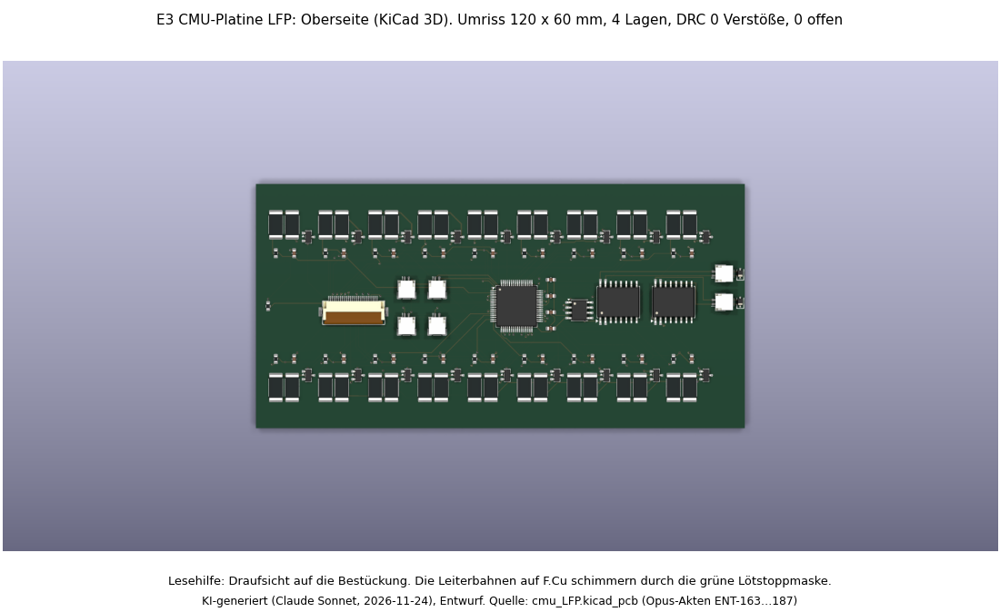

**Lesehilfe:** Oberseite der Platine LFP (KiCad 3D). Draufsicht auf die Bestückung; die Leiterbahnen schimmern durch die grüne Lötstoppmaske. Es gibt kein Zielband, weil es ein Geometriebild ist; der Umriss 120 x 60 mm steht in der Kopfzeile.

- Quelle: `sim/elektrik/e3_platine/ergebnis_platine.json`; Lesehilfe: `sim/elektrik/e3_platine/lesehilfe.md`
- Vorgang: E3

### platine_LFP_einbau.png

**Lesehilfe:** Das Pack LFP mit den CMU-Platinen am Einbauort in den Endzonen (Blender). Zellen und Deckel sind ausgeblendet, alles außer den Platinen ist grau und durchsichtig; oben die Übersicht, unten eine Nahansicht der Endzone. Platinenmasse 27,2 g, mit Wärmeleitpad 48,9 g. Kein Zielband (Geometriebild).

- Quelle: `sim/elektrik/e3_platine/ergebnis_platine.json`; Lesehilfe: `sim/elektrik/e3_platine/lesehilfe.md`
- Vorgang: E3

### platine_LFP_explosion.png

**Lesehilfe:** Die Lagen der Platine LFP wie ein Lagenkuchen nach oben auseinandergezogen (Blender): Bauteile, F.Cu, Substrat, In1, In2, B.Cu, darunter das Wärmeleitpad (ENT-185, 1,0 mm) und der Al-Rahmen mit dem Ausschnitt. Kupfer ist kupferfarben; die orangen Stäbe sind die Thermovias unter den Ausgleichswiderständen (ENT-187): 144 von 144. Abstand der Lagen und Kupferdicke sind nur zur Darstellung überhöht. Kein Zielband (Geometriebild).

- Quelle: `sim/elektrik/e3_platine/ergebnis_platine.json`; Lesehilfe: `sim/elektrik/e3_platine/lesehilfe.md`
- Vorgang: E3

### platine_NMC.png

**Lesehilfe:** Die Überwachungsplatine der Variante NMC von oben (Bestückung) und von unten (Kupferflächen und Durchkontaktierungen), in den roten Rahmen = Zielband 120 x 60 mm gezeichnet. Alles liegt innerhalb. Die Platine ist vollständig verdrahtet und geprüft (DRC 0 Verstöße, 0 offene Verbindungen). Unten sind die Kupferflächen unter den Ausgleichswiderständen zu sehen (Wärmeableitung, 144 von 144 Thermovias).

- Quelle: `sim/elektrik/e3_platine/ergebnis_platine.json`; Lesehilfe: `sim/elektrik/e3_platine/lesehilfe.md`
- Vorgang: E3

### platine_NMC_3d_bottom.png

**Lesehilfe:** Unterseite der Platine NMC (KiCad 3D). Unterseite ohne Bauteile; zu sehen sind die Kupferflächen unter den Widerstandspaaren, Bahnen und Via-Punkte. Es gibt kein Zielband, weil es ein Geometriebild ist; der Umriss 120 x 60 mm steht in der Kopfzeile.

- Quelle: `sim/elektrik/e3_platine/ergebnis_platine.json`; Lesehilfe: `sim/elektrik/e3_platine/lesehilfe.md`
- Vorgang: E3

### platine_NMC_3d_iso.png

**Lesehilfe:** Schrägansicht der Platine NMC (KiCad 3D). Die Platine von schräg oben mit Bauteilen, hellen Leiterbahnen und gelben Via-Ringen. Es gibt kein Zielband, weil es ein Geometriebild ist; der Umriss 120 x 60 mm steht in der Kopfzeile.

- Quelle: `sim/elektrik/e3_platine/ergebnis_platine.json`; Lesehilfe: `sim/elektrik/e3_platine/lesehilfe.md`
- Vorgang: E3

### platine_NMC_3d_nah.png

**Lesehilfe:** Nahaufnahme Ausgleichskanal der Platine NMC (KiCad 3D). Ein Ausgleichskanal: zwei große Widerstände (verheizen Ladung), ein kleiner Schalter (FET) und Filterteile; die Vias liegen unter den Widerständen und sind verdeckt. Es gibt kein Zielband, weil es ein Geometriebild ist; der Umriss 120 x 60 mm steht in der Kopfzeile.

- Quelle: `sim/elektrik/e3_platine/ergebnis_platine.json`; Lesehilfe: `sim/elektrik/e3_platine/lesehilfe.md`
- Vorgang: E3

### platine_NMC_3d_top.png

**Lesehilfe:** Oberseite der Platine NMC (KiCad 3D). Draufsicht auf die Bestückung; die Leiterbahnen schimmern durch die grüne Lötstoppmaske. Es gibt kein Zielband, weil es ein Geometriebild ist; der Umriss 120 x 60 mm steht in der Kopfzeile.

- Quelle: `sim/elektrik/e3_platine/ergebnis_platine.json`; Lesehilfe: `sim/elektrik/e3_platine/lesehilfe.md`
- Vorgang: E3

### platine_NMC_einbau.png

**Lesehilfe:** Das Pack NMC mit den CMU-Platinen am Einbauort in den Endzonen (Blender). Zellen und Deckel sind ausgeblendet, alles außer den Platinen ist grau und durchsichtig; oben die Übersicht, unten eine Nahansicht der Endzone. Platinenmasse 27,2 g, mit Wärmeleitpad 48,9 g. Kein Zielband (Geometriebild).

- Quelle: `sim/elektrik/e3_platine/ergebnis_platine.json`; Lesehilfe: `sim/elektrik/e3_platine/lesehilfe.md`
- Vorgang: E3

### platine_NMC_explosion.png

**Lesehilfe:** Die Lagen der Platine NMC wie ein Lagenkuchen nach oben auseinandergezogen (Blender): Bauteile, F.Cu, Substrat, In1, In2, B.Cu, darunter das Wärmeleitpad (ENT-185, 1,0 mm) und der Al-Rahmen mit dem Ausschnitt. Kupfer ist kupferfarben; die orangen Stäbe sind die Thermovias unter den Ausgleichswiderständen (ENT-187): 144 von 144. Abstand der Lagen und Kupferdicke sind nur zur Darstellung überhöht. Kein Zielband (Geometriebild).

- Quelle: `sim/elektrik/e3_platine/ergebnis_platine.json`; Lesehilfe: `sim/elektrik/e3_platine/lesehilfe.md`
- Vorgang: E3

### schaltbild_cmu.png

**Lesehilfe:** Blockbild der Schaltung der CMU: Zellabgriffe, Filter, Mess-Chip, Ausgleich, Übertrager, Sekundärschutz. Es gibt kein Zielband, weil es ein Schaltbild ist; das vollständige Schaltbild ist die Netzliste `cmu_<V>.net`.

- Quelle: `sim/elektrik/e3_platine/ergebnis_platine.json`; Lesehilfe: `sim/elektrik/e3_platine/lesehilfe.md`
- Vorgang: E3

## sim/elektrik/e3_platine/schaltplan

### schaltplan_LFP_afe.png

**Lesehilfe:** Lesehilfe fehlt

- Quelle: `ergebnis.json fehlt`
- Vorgang: unbekannt

### schaltplan_LFP_daisy.png

**Lesehilfe:** Lesehilfe fehlt

- Quelle: `ergebnis.json fehlt`
- Vorgang: unbekannt

### schaltplan_LFP_deckblatt.png

**Lesehilfe:** Lesehilfe fehlt

- Quelle: `ergebnis.json fehlt`
- Vorgang: unbekannt

### schaltplan_LFP_kanaele.png

**Lesehilfe:** Lesehilfe fehlt

- Quelle: `ergebnis.json fehlt`
- Vorgang: unbekannt

### schaltplan_LFP_kanal.png

**Lesehilfe:** Lesehilfe fehlt

- Quelle: `ergebnis.json fehlt`
- Vorgang: unbekannt

### schaltplan_LFP_ntc_stecker.png

**Lesehilfe:** Lesehilfe fehlt

- Quelle: `ergebnis.json fehlt`
- Vorgang: unbekannt

### schaltplan_LFP_sekundaerschutz.png

**Lesehilfe:** Lesehilfe fehlt

- Quelle: `ergebnis.json fehlt`
- Vorgang: unbekannt

### schaltplan_NMC_afe.png

**Lesehilfe:** Lesehilfe fehlt

- Quelle: `ergebnis.json fehlt`
- Vorgang: unbekannt

### schaltplan_NMC_daisy.png

**Lesehilfe:** Lesehilfe fehlt

- Quelle: `ergebnis.json fehlt`
- Vorgang: unbekannt

### schaltplan_NMC_deckblatt.png

**Lesehilfe:** Lesehilfe fehlt

- Quelle: `ergebnis.json fehlt`
- Vorgang: unbekannt

### schaltplan_NMC_kanaele.png

**Lesehilfe:** Lesehilfe fehlt

- Quelle: `ergebnis.json fehlt`
- Vorgang: unbekannt

### schaltplan_NMC_kanal.png

**Lesehilfe:** Lesehilfe fehlt

- Quelle: `ergebnis.json fehlt`
- Vorgang: unbekannt

### schaltplan_NMC_ntc_stecker.png

**Lesehilfe:** Lesehilfe fehlt

- Quelle: `ergebnis.json fehlt`
- Vorgang: unbekannt

### schaltplan_NMC_sekundaerschutz.png

**Lesehilfe:** Lesehilfe fehlt

- Quelle: `ergebnis.json fehlt`
- Vorgang: unbekannt

## sim/elektrik/e3_platine

### spice_ausgleich_vorladung.png

**Lesehilfe:** Links der Ausgleichsstrom über der Zellspannung (sinkt mit der Spannung, Widerstand fest), rechts die Vorladung des Hochvoltkreises über den Widerstand. Die Zahlen stehen in `ergebnis_ausgleich.json` und `ergebnis_vorladung.json`; Zielbänder aus der Erwartung sind im Bild eingezeichnet, soweit es eines gibt.

- Quelle: `sim/elektrik/e3_platine/ergebnis_platine.json`; Lesehilfe: `sim/elektrik/e3_platine/lesehilfe.md`
- Vorgang: E3

## sim/elektrik/e3b_platine_waerme

### e3b_temperatur.png

**Lesehilfe:** Das Bild zeigt die Überwachungsplatine (120 x 60 mm) von oben, eingefärbt nach Temperatur im Dauerbetrieb des Ausgleichs (rund 10 W Wärme aus den 36 Ausgleichswiderständen und 18 Schaltern). Obere Reihe: Variante LFP, untere Reihe: NMC. Spalte (a): Wärmeleitpad zur gekühlten Wand mit Wärmeleitlöchern (Vias) durch die Platine, Spalte (b): Pad ohne Vias, Spalte (c): ohne Pad, die Platine gibt die Wärme nur an die Luft ab (Prüffall). Kalte Farben (dunkelblau) liegen nahe der Wandtemperatur von 45 °C, warme Farben (orange, rot) sind heiß. Die schwarze Linie in der Farbskala und die gestrichelte Linie in den Bildern markieren die Grenze von 105 °C (Annahme, wie in E3). Das Zielband ist alles darunter. Nur der Prüffall (c) überschreitet die Grenze; mit Pad (a, b) bleibt die Platine weit darunter. Der weiße Punkt ist die heißeste Stelle. Die Temperaturen sind Rechnung mit Annahmen (Kupferlagen, Vias, Pad), keine Messung.

- Quelle: `sim/elektrik/e3b_platine_waerme/ergebnis.json`; Lesehilfe: `sim/elektrik/e3b_platine_waerme/lesehilfe.md`
- Vorgang: E3b

## sim/elektrik/e3c_bms_platine

### platine_bms.png

**Lesehilfe:** Die Steuerplatine des Batteriemanagements (BMS) von oben und von unten, in den roten Rahmen = Zielband Umriss 160 x 100 mm gezeichnet. Alles liegt innerhalb. Die rot gestrichelte Fläche ist die Sperrzone zwischen der Niedervoltseite (links: Rechner, CAN, Schützansteuerung) und der Hochvoltseite (rechts: Shunt-Messung, Verbindung zu den Zellüberwachungen). In dieser 10 mm breiten Zone gibt es kein Kupfer; nur vier Bauteile (zwei Übertrager, zwei digitale Isolatoren) reichen darüber hinweg. Die Unterseite ist so gespiegelt, dass links und rechts wie oben liegen. Die Platine ist vollständig verdrahtet und geprüft (DRC 0 Verstöße, 0 offene Verbindungen).

- Quelle: `sim/elektrik/e3c_bms_platine/ergebnis_platine.json`; Lesehilfe: `sim/elektrik/e3c_bms_platine/lesehilfe.md`
- Vorgang: E3c

### platine_bms_3d_bottom.png

**Lesehilfe:** Unterseite der BMS-Platine (KiCad 3D). Sie trägt keine Bauteile, nur Leiterbahnen, Durchkontaktierungen und die große Massefläche. Die Ansicht ist von unten, deshalb liegt die Sperrzone spiegelverkehrt. Es gibt kein Zielband, weil es ein Geometriebild ist.

- Quelle: `sim/elektrik/e3c_bms_platine/ergebnis_platine.json`; Lesehilfe: `sim/elektrik/e3c_bms_platine/lesehilfe.md`
- Vorgang: E3c

### platine_bms_3d_iso.png

**Lesehilfe:** Schrägansicht der BMS-Platine (KiCad 3D). Links der große Rechner-Chip, unten die drei Schützkanäle mit ihren Steckern, rechts hinter der Sperrzone die Hochvoltseite mit den Anschlüssen. Es gibt kein Zielband, weil es ein Geometriebild ist; der Umriss 160 x 100 mm steht in der Kopfzeile. Die Stecker JST PH und die Gleichtaktdrosseln haben in der Bibliothek kein 3D-Modell und erscheinen nur als Anschlussflächen.

- Quelle: `sim/elektrik/e3c_bms_platine/ergebnis_platine.json`; Lesehilfe: `sim/elektrik/e3c_bms_platine/lesehilfe.md`
- Vorgang: E3c

### platine_bms_3d_nah.png

**Lesehilfe:** Nahaufnahme an der Sperrzone: Die hellen Blöcke sind Übertrager und digitaler Isolator mit verstärkter Isolation. Sie sind die einzigen Bauteile, die den kupferfreien Streifen überbrücken. Es gibt kein Zielband, weil es ein Geometriebild ist.

- Quelle: `sim/elektrik/e3c_bms_platine/ergebnis_platine.json`; Lesehilfe: `sim/elektrik/e3c_bms_platine/lesehilfe.md`
- Vorgang: E3c

### platine_bms_3d_top.png

**Lesehilfe:** Draufsicht auf die Bestückung der BMS-Platine (KiCad 3D). Die Leiterbahnen schimmern durch die grüne Lötstoppmaske. Rechts der Mitte der kupferfreie Streifen (Sperrzone) mit den vier hellen Brückenbauteilen. Es gibt kein Zielband, weil es ein Geometriebild ist; der Umriss steht in der Kopfzeile.

- Quelle: `sim/elektrik/e3c_bms_platine/ergebnis_platine.json`; Lesehilfe: `sim/elektrik/e3c_bms_platine/lesehilfe.md`
- Vorgang: E3c

### platine_bms_einbau.png

**Lesehilfe:** Blick von schräg oben in die geöffnete Schaltbox des LFP-Packs. Die Wanne ist durchsichtig, der Inhalt (Schütze, Shunt, Sicherungen) grau, die grüne BMS-Platine liegt in der Ecke des BMS-Platzes. Der rote Rahmen ist das Zielband: der Platz des BMS (BT-310, 200 x 150 mm). Die Platine (160 x 100 mm) ist kleiner und passt. Die rote durchsichtige Platte ist die Sperrzone. Die Lage der Platine im Platz ist nicht festgelegt, die Ecke ist eine Darstellung.

- Quelle: `sim/elektrik/e3c_bms_platine/ergebnis_platine.json`; Lesehilfe: `sim/elektrik/e3c_bms_platine/lesehilfe.md`
- Vorgang: E3c

### platine_bms_explosion.png

**Lesehilfe:** Die Lagen der BMS-Platine wie ein Lagenkuchen nach oben auseinandergezogen (Blender): Bauteile, F.Cu, Substrat, In1, In2, B.Cu. Die rot durchsichtige Platte ist die Sperrzone: Auf keiner Lage gibt es dort Kupfer. Die Masseflächen auf In1 und B.Cu sind links (Niedervolt) und rechts (Hochvolt) getrennt. Kupferdicke überhöht dargestellt (0,35 mm statt 0,07 mm), Lagenabstand nur Darstellung. Es gibt kein Zielband, weil es ein Geometriebild ist; die Sperrzone mit Soll 10 mm steht in der Beschriftung.

- Quelle: `sim/elektrik/e3c_bms_platine/ergebnis_platine.json`; Lesehilfe: `sim/elektrik/e3c_bms_platine/lesehilfe.md`
- Vorgang: E3c

### schaltplan_bms_blatt-1.png

**Lesehilfe:** Schaltplanblatt 1, Deckblatt (KiCad-Schaltplan, echter hierarchischer Plan aus derselben Quelle wie das Layout). Die sechs Blätter als Kästen mit Blattpins; die grünen Drähte sind die Verbindungen zwischen den Blöcken. Rot gestrichelt umrandet sind die beiden Blätter, die die Trennung zwischen Hoch- und Niedervolt enthalten. Jedes Teil zeigt Referenz, Wert (offen = nicht festgelegt), Tag und Aktenverweis; Grüne Linien sind Drähte; Netznamen stehen nur für Versorgung/GND und für Verbindungen zu anderen Blättern (Blattpins auf dem Deckblatt). Es gibt kein Zielband, weil es ein Schaltplan ist; Prüfung: ERC 0, Netzliste gleich der des Layouts (ergebnis_schaltplan.json).

- Quelle: `sim/elektrik/e3c_bms_platine/ergebnis_platine.json`; Lesehilfe: `sim/elektrik/e3c_bms_platine/lesehilfe.md`
- Vorgang: E3c

### schaltplan_bms_blatt-2.png

**Lesehilfe:** Schaltplanblatt 2, Versorgung 12 V (KiCad-Schaltplan, echter hierarchischer Plan aus derselben Quelle wie das Layout). Verpolschutz, Überspannungsschutz, Filter und der Systembasis-Baustein mit Überwachung (Watchdog), der die 3,3-V-Versorgung erzeugt. Jedes Teil zeigt Referenz, Wert (offen = nicht festgelegt), Tag und Aktenverweis; Grüne Linien sind Drähte; Netznamen stehen nur für Versorgung/GND und für Verbindungen zu anderen Blättern (Blattpins auf dem Deckblatt). Es gibt kein Zielband, weil es ein Schaltplan ist; Prüfung: ERC 0, Netzliste gleich der des Layouts (ergebnis_schaltplan.json).

- Quelle: `sim/elektrik/e3c_bms_platine/ergebnis_platine.json`; Lesehilfe: `sim/elektrik/e3c_bms_platine/lesehilfe.md`
- Vorgang: E3c

### schaltplan_bms_blatt-3.png

**Lesehilfe:** Schaltplanblatt 3, Rechner (KiCad-Schaltplan, echter hierarchischer Plan aus derselben Quelle wie das Layout). Der Sicherheitsrechner mit seinen Anschlüssen, Takt, Reset, Debug-Stecker, Leuchtdioden und Temperaturfühler. Die Kondensatoren darunter sind Entkopplung. Jedes Teil zeigt Referenz, Wert (offen = nicht festgelegt), Tag und Aktenverweis; Grüne Linien sind Drähte; Netznamen stehen nur für Versorgung/GND und für Verbindungen zu anderen Blättern (Blattpins auf dem Deckblatt). Es gibt kein Zielband, weil es ein Schaltplan ist; Prüfung: ERC 0, Netzliste gleich der des Layouts (ergebnis_schaltplan.json).

- Quelle: `sim/elektrik/e3c_bms_platine/ergebnis_platine.json`; Lesehilfe: `sim/elektrik/e3c_bms_platine/lesehilfe.md`
- Vorgang: E3c

### schaltplan_bms_blatt-4.png

**Lesehilfe:** Schaltplanblatt 4, CAN (KiCad-Schaltplan, echter hierarchischer Plan aus derselben Quelle wie das Layout). Zwei CAN-FD-Schnittstellen mit Treiber, Gleichtaktdrossel, Schutzdioden und Abschluss. Jedes Teil zeigt Referenz, Wert (offen = nicht festgelegt), Tag und Aktenverweis; Grüne Linien sind Drähte; Netznamen stehen nur für Versorgung/GND und für Verbindungen zu anderen Blättern (Blattpins auf dem Deckblatt). Es gibt kein Zielband, weil es ein Schaltplan ist; Prüfung: ERC 0, Netzliste gleich der des Layouts (ergebnis_schaltplan.json).

- Quelle: `sim/elektrik/e3c_bms_platine/ergebnis_platine.json`; Lesehilfe: `sim/elektrik/e3c_bms_platine/lesehilfe.md`
- Vorgang: E3c

### schaltplan_bms_blatt-5.png

**Lesehilfe:** Schaltplanblatt 5, Schützansteuerung (KiCad-Schaltplan, echter hierarchischer Plan aus derselben Quelle wie das Layout). Drei Schützkanäle mit High-Side- und Low-Side-Schalter, Freilauf- und Löschdiode, Strommessung sowie das Hardware-UND des Sekundärpfads. Jedes Teil zeigt Referenz, Wert (offen = nicht festgelegt), Tag und Aktenverweis; Grüne Linien sind Drähte; Netznamen stehen nur für Versorgung/GND und für Verbindungen zu anderen Blättern (Blattpins auf dem Deckblatt). Es gibt kein Zielband, weil es ein Schaltplan ist; Prüfung: ERC 0, Netzliste gleich der des Layouts (ergebnis_schaltplan.json).

- Quelle: `sim/elektrik/e3c_bms_platine/ergebnis_platine.json`; Lesehilfe: `sim/elektrik/e3c_bms_platine/lesehilfe.md`
- Vorgang: E3c

### schaltplan_bms_blatt-6.png

**Lesehilfe:** Schaltplanblatt 6, Daisy-Master mit Isolation (KiCad-Schaltplan, echter hierarchischer Plan aus derselben Quelle wie das Layout). Der Daisy-Master (links, Niedervolt), die zwei Übertrager und der Isolator des Sekundärpfads in der mittleren roten Trennzone, rechts die Hochvoltseite mit Steckern. Die Trennzone trägt den Vermerk verstärkte Isolation 10/8 mm. Jedes Teil zeigt Referenz, Wert (offen = nicht festgelegt), Tag und Aktenverweis; Grüne Linien sind Drähte; Netznamen stehen nur für Versorgung/GND und für Verbindungen zu anderen Blättern (Blattpins auf dem Deckblatt). Es gibt kein Zielband, weil es ein Schaltplan ist; Prüfung: ERC 0, Netzliste gleich der des Layouts (ergebnis_schaltplan.json).

- Quelle: `sim/elektrik/e3c_bms_platine/ergebnis_platine.json`; Lesehilfe: `sim/elektrik/e3c_bms_platine/lesehilfe.md`
- Vorgang: E3c

### schaltplan_bms_blatt-7.png

**Lesehilfe:** Schaltplanblatt 7, Strommessung HV-Seite (KiCad-Schaltplan, echter hierarchischer Plan aus derselben Quelle wie das Layout). Der Shunt-Messbaustein mit Stecker und Filter auf der Hochvoltseite (rechts), der digitale Isolator in der Trennzone (Mitte) und die Niedervoltseite (links). Jedes Teil zeigt Referenz, Wert (offen = nicht festgelegt), Tag und Aktenverweis; Grüne Linien sind Drähte; Netznamen stehen nur für Versorgung/GND und für Verbindungen zu anderen Blättern (Blattpins auf dem Deckblatt). Es gibt kein Zielband, weil es ein Schaltplan ist; Prüfung: ERC 0, Netzliste gleich der des Layouts (ergebnis_schaltplan.json).

- Quelle: `sim/elektrik/e3c_bms_platine/ergebnis_platine.json`; Lesehilfe: `sim/elektrik/e3c_bms_platine/lesehilfe.md`
- Vorgang: E3c

## sim/elektrik/e3d_fmeda

### e3d_fmeda.png

**Lesehilfe:** Gefragt wird, wie sicher die Überwachungsplatine (CMU) gegen einzelne Bauteilfehler ist. Links stehen zwei Kennzahlen aus der Norm ISO 26262: SPFM sagt, welcher Anteil der gefährlichen Einzelfehler erkannt oder abgefangen wird, LFM sagt dasselbe für versteckte Fehler, die erst zusammen mit einem zweiten Fehler gefährlich werden. Höher ist besser. Die grünen Striche mit grünem Feld darüber sind die Ziele: SG-01 (Zelle nicht überladen, ASIL D) 99 % und 90 %, SG-02 (tiefentladene Zelle nicht laden, ASIL C) 97 % und 80 %. Liegt ein Balken unter dem Strich, ist das Ziel verfehlt (hier SG-02, SPFM). Die Achse beginnt bei 80 %, damit man die Unterschiede sieht. LFP und NMC sind gleich, weil beide Platinen dieselben Bauteilarten mit denselben Annahmen haben. Rechts stehen die fünf größten Beiträge zu den nicht abgefangenen Fehlern in FIT (1 FIT = ein Ausfall in einer Milliarde Betriebsstunden). Alle Ausfallraten und Erkennungsraten sind Annahmen von Opus aus dem Gedächtnis, nicht aus einem Katalog.

- Quelle: `sim/elektrik/e3d_fmeda/ergebnis.json`; Lesehilfe: `sim/elektrik/e3d_fmeda/lesehilfe.md`
- Vorgang: E3d

## sim/geometrie/g1_anordnung

### anordnung.png

**Lesehilfe:** Das Bild zeigt von oben, wie die Zellen in den Bauraum (schwarzer Rahmen, 1950 x 1430 mm) passen sollen. Der rote gestrichelte Rahmen ist der nutzbare Innenraum nach Abzug von 30 mm Wand je Seite (eine Annahme). Obere Zeile: Fall A (73.9 kWh), untere Zeile: Fall B. Links die LFP-Blade-Zellen (lange flache Rechtecke, stehend nebeneinander gestapelt), rechts die runden NMC-Zellen im Sechseck-Muster. Ragen blaue Zellen über den roten Rahmen, passt die Anordnung nicht. Bei NMC sind gefüllte Kreise belegte Plätze, leere Kreise freie Plätze. Ergebnis: LFP A passt (Reserve in L 16 mm), LFP B passt nicht, NMC A passt (69 % der Plätze belegt), NMC B passt (86 %). Es ist eine Vorprüfung mit Annahmen für Rand und Abstände.

- Quelle: `sim/geometrie/g1_anordnung/ergebnis.json`; Lesehilfe: `sim/geometrie/g1_anordnung/anordnung_lesehilfe.md`
- Vorgang: G1

## sim/kuehlung/k0_zelle/bilder

### cycles_LFP_K1_L2_t0000.png

**Lesehilfe:** LFP K1 L2 nach 0 s (0 min) Schnellladen, T_max = 25.0 °C. LFP-Zelle in echter Proportion (681 × 90 × 14 mm), halbe Dicke weggeschnitten: man blickt schräg von vorn-oben auf die Schnittfläche. Unten die Kühlplatte (graue Platte, nur angedeutet, Annahme). Der cyanfarbene Rahmen markiert die Lupe (links unten), die die Schnittfläche am Boden vergrößert zeigt. Farbe = Temperatur (Skala 25–54 °C, in allen Bildern gleich): dunkel/violett kühl, orange/gelb heiß. Cyan an der Farbskala = Vorgabe 45 °C (REQ-P09). Annahmen: Kühlmittel 25 °C, h = 500 W/(m²·K). Die Farben sind mit leichter Schattierung gerendert, damit die Form lesbar ist; die Temperatur ist an der Farbe auf etwa ±1 K ablesbar, an stark schattierten Flächen etwas ungenauer.

- Quelle: `sim/kuehlung/k0_zelle/ergebnis.json`; Lesehilfe: `sim/kuehlung/k0_zelle/bilder/cycles_lesehilfe.md`
- Vorgang: K0

### cycles_LFP_K1_L2_t0300.png

**Lesehilfe:** LFP K1 L2 nach 300 s (5 min) Schnellladen, T_max = 32.3 °C. LFP-Zelle in echter Proportion (681 × 90 × 14 mm), halbe Dicke weggeschnitten: man blickt schräg von vorn-oben auf die Schnittfläche. Unten die Kühlplatte (graue Platte, nur angedeutet, Annahme). Der cyanfarbene Rahmen markiert die Lupe (links unten), die die Schnittfläche am Boden vergrößert zeigt. Farbe = Temperatur (Skala 25–54 °C, in allen Bildern gleich): dunkel/violett kühl, orange/gelb heiß. Cyan an der Farbskala = Vorgabe 45 °C (REQ-P09). Annahmen: Kühlmittel 25 °C, h = 500 W/(m²·K). Die Farben sind mit leichter Schattierung gerendert, damit die Form lesbar ist; die Temperatur ist an der Farbe auf etwa ±1 K ablesbar, an stark schattierten Flächen etwas ungenauer.

- Quelle: `sim/kuehlung/k0_zelle/ergebnis.json`; Lesehilfe: `sim/kuehlung/k0_zelle/bilder/cycles_lesehilfe.md`
- Vorgang: K0

### cycles_LFP_K1_L2_t0600.png

**Lesehilfe:** LFP K1 L2 nach 600 s (10 min) Schnellladen, T_max = 37.4 °C. LFP-Zelle in echter Proportion (681 × 90 × 14 mm), halbe Dicke weggeschnitten: man blickt schräg von vorn-oben auf die Schnittfläche. Unten die Kühlplatte (graue Platte, nur angedeutet, Annahme). Der cyanfarbene Rahmen markiert die Lupe (links unten), die die Schnittfläche am Boden vergrößert zeigt. Farbe = Temperatur (Skala 25–54 °C, in allen Bildern gleich): dunkel/violett kühl, orange/gelb heiß. Cyan an der Farbskala = Vorgabe 45 °C (REQ-P09). Annahmen: Kühlmittel 25 °C, h = 500 W/(m²·K). Die Farben sind mit leichter Schattierung gerendert, damit die Form lesbar ist; die Temperatur ist an der Farbe auf etwa ±1 K ablesbar, an stark schattierten Flächen etwas ungenauer.

- Quelle: `sim/kuehlung/k0_zelle/ergebnis.json`; Lesehilfe: `sim/kuehlung/k0_zelle/bilder/cycles_lesehilfe.md`
- Vorgang: K0

### cycles_LFP_K1_L2_t0900.png

**Lesehilfe:** LFP K1 L2 nach 900 s (15 min) Schnellladen, T_max = 40.8 °C. LFP-Zelle in echter Proportion (681 × 90 × 14 mm), halbe Dicke weggeschnitten: man blickt schräg von vorn-oben auf die Schnittfläche. Unten die Kühlplatte (graue Platte, nur angedeutet, Annahme). Der cyanfarbene Rahmen markiert die Lupe (links unten), die die Schnittfläche am Boden vergrößert zeigt. Farbe = Temperatur (Skala 25–54 °C, in allen Bildern gleich): dunkel/violett kühl, orange/gelb heiß. Cyan an der Farbskala = Vorgabe 45 °C (REQ-P09). Annahmen: Kühlmittel 25 °C, h = 500 W/(m²·K). Die Farben sind mit leichter Schattierung gerendert, damit die Form lesbar ist; die Temperatur ist an der Farbe auf etwa ±1 K ablesbar, an stark schattierten Flächen etwas ungenauer.

- Quelle: `sim/kuehlung/k0_zelle/ergebnis.json`; Lesehilfe: `sim/kuehlung/k0_zelle/bilder/cycles_lesehilfe.md`
- Vorgang: K0

### cycles_LFP_K1_L2_t1200.png

**Lesehilfe:** LFP K1 L2 nach 1200 s (20 min) Schnellladen, T_max = 43.1 °C. LFP-Zelle in echter Proportion (681 × 90 × 14 mm), halbe Dicke weggeschnitten: man blickt schräg von vorn-oben auf die Schnittfläche. Unten die Kühlplatte (graue Platte, nur angedeutet, Annahme). Der cyanfarbene Rahmen markiert die Lupe (links unten), die die Schnittfläche am Boden vergrößert zeigt. Farbe = Temperatur (Skala 25–54 °C, in allen Bildern gleich): dunkel/violett kühl, orange/gelb heiß. Cyan an der Farbskala = Vorgabe 45 °C (REQ-P09). Annahmen: Kühlmittel 25 °C, h = 500 W/(m²·K). Die Farben sind mit leichter Schattierung gerendert, damit die Form lesbar ist; die Temperatur ist an der Farbe auf etwa ±1 K ablesbar, an stark schattierten Flächen etwas ungenauer.

- Quelle: `sim/kuehlung/k0_zelle/ergebnis.json`; Lesehilfe: `sim/kuehlung/k0_zelle/bilder/cycles_lesehilfe.md`
- Vorgang: K0

### cycles_NMC_K1_L2_t0000.png

**Lesehilfe:** NMC K1 L2 nach 0 s (0 min) Schnellladen, T_max = 25.0 °C. NMC-Rundzelle 4680, ein Viertel weggeschnitten, Blick leicht von oben. Die durchsichtige Hülle zeigt, wo das weggeschnittene Viertel des Bechers saß. Unten die Kühlplatte (angedeutet, Annahme). Farbe = Temperatur (Skala 25–54 °C, in allen Bildern gleich): dunkel/violett kühl, orange/gelb heiß. Cyan an der Farbskala = Vorgabe 45 °C (REQ-P09). Annahmen: Kühlmittel 25 °C, h = 500 W/(m²·K). Die Farben sind mit leichter Schattierung gerendert, damit die Form lesbar ist; die Temperatur ist an der Farbe auf etwa ±1 K ablesbar, an stark schattierten Flächen etwas ungenauer.

- Quelle: `sim/kuehlung/k0_zelle/ergebnis.json`; Lesehilfe: `sim/kuehlung/k0_zelle/bilder/cycles_lesehilfe.md`
- Vorgang: K0

### cycles_NMC_K1_L2_t0300.png

**Lesehilfe:** NMC K1 L2 nach 300 s (5 min) Schnellladen, T_max = 36.0 °C. NMC-Rundzelle 4680, ein Viertel weggeschnitten, Blick leicht von oben. Die durchsichtige Hülle zeigt, wo das weggeschnittene Viertel des Bechers saß. Unten die Kühlplatte (angedeutet, Annahme). Farbe = Temperatur (Skala 25–54 °C, in allen Bildern gleich): dunkel/violett kühl, orange/gelb heiß. Cyan an der Farbskala = Vorgabe 45 °C (REQ-P09). Annahmen: Kühlmittel 25 °C, h = 500 W/(m²·K). Die Farben sind mit leichter Schattierung gerendert, damit die Form lesbar ist; die Temperatur ist an der Farbe auf etwa ±1 K ablesbar, an stark schattierten Flächen etwas ungenauer.

- Quelle: `sim/kuehlung/k0_zelle/ergebnis.json`; Lesehilfe: `sim/kuehlung/k0_zelle/bilder/cycles_lesehilfe.md`
- Vorgang: K0

### cycles_NMC_K1_L2_t0600.png

**Lesehilfe:** NMC K1 L2 nach 600 s (10 min) Schnellladen, T_max = 44.1 °C. NMC-Rundzelle 4680, ein Viertel weggeschnitten, Blick leicht von oben. Die durchsichtige Hülle zeigt, wo das weggeschnittene Viertel des Bechers saß. Unten die Kühlplatte (angedeutet, Annahme). Farbe = Temperatur (Skala 25–54 °C, in allen Bildern gleich): dunkel/violett kühl, orange/gelb heiß. Cyan an der Farbskala = Vorgabe 45 °C (REQ-P09). Annahmen: Kühlmittel 25 °C, h = 500 W/(m²·K). Die Farben sind mit leichter Schattierung gerendert, damit die Form lesbar ist; die Temperatur ist an der Farbe auf etwa ±1 K ablesbar, an stark schattierten Flächen etwas ungenauer.

- Quelle: `sim/kuehlung/k0_zelle/ergebnis.json`; Lesehilfe: `sim/kuehlung/k0_zelle/bilder/cycles_lesehilfe.md`
- Vorgang: K0

### cycles_NMC_K1_L2_t0900.png

**Lesehilfe:** NMC K1 L2 nach 900 s (15 min) Schnellladen, T_max = 49.7 °C. NMC-Rundzelle 4680, ein Viertel weggeschnitten, Blick leicht von oben. Die durchsichtige Hülle zeigt, wo das weggeschnittene Viertel des Bechers saß. Unten die Kühlplatte (angedeutet, Annahme). Farbe = Temperatur (Skala 25–54 °C, in allen Bildern gleich): dunkel/violett kühl, orange/gelb heiß. Cyan an der Farbskala = Vorgabe 45 °C (REQ-P09). Annahmen: Kühlmittel 25 °C, h = 500 W/(m²·K). Die Farben sind mit leichter Schattierung gerendert, damit die Form lesbar ist; die Temperatur ist an der Farbe auf etwa ±1 K ablesbar, an stark schattierten Flächen etwas ungenauer.

- Quelle: `sim/kuehlung/k0_zelle/ergebnis.json`; Lesehilfe: `sim/kuehlung/k0_zelle/bilder/cycles_lesehilfe.md`
- Vorgang: K0

### cycles_NMC_K1_L2_t1200.png

**Lesehilfe:** NMC K1 L2 nach 1200 s (20 min) Schnellladen, T_max = 53.6 °C. NMC-Rundzelle 4680, ein Viertel weggeschnitten, Blick leicht von oben. Die durchsichtige Hülle zeigt, wo das weggeschnittene Viertel des Bechers saß. Unten die Kühlplatte (angedeutet, Annahme). Farbe = Temperatur (Skala 25–54 °C, in allen Bildern gleich): dunkel/violett kühl, orange/gelb heiß. Cyan an der Farbskala = Vorgabe 45 °C (REQ-P09). Annahmen: Kühlmittel 25 °C, h = 500 W/(m²·K). Die Farben sind mit leichter Schattierung gerendert, damit die Form lesbar ist; die Temperatur ist an der Farbe auf etwa ±1 K ablesbar, an stark schattierten Flächen etwas ungenauer.

- Quelle: `sim/kuehlung/k0_zelle/ergebnis.json`; Lesehilfe: `sim/kuehlung/k0_zelle/bilder/cycles_lesehilfe.md`
- Vorgang: K0

### cycles_NMC_K2_L2_t0000.png

**Lesehilfe:** NMC K2 L2 nach 0 s (0 min) Schnellladen, T_max = 25.0 °C. NMC-Rundzelle 4680, ein Viertel weggeschnitten, Blick leicht von oben. Das Kühlband (grau) liegt rechts hinten am Mantel (25 % des Umfangs), nur zum Vergleich. Farbe = Temperatur (Skala 25–54 °C, in allen Bildern gleich): dunkel/violett kühl, orange/gelb heiß. Cyan an der Farbskala = Vorgabe 45 °C (REQ-P09). Annahmen: Kühlmittel 25 °C, h = 500 W/(m²·K). Die Farben sind mit leichter Schattierung gerendert, damit die Form lesbar ist; die Temperatur ist an der Farbe auf etwa ±1 K ablesbar, an stark schattierten Flächen etwas ungenauer.

- Quelle: `sim/kuehlung/k0_zelle/ergebnis.json`; Lesehilfe: `sim/kuehlung/k0_zelle/bilder/cycles_lesehilfe.md`
- Vorgang: K0

### cycles_NMC_K2_L2_t0300.png

**Lesehilfe:** NMC K2 L2 nach 300 s (5 min) Schnellladen, T_max = 35.6 °C. NMC-Rundzelle 4680, ein Viertel weggeschnitten, Blick leicht von oben. Das Kühlband (grau) liegt rechts hinten am Mantel (25 % des Umfangs), nur zum Vergleich. Farbe = Temperatur (Skala 25–54 °C, in allen Bildern gleich): dunkel/violett kühl, orange/gelb heiß. Cyan an der Farbskala = Vorgabe 45 °C (REQ-P09). Annahmen: Kühlmittel 25 °C, h = 500 W/(m²·K). Die Farben sind mit leichter Schattierung gerendert, damit die Form lesbar ist; die Temperatur ist an der Farbe auf etwa ±1 K ablesbar, an stark schattierten Flächen etwas ungenauer.

- Quelle: `sim/kuehlung/k0_zelle/ergebnis.json`; Lesehilfe: `sim/kuehlung/k0_zelle/bilder/cycles_lesehilfe.md`
- Vorgang: K0

### cycles_NMC_K2_L2_t0600.png

**Lesehilfe:** NMC K2 L2 nach 600 s (10 min) Schnellladen, T_max = 42.6 °C. NMC-Rundzelle 4680, ein Viertel weggeschnitten, Blick leicht von oben. Das Kühlband (grau) liegt rechts hinten am Mantel (25 % des Umfangs), nur zum Vergleich. Farbe = Temperatur (Skala 25–54 °C, in allen Bildern gleich): dunkel/violett kühl, orange/gelb heiß. Cyan an der Farbskala = Vorgabe 45 °C (REQ-P09). Annahmen: Kühlmittel 25 °C, h = 500 W/(m²·K). Die Farben sind mit leichter Schattierung gerendert, damit die Form lesbar ist; die Temperatur ist an der Farbe auf etwa ±1 K ablesbar, an stark schattierten Flächen etwas ungenauer.

- Quelle: `sim/kuehlung/k0_zelle/ergebnis.json`; Lesehilfe: `sim/kuehlung/k0_zelle/bilder/cycles_lesehilfe.md`
- Vorgang: K0

### cycles_NMC_K2_L2_t0900.png

**Lesehilfe:** NMC K2 L2 nach 900 s (15 min) Schnellladen, T_max = 47.1 °C. NMC-Rundzelle 4680, ein Viertel weggeschnitten, Blick leicht von oben. Das Kühlband (grau) liegt rechts hinten am Mantel (25 % des Umfangs), nur zum Vergleich. Farbe = Temperatur (Skala 25–54 °C, in allen Bildern gleich): dunkel/violett kühl, orange/gelb heiß. Cyan an der Farbskala = Vorgabe 45 °C (REQ-P09). Annahmen: Kühlmittel 25 °C, h = 500 W/(m²·K). Die Farben sind mit leichter Schattierung gerendert, damit die Form lesbar ist; die Temperatur ist an der Farbe auf etwa ±1 K ablesbar, an stark schattierten Flächen etwas ungenauer.

- Quelle: `sim/kuehlung/k0_zelle/ergebnis.json`; Lesehilfe: `sim/kuehlung/k0_zelle/bilder/cycles_lesehilfe.md`
- Vorgang: K0

### cycles_NMC_K2_L2_t1200.png

**Lesehilfe:** NMC K2 L2 nach 1200 s (20 min) Schnellladen, T_max = 49.9 °C. NMC-Rundzelle 4680, ein Viertel weggeschnitten, Blick leicht von oben. Das Kühlband (grau) liegt rechts hinten am Mantel (25 % des Umfangs), nur zum Vergleich. Farbe = Temperatur (Skala 25–54 °C, in allen Bildern gleich): dunkel/violett kühl, orange/gelb heiß. Cyan an der Farbskala = Vorgabe 45 °C (REQ-P09). Annahmen: Kühlmittel 25 °C, h = 500 W/(m²·K). Die Farben sind mit leichter Schattierung gerendert, damit die Form lesbar ist; die Temperatur ist an der Farbe auf etwa ±1 K ablesbar, an stark schattierten Flächen etwas ungenauer.

- Quelle: `sim/kuehlung/k0_zelle/ergebnis.json`; Lesehilfe: `sim/kuehlung/k0_zelle/bilder/cycles_lesehilfe.md`
- Vorgang: K0

### tafel_L2.png

**Lesehilfe:** Bildtafel: drei Zeilen (LFP K1, NMC K1, NMC K2), fünf Spalten (t = 0, 300, 600, 900, 1200 s), gemeinsame Skala 25–54 °C, Vorgabe 45 °C cyan an der Skala. So sieht man, wie sich die Zellen beim Schnellladen erwärmen und wo es heiß wird. Quelle: `ergebnis.json`.

- Quelle: `sim/kuehlung/k0_zelle/ergebnis.json`; Lesehilfe: `sim/kuehlung/k0_zelle/bilder/cycles_lesehilfe.md`
- Vorgang: K0

## sim/kuehlung/k0_zelle

### empfindlichkeit_K0.png

**Lesehilfe:** Wie stark sich der Temperaturunterschied im Kern (ΔT, 1C-Dauerbetrieb, Bodenkühlung) ändert, wenn man genau eine unsichere Annahme innerhalb ihrer Spanne ändert. Je länger der Balken, desto wichtiger die Annahme. Die senkrechte schwarze Linie ist der Hauptfall, die graue gepunktete die Vorgabe 5 K. Der Luftspalt ist keine Messspanne, sondern eine Modellvariante.

- Quelle: `sim/kuehlung/k0_zelle/ergebnis.json`; Lesehilfe: `sim/kuehlung/k0_zelle/k0_lesehilfe.md`
- Vorgang: K0

### temperatur3d_LFP_K1_L2.png

**Lesehilfe:** Dieselbe Zelle LFP K1 L2 nach 20 min als aufgeschnittenes 3D-Bild (Gitterdarstellung, matplotlib). Farben wie oben: heller = heißer; die türkise Marke an der Farbskala zeigt 45 °C (Vorgabe).

- Quelle: `sim/kuehlung/k0_zelle/ergebnis.json`; Lesehilfe: `sim/kuehlung/k0_zelle/k0_lesehilfe.md`
- Vorgang: K0

### temperatur3d_NMC_K1_L2.png

**Lesehilfe:** Dieselbe Zelle NMC K1 L2 nach 20 min als aufgeschnittenes 3D-Bild (Gitterdarstellung, matplotlib). Farben wie oben: heller = heißer; die türkise Marke an der Farbskala zeigt 45 °C (Vorgabe).

- Quelle: `sim/kuehlung/k0_zelle/ergebnis.json`; Lesehilfe: `sim/kuehlung/k0_zelle/k0_lesehilfe.md`
- Vorgang: K0

### temperatur3d_NMC_K2_L2.png

**Lesehilfe:** Dieselbe Zelle NMC K2 L2 nach 20 min als aufgeschnittenes 3D-Bild (Gitterdarstellung, matplotlib). Farben wie oben: heller = heißer; die türkise Marke an der Farbskala zeigt 45 °C (Vorgabe).

- Quelle: `sim/kuehlung/k0_zelle/ergebnis.json`; Lesehilfe: `sim/kuehlung/k0_zelle/k0_lesehilfe.md`
- Vorgang: K0

### temperatur_LFP_K1_L1.png

**Lesehilfe:** Temperaturfeld der Zelle LFP K1 L1 stationär bei Dauerladung 1C. Das Bild zeigt, wie warm die Zelle innen wird. Links ein Schnitt, rechts ein zweiter Schnitt quer dazu. Je heller (gelb), desto heißer, je dunkler (violett), desto kühler. Die Kühlung sitzt an der in der Achsenbeschriftung genannten Seite. Die türkise Linie (falls sichtbar) ist die Grenze 45 °C; die Vorgabe der Spreizung ist 5 K zwischen heißester und kühlster Stelle im Zellkern (Vorgabe REQ-P09). Die Zahlen im Titel stammen aus der Rechnung.

- Quelle: `sim/kuehlung/k0_zelle/ergebnis.json`; Lesehilfe: `sim/kuehlung/k0_zelle/k0_lesehilfe.md`
- Vorgang: K0

### temperatur_LFP_K1_L2.png

**Lesehilfe:** Temperaturfeld der Zelle LFP K1 L2 am Ende des Schnellladens (20 min, ca. 2,1C). Das Bild zeigt, wie warm die Zelle innen wird. Links ein Schnitt, rechts ein zweiter Schnitt quer dazu. Je heller (gelb), desto heißer, je dunkler (violett), desto kühler. Die Kühlung sitzt an der in der Achsenbeschriftung genannten Seite. Die türkise Linie (falls sichtbar) ist die Grenze 45 °C; die Vorgabe der Spreizung ist 5 K zwischen heißester und kühlster Stelle im Zellkern (Vorgabe REQ-P09). Die Zahlen im Titel stammen aus der Rechnung.

- Quelle: `sim/kuehlung/k0_zelle/ergebnis.json`; Lesehilfe: `sim/kuehlung/k0_zelle/k0_lesehilfe.md`
- Vorgang: K0

### temperatur_NMC_K1_L1.png

**Lesehilfe:** Temperaturfeld der Zelle NMC K1 L1 stationär bei Dauerladung 1C. Das Bild zeigt, wie warm die Zelle innen wird. Links ein Schnitt, rechts ein zweiter Schnitt quer dazu. Je heller (gelb), desto heißer, je dunkler (violett), desto kühler. Die Kühlung sitzt an der in der Achsenbeschriftung genannten Seite. Die türkise Linie (falls sichtbar) ist die Grenze 45 °C; die Vorgabe der Spreizung ist 5 K zwischen heißester und kühlster Stelle im Zellkern (Vorgabe REQ-P09). Die Zahlen im Titel stammen aus der Rechnung.

- Quelle: `sim/kuehlung/k0_zelle/ergebnis.json`; Lesehilfe: `sim/kuehlung/k0_zelle/k0_lesehilfe.md`
- Vorgang: K0

### temperatur_NMC_K1_L2.png

**Lesehilfe:** Temperaturfeld der Zelle NMC K1 L2 am Ende des Schnellladens (20 min, ca. 2,1C). Das Bild zeigt, wie warm die Zelle innen wird. Links ein Schnitt, rechts ein zweiter Schnitt quer dazu. Je heller (gelb), desto heißer, je dunkler (violett), desto kühler. Die Kühlung sitzt an der in der Achsenbeschriftung genannten Seite. Die türkise Linie (falls sichtbar) ist die Grenze 45 °C; die Vorgabe der Spreizung ist 5 K zwischen heißester und kühlster Stelle im Zellkern (Vorgabe REQ-P09). Die Zahlen im Titel stammen aus der Rechnung.

- Quelle: `sim/kuehlung/k0_zelle/ergebnis.json`; Lesehilfe: `sim/kuehlung/k0_zelle/k0_lesehilfe.md`
- Vorgang: K0

### temperatur_NMC_K2_L1.png

**Lesehilfe:** Temperaturfeld der Zelle NMC K2 L1 stationär bei Dauerladung 1C. Das Bild zeigt, wie warm die Zelle innen wird. Links ein Schnitt, rechts ein zweiter Schnitt quer dazu. Je heller (gelb), desto heißer, je dunkler (violett), desto kühler. Die Kühlung sitzt an der in der Achsenbeschriftung genannten Seite. Die türkise Linie (falls sichtbar) ist die Grenze 45 °C; die Vorgabe der Spreizung ist 5 K zwischen heißester und kühlster Stelle im Zellkern (Vorgabe REQ-P09). Die Zahlen im Titel stammen aus der Rechnung.

- Quelle: `sim/kuehlung/k0_zelle/ergebnis.json`; Lesehilfe: `sim/kuehlung/k0_zelle/k0_lesehilfe.md`
- Vorgang: K0

### temperatur_NMC_K2_L2.png

**Lesehilfe:** Temperaturfeld der Zelle NMC K2 L2 am Ende des Schnellladens (20 min, ca. 2,1C). Das Bild zeigt, wie warm die Zelle innen wird. Links ein Schnitt, rechts ein zweiter Schnitt quer dazu. Je heller (gelb), desto heißer, je dunkler (violett), desto kühler. Die Kühlung sitzt an der in der Achsenbeschriftung genannten Seite. Die türkise Linie (falls sichtbar) ist die Grenze 45 °C; die Vorgabe der Spreizung ist 5 K zwischen heißester und kühlster Stelle im Zellkern (Vorgabe REQ-P09). Die Zahlen im Titel stammen aus der Rechnung.

- Quelle: `sim/kuehlung/k0_zelle/ergebnis.json`; Lesehilfe: `sim/kuehlung/k0_zelle/k0_lesehilfe.md`
- Vorgang: K0

### verlauf_L2.png

**Lesehilfe:** Zeitlicher Verlauf beim Schnellladen. Durchgezogene Linien (linke Achse): heißeste Stelle der Zelle. Gestrichelt (rechte Achse): Temperaturunterschied im Zellkern. Die schwarze waagerechte Linie ist die Vorgabe 45 °C, die graue gepunktete die Vorgabe 5 K (REQ-P09). Wo eine Linie über ihrer Vorgabe liegt, ist sie überschritten.

- Quelle: `sim/kuehlung/k0_zelle/ergebnis.json`; Lesehilfe: `sim/kuehlung/k0_zelle/k0_lesehilfe.md`
- Vorgang: K0

## sim/kuehlung/k1_schnellladen/bilder

### render_LFP_P0_K3h1000_ende.png

**Lesehilfe:** Temperaturfeld der Prismenzelle (LFP), Profil P0 (konstant 2,1C), Kühlung beidseitig mit h 1000: der Fall mit der niedrigsten T_max-Spitze unter den LFP-Fällen, die beide Vorgaben erfüllen, am Ladeende (20 min): Je heller (gelb), desto heißer, je dunkler (schwarz/violett), desto kühler; die cyanfarbene Marke an der Farbskala ist die Vorgabe 45 °C. Die Zelle ist zur Hälfte bzw. zu einem Viertel aufgeschnitten, damit man das Innere sieht. Die graue Platte ist die Kühlplatte am Boden (bei beidseitiger Kühlung ist die obere Platte nicht gezeichnet). T_max 30.8 °C, Spreizung im Kern 3.8 K (Vorgabe 5 K); die Zahlen stammen aus der Rechnung. Die Skala läuft einheitlich von 25 bis 55 °C, daher wirkt ein kühler Fall dunkel.

- Quelle: `sim/kuehlung/k1_schnellladen/ergebnis.json`; Lesehilfe: `sim/kuehlung/k1_schnellladen/bilder/render_lesehilfe.md`
- Vorgang: K1

### render_NMC_P3_K3_ende.png

**Lesehilfe:** Temperaturfeld der runden 4680-Zelle (NMC), Profil P3 (1,68C, 25 min), Kühlung beidseitig (Boden und Deckel, Tab-Scheibe zwischen Wickel und Deckel als Annahme): der NMC-Fall mit der niedrigsten T_max-Spitze unter den Fällen, die beide Vorgaben erfüllen. Je heller (gelb), desto heißer, je dunkler (schwarz/violett), desto kühler; die cyanfarbene Marke an der Farbskala ist die Vorgabe 45 °C. Ein Viertel der Zelle ist aufgeschnitten, damit man das Innere sieht. Die graue Platte ist die Kühlplatte am Boden (die obere Platte ist nicht gezeichnet). T_max 34.0 °C, Spreizung im Kern 3.8 K (Vorgabe 5 K); die Zahlen stammen aus der Rechnung. Die Skala läuft einheitlich von 25 bis 55 °C, daher wirkt ein kühler Fall dunkel.

- Quelle: `sim/kuehlung/k1_schnellladen/ergebnis.json`; Lesehilfe: `sim/kuehlung/k1_schnellladen/bilder/render_lesehilfe.md`
- Vorgang: K1

## sim/kuehlung/k1_schnellladen

### landkarte.png

**Lesehilfe:** Übersicht aller gerechneten Fälle (Zeilen) für beide Zellarten (Spalten). Jedes Feld zeigt den Spitzenwert über die Ladezeit; grün = Vorgabe eingehalten (T_max ≤ 45 °C bzw. ΔT ≤ 5 K), rot = verfehlt. Die Spalte „Ampel“ fasst je Zelle beide Vorgaben zusammen: grün = beide erfüllt, gelb = nur eine, rot = keine. Graue Felder: nicht gerechnet.

- Quelle: `sim/kuehlung/k1_schnellladen/ergebnis.json`; Lesehilfe: `sim/kuehlung/k1_schnellladen/k1_lesehilfe.md`
- Vorgang: K1

### profile.png

**Lesehilfe:** Oben: wie stark die Zelle mit welchem Strom geladen wird (in C: 1C lädt die Zelle in einer Stunde voll, 2C in 30 Minuten). Unten: wie der Ladezustand dabei von 10 auf 80 % steigt. Alle fünf Ladeprofile (P0 bis P4) laden denselben Hub; sie unterscheiden sich in Höhe und Verlauf des Stroms und damit in der Ladedauer (20, 25 oder 30 Minuten). Die gezackte Linie P2 ist das Wechselladen: halbe Zeit doppelter Strom, dazwischen Pause. Je höher der Strom, desto mehr Wärme entsteht in der Zelle (Wärme wächst mit dem Quadrat des Stroms).

- Quelle: `sim/kuehlung/k1_schnellladen/ergebnis.json`; Lesehilfe: `sim/kuehlung/k1_schnellladen/k1_lesehilfe.md`
- Vorgang: K1

### verlauf_kuehlung_LFP.png

**Lesehilfe:** Wie die Profilbilder, aber für Kühlvarianten bei gleichem Ladeprofil P0 (konstant 2,1C): mehr Wärmeübergang am Boden (h 1000, h 2000), Kühlung auf zwei gegenüberliegenden Seiten (K3), Vorkühlung auf 15 °C (V15), dazu gestrichelt zwei Kombinationen mit Stufenprofil bzw. K3 und h 1000. Grüner Bereich = Zielband. Man sieht, welche Maßnahme die Temperatur und welche die Spreizung senkt.

- Quelle: `sim/kuehlung/k1_schnellladen/ergebnis.json`; Lesehilfe: `sim/kuehlung/k1_schnellladen/k1_lesehilfe.md`
- Vorgang: K1

### verlauf_kuehlung_NMC.png

**Lesehilfe:** Wie das LFP-Bild, für die 4680-Zelle; zusätzlich die Kombination Profil P3 mit h 2000.

- Quelle: `sim/kuehlung/k1_schnellladen/ergebnis.json`; Lesehilfe: `sim/kuehlung/k1_schnellladen/k1_lesehilfe.md`
- Vorgang: K1

### verlauf_profile_LFP.png

**Lesehilfe:** Oben die höchste Temperatur in der Zelle über die Ladezeit, unten der Temperaturunterschied zwischen heißester und kühlster Stelle im Zellkern (Spreizung). Der grüne Bereich ist das Zielband: darunter ist die Vorgabe erfüllt (45 °C bzw. 5 K, Linie beschriftet). Fünf Ladeprofile, LFP-Zelle, Kühlung am Boden. Die Spitzenwerte stehen in der Legende. Kurven, die in den grünen Bereich passen, halten die Vorgabe ein.

- Quelle: `sim/kuehlung/k1_schnellladen/ergebnis.json`; Lesehilfe: `sim/kuehlung/k1_schnellladen/k1_lesehilfe.md`
- Vorgang: K1

### verlauf_profile_NMC.png

**Lesehilfe:** Wie das LFP-Bild, aber für die runde 4680-Zelle (NMC). Grüner Bereich = Zielband, Linie = Vorgabe 45 °C bzw. 5 K.

- Quelle: `sim/kuehlung/k1_schnellladen/ergebnis.json`; Lesehilfe: `sim/kuehlung/k1_schnellladen/k1_lesehilfe.md`
- Vorgang: K1

## sim/kuehlung/k2_kuehlplatte

### durchfluss_druck.png

**Lesehilfe:** Oben der Druckverlust, unten der Wärmeübergang (h) im Kanal, jeweils über der Menge Kühlmittel, die pro Minute durch das ganze Pack fließt. Links LFP, Mitte und rechts die 4680-Zelle (NMC) in zwei Ladefällen. Jede Linie ist eine Kanalbreite (Farbe) und Führung (durchgezogen quer, gestrichelt längs); Punkte markieren die Kühlmittelerwärmung 5, 8 und 10 K. Grün ist das Zielband (Annahme aus ERWARTUNG.md): oben höchstens 0,5 bar, unten h mindestens 500. Rot ist verfehlt (über 1 bar, unter h 300). Der Druckverlust liegt weit im grünen Bereich (Achse logarithmisch), h aber im roten bis weißen Bereich unter dem Ziel. Ein höherer Durchfluss verbessert h kaum, weil die Strömung laminar ist.

- Quelle: `sim/kuehlung/k2_kuehlplatte/ergebnis.json`; Lesehilfe: `sim/kuehlung/k2_kuehlplatte/k2_lesehilfe.md`
- Vorgang: unbekannt

### k2b_U_dp.png

**Lesehilfe:** Jeder Punkt ist eine Bauvariante der Blechplatte 1/4/1 mm mit Mäander (Farbe = Zahl der Bahnen n). Waagerecht steht der Druckverlust je Platte (logarithmisch), senkrecht der Gesamtwärmedurchgang U von der Zelle ins Kühlmittel. Das grün schattierte Feld oben links ist das Zielband (U mindestens 500, Druckverlust höchstens 0,5 bar, Annahmen aus ERWARTUNG.md). Je weiter links und höher ein Punkt, desto besser. Der schwarze Ring ist der Vorschlag mit dem kleinsten Druckverlust im Zielband. Links LFP (23 L/min je Pack), rechts NMC (20 L/min). Quelle: ergebnis_k2b.json.

- Quelle: `sim/kuehlung/k2_kuehlplatte/ergebnis.json`; Lesehilfe: `sim/kuehlung/k2_kuehlplatte/k2_lesehilfe.md`
- Vorgang: unbekannt

### nachtrag_U_leistung.png

**Lesehilfe:** Jeder Punkt ist eine Bauvariante (Farbe Kanalbreite, Kreis 5 mm Höhe, Dreieck 3 mm). Waagerecht steht die Pumpenleistung (logarithmisch, nur Varianten unter 0,5 bar), senkrecht der Gesamtwärmedurchgang von der Zelle über Pad und Blech ins Kühlmittel, bezogen auf die Plattenfläche. Oberhalb der grünen Linie (500, Annahme aus K0/K1) ist das Ziel erreicht. Je weiter links, desto weniger Pumpenleistung. Der schwarze Ring ist die Auswahl für ΔT ≤ 5 K.

- Quelle: `sim/kuehlung/k2_kuehlplatte/ergebnis.json`; Lesehilfe: `sim/kuehlung/k2_kuehlplatte/k2_lesehilfe.md`
- Vorgang: unbekannt

### platte_LFP.png

**Lesehilfe:** Draufsicht auf eine der beiden Kühlplatten maßstäblich: viele parallele Kanäle (blau) zwischen Vorlauf (unten) und Rücklauf (oben), Stege weiß. Die Zahlen im Titel stammen aus ergebnis.json. Die gezeigte Variante (20 mm quer, ΔT 5 K) hat das höchste h der Rechnung und verfehlt das Ziel trotzdem.

- Quelle: `sim/kuehlung/k2_kuehlplatte/ergebnis.json`; Lesehilfe: `sim/kuehlung/k2_kuehlplatte/k2_lesehilfe.md`
- Vorgang: unbekannt

### platte_NMC.png

**Lesehilfe:** Lesehilfe fehlt

- Quelle: `sim/kuehlung/k2_kuehlplatte/ergebnis.json`
- Vorgang: unbekannt

## sim/kuehlung/k3_gesamt/film

### f000.png

**Lesehilfe:** Lesehilfe fehlt

- Quelle: `sim/kuehlung/k3_gesamt/ergebnis.json`
- Vorgang: unbekannt

### f001.png

**Lesehilfe:** Lesehilfe fehlt

- Quelle: `sim/kuehlung/k3_gesamt/ergebnis.json`
- Vorgang: unbekannt

### f002.png

**Lesehilfe:** Lesehilfe fehlt

- Quelle: `sim/kuehlung/k3_gesamt/ergebnis.json`
- Vorgang: unbekannt

### f003.png

**Lesehilfe:** Lesehilfe fehlt

- Quelle: `sim/kuehlung/k3_gesamt/ergebnis.json`
- Vorgang: unbekannt

### f004.png

**Lesehilfe:** Lesehilfe fehlt

- Quelle: `sim/kuehlung/k3_gesamt/ergebnis.json`
- Vorgang: unbekannt

### f005.png

**Lesehilfe:** Lesehilfe fehlt

- Quelle: `sim/kuehlung/k3_gesamt/ergebnis.json`
- Vorgang: unbekannt

### f006.png

**Lesehilfe:** Lesehilfe fehlt

- Quelle: `sim/kuehlung/k3_gesamt/ergebnis.json`
- Vorgang: unbekannt

### f007.png

**Lesehilfe:** Lesehilfe fehlt

- Quelle: `sim/kuehlung/k3_gesamt/ergebnis.json`
- Vorgang: unbekannt

### f008.png

**Lesehilfe:** Lesehilfe fehlt

- Quelle: `sim/kuehlung/k3_gesamt/ergebnis.json`
- Vorgang: unbekannt

### f009.png

**Lesehilfe:** Lesehilfe fehlt

- Quelle: `sim/kuehlung/k3_gesamt/ergebnis.json`
- Vorgang: unbekannt

### f010.png

**Lesehilfe:** Lesehilfe fehlt

- Quelle: `sim/kuehlung/k3_gesamt/ergebnis.json`
- Vorgang: unbekannt

### f011.png

**Lesehilfe:** Lesehilfe fehlt

- Quelle: `sim/kuehlung/k3_gesamt/ergebnis.json`
- Vorgang: unbekannt

### f012.png

**Lesehilfe:** Lesehilfe fehlt

- Quelle: `sim/kuehlung/k3_gesamt/ergebnis.json`
- Vorgang: unbekannt

### f013.png

**Lesehilfe:** Lesehilfe fehlt

- Quelle: `sim/kuehlung/k3_gesamt/ergebnis.json`
- Vorgang: unbekannt

### f014.png

**Lesehilfe:** Lesehilfe fehlt

- Quelle: `sim/kuehlung/k3_gesamt/ergebnis.json`
- Vorgang: unbekannt

### f015.png

**Lesehilfe:** Lesehilfe fehlt

- Quelle: `sim/kuehlung/k3_gesamt/ergebnis.json`
- Vorgang: unbekannt

### f016.png

**Lesehilfe:** Lesehilfe fehlt

- Quelle: `sim/kuehlung/k3_gesamt/ergebnis.json`
- Vorgang: unbekannt

### f017.png

**Lesehilfe:** Lesehilfe fehlt

- Quelle: `sim/kuehlung/k3_gesamt/ergebnis.json`
- Vorgang: unbekannt

### f018.png

**Lesehilfe:** Lesehilfe fehlt

- Quelle: `sim/kuehlung/k3_gesamt/ergebnis.json`
- Vorgang: unbekannt

### f019.png

**Lesehilfe:** Lesehilfe fehlt

- Quelle: `sim/kuehlung/k3_gesamt/ergebnis.json`
- Vorgang: unbekannt

## sim/kuehlung/k3_gesamt/fluidx3d/skybox

### skybox8k.png

**Lesehilfe:** Lesehilfe fehlt

- Quelle: `ergebnis.json fehlt`
- Vorgang: unbekannt

## sim/kuehlung/k3_gesamt

### k3_durchstroemung_geschwindigkeit.png

**Lesehilfe:** Lesehilfe fehlt

- Quelle: `sim/kuehlung/k3_gesamt/ergebnis.json`
- Vorgang: unbekannt

### k3_durchstroemung_temperatur.png

**Lesehilfe:** Lesehilfe fehlt

- Quelle: `sim/kuehlung/k3_gesamt/ergebnis.json`
- Vorgang: unbekannt

### k3_umlenk_T_re200.png

**Lesehilfe:** Lesehilfe fehlt

- Quelle: `sim/kuehlung/k3_gesamt/ergebnis.json`
- Vorgang: unbekannt

### k3_umlenk_u_re200.png

**Lesehilfe:** Lesehilfe fehlt

- Quelle: `sim/kuehlung/k3_gesamt/ergebnis.json`
- Vorgang: unbekannt

### k3_vergleich.png

**Lesehilfe:** Lesehilfe fehlt

- Quelle: `sim/kuehlung/k3_gesamt/ergebnis.json`
- Vorgang: unbekannt

### k4_temperatur_LFP_DAUER_V0.png

**Lesehilfe:** Lesehilfe fehlt

- Quelle: `sim/kuehlung/k3_gesamt/ergebnis.json`
- Vorgang: unbekannt

### k4_temperatur_LFP_P0_V0.png

**Lesehilfe:** Lesehilfe fehlt

- Quelle: `sim/kuehlung/k3_gesamt/ergebnis.json`
- Vorgang: unbekannt

### k4_temperatur_LFP_P0_V1.png

**Lesehilfe:** Lesehilfe fehlt

- Quelle: `sim/kuehlung/k3_gesamt/ergebnis.json`
- Vorgang: unbekannt

### k4_temperatur_LFP_P0_V2.png

**Lesehilfe:** Lesehilfe fehlt

- Quelle: `sim/kuehlung/k3_gesamt/ergebnis.json`
- Vorgang: unbekannt

### k4_temperatur_LFP_P0_V3.png

**Lesehilfe:** Lesehilfe fehlt

- Quelle: `sim/kuehlung/k3_gesamt/ergebnis.json`
- Vorgang: unbekannt

### k4_temperatur_LFP_P0_V4.png

**Lesehilfe:** Lesehilfe fehlt

- Quelle: `sim/kuehlung/k3_gesamt/ergebnis.json`
- Vorgang: unbekannt

### k4_temperatur_LFP_P0_V4p.png

**Lesehilfe:** Lesehilfe fehlt

- Quelle: `sim/kuehlung/k3_gesamt/ergebnis.json`
- Vorgang: unbekannt

### k4_temperatur_NMC_DAUER_V0.png

**Lesehilfe:** Lesehilfe fehlt

- Quelle: `sim/kuehlung/k3_gesamt/ergebnis.json`
- Vorgang: unbekannt

### k4_temperatur_NMC_P4_V0.png

**Lesehilfe:** Lesehilfe fehlt

- Quelle: `sim/kuehlung/k3_gesamt/ergebnis.json`
- Vorgang: unbekannt

### k4_temperatur_NMC_P4_V3.png

**Lesehilfe:** Lesehilfe fehlt

- Quelle: `sim/kuehlung/k3_gesamt/ergebnis.json`
- Vorgang: unbekannt

### k4_temperatur_NMC_P4_V4.png

**Lesehilfe:** Lesehilfe fehlt

- Quelle: `sim/kuehlung/k3_gesamt/ergebnis.json`
- Vorgang: unbekannt

### k4_temperatur_NMC_P4_V4p.png

**Lesehilfe:** Lesehilfe fehlt

- Quelle: `sim/kuehlung/k3_gesamt/ergebnis.json`
- Vorgang: unbekannt

## sim/kuehlung/k5_parallel

### dp_durchfluss.png

**Lesehilfe:** Lesehilfe fehlt

- Quelle: `ergebnis.json fehlt`
- Vorgang: unbekannt

### k4_vergleich_V0_V3_V4.png

**Lesehilfe:** Lesehilfe fehlt

- Quelle: `ergebnis.json fehlt`
- Vorgang: unbekannt

### k4_vergleich_V0_V3_V4_V4p.png

**Lesehilfe:** Vier Kühlplatten-Varianten im Vergleich (Rechnung Elmer K4). Niedriger ist besser. Grün gestrichelt: Ziel für den Temperaturunterschied im Zellblock von höchstens 5 K (Annahme Opus). V4p ist die gebaute Platte (zwei parallele Mäander, Ober- und Unterplatte gleichsinnig).

- Quelle: `ergebnis.json fehlt`; Lesehilfe: `sim/kuehlung/k5_parallel/lesehilfe.md`
- Vorgang: unbekannt

### verteilung.png

**Lesehilfe:** Lesehilfe fehlt

- Quelle: `ergebnis.json fehlt`
- Vorgang: unbekannt

## sim/mechanik/m0_gehaeuse

### draufsicht_LFP.png

**Lesehilfe:** Blick von oben auf das LFP-Gehäuse: viele dünne blaue Zellen in zwei Reihen, dazwischen drei orangefarbene Querträger (Aluprofile quer zur Fahrtrichtung). Schwarz ist die Außenkante, rot gestrichelt der Innenrand, das grüne Band der Zielbereich der Länge (2000–2060 mm). Die Länge liegt bei 2024 mm, also im Band; sie wächst gegenüber 1950 mm durch die Querträger.

- Quelle: `sim/mechanik/m0_gehaeuse/ergebnis.json`; Lesehilfe: `sim/mechanik/m0_gehaeuse/m0_lesehilfe.md`
- Vorgang: unbekannt

### draufsicht_NMC.png

**Lesehilfe:** Wie oben mit runden Zellen im Wabenmuster, vier Felder zwischen den (blauen) Querträgern. Gefüllte Kreise sind belegte Plätze, leere frei. Ziel: mindestens 868 Plätze; vorhanden 1120.

- Quelle: `sim/mechanik/m0_gehaeuse/ergebnis.json`; Lesehilfe: `sim/mechanik/m0_gehaeuse/m0_lesehilfe.md`
- Vorgang: unbekannt

### schnitt_LFP.png

**Lesehilfe:** Seitenschnitt als Stapel von unten (Unterfahrschutz) nach oben (Deckel) mit Dicken in mm. Die rote Linie ist die Höhengrenze 130 mm (Annahme). LFP liegt bei 121 mm.

- Quelle: `sim/mechanik/m0_gehaeuse/ergebnis.json`; Lesehilfe: `sim/mechanik/m0_gehaeuse/m0_lesehilfe.md`
- Vorgang: unbekannt

### schnitt_NMC.png

**Lesehilfe:** Wie oben für NMC, 111 mm, also mehr Rest unter der Grenze.

- Quelle: `sim/mechanik/m0_gehaeuse/ergebnis.json`; Lesehilfe: `sim/mechanik/m0_gehaeuse/m0_lesehilfe.md`
- Vorgang: unbekannt

## sim/mechanik/x1_seitencrash

### kraft_weg.png

**Lesehilfe:** Lesehilfe fehlt

- Quelle: `sim/mechanik/x1_seitencrash/ergebnis.json`
- Vorgang: unbekannt

### verformung_LFP_LF1.png

**Lesehilfe:** Lesehilfe fehlt

- Quelle: `sim/mechanik/x1_seitencrash/ergebnis.json`
- Vorgang: unbekannt

### verformung_LFP_LF2.png

**Lesehilfe:** Lesehilfe fehlt

- Quelle: `sim/mechanik/x1_seitencrash/ergebnis.json`
- Vorgang: unbekannt

### verformung_NMC_LF1.png

**Lesehilfe:** Lesehilfe fehlt

- Quelle: `sim/mechanik/x1_seitencrash/ergebnis.json`
- Vorgang: unbekannt

### verformung_NMC_LF2.png

**Lesehilfe:** Lesehilfe fehlt

- Quelle: `sim/mechanik/x1_seitencrash/ergebnis.json`
- Vorgang: unbekannt

## sim/mechanik/x1b_knautschzone

### energie_bis_zellberuehrung_ueber_w.png

**Lesehilfe:** Lesehilfe fehlt

- Quelle: `sim/mechanik/x1b_knautschzone/ergebnis.json`
- Vorgang: unbekannt

### energiebilanz_oc.png

**Lesehilfe:** Lesehilfe fehlt

- Quelle: `sim/mechanik/x1b_knautschzone/ergebnis.json`
- Vorgang: unbekannt

### kraft_eindringung_oc.png

**Lesehilfe:** Lesehilfe fehlt

- Quelle: `sim/mechanik/x1b_knautschzone/ergebnis.json`
- Vorgang: unbekannt

### kraft_weg_w.png

**Lesehilfe:** Lesehilfe fehlt

- Quelle: `sim/mechanik/x1b_knautschzone/ergebnis.json`
- Vorgang: unbekannt

### verformung_LFP_w15.png

**Lesehilfe:** Lesehilfe fehlt

- Quelle: `sim/mechanik/x1b_knautschzone/ergebnis.json`
- Vorgang: unbekannt

### verformung_LFP_w20.png

**Lesehilfe:** Lesehilfe fehlt

- Quelle: `sim/mechanik/x1b_knautschzone/ergebnis.json`
- Vorgang: unbekannt

### verformung_LFP_w30.png

**Lesehilfe:** Lesehilfe fehlt

- Quelle: `sim/mechanik/x1b_knautschzone/ergebnis.json`
- Vorgang: unbekannt

### verformung_NMC_w15.png

**Lesehilfe:** Lesehilfe fehlt

- Quelle: `sim/mechanik/x1b_knautschzone/ergebnis.json`
- Vorgang: unbekannt

### verformung_NMC_w20.png

**Lesehilfe:** Lesehilfe fehlt

- Quelle: `sim/mechanik/x1b_knautschzone/ergebnis.json`
- Vorgang: unbekannt

### verformung_oc_LFP_w15.png

**Lesehilfe:** Lesehilfe fehlt

- Quelle: `sim/mechanik/x1b_knautschzone/ergebnis.json`
- Vorgang: unbekannt

### verformung_oc_LFP_w20.png

**Lesehilfe:** Lesehilfe fehlt

- Quelle: `sim/mechanik/x1b_knautschzone/ergebnis.json`
- Vorgang: unbekannt

### verformung_oc_LFP_w30.png

**Lesehilfe:** Lesehilfe fehlt

- Quelle: `sim/mechanik/x1b_knautschzone/ergebnis.json`
- Vorgang: unbekannt

### verformung_oc_NMC_w20.png

**Lesehilfe:** Lesehilfe fehlt

- Quelle: `sim/mechanik/x1b_knautschzone/ergebnis.json`
- Vorgang: unbekannt

## sim/mechanik/x3_crash_g5

### energie_LFP_a.png

**Lesehilfe:** Lesehilfe fehlt

- Quelle: `sim/mechanik/x3_crash_g5/ergebnis.json`
- Vorgang: unbekannt

### energie_LFP_a2.png

**Lesehilfe:** Lesehilfe fehlt

- Quelle: `sim/mechanik/x3_crash_g5/ergebnis.json`
- Vorgang: unbekannt

### energie_LFP_a_p2.png

**Lesehilfe:** Lesehilfe fehlt

- Quelle: `sim/mechanik/x3_crash_g5/ergebnis.json`
- Vorgang: unbekannt

### energie_LFP_a_probe25.png

**Lesehilfe:** Lesehilfe fehlt

- Quelle: `sim/mechanik/x3_crash_g5/ergebnis.json`
- Vorgang: unbekannt

### energie_LFP_a_s10.png

**Lesehilfe:** Lesehilfe fehlt

- Quelle: `sim/mechanik/x3_crash_g5/ergebnis.json`
- Vorgang: unbekannt

### energie_LFP_a_s40.png

**Lesehilfe:** Lesehilfe fehlt

- Quelle: `sim/mechanik/x3_crash_g5/ergebnis.json`
- Vorgang: unbekannt

### energie_LFP_a_ungueltig_N3.png

**Lesehilfe:** Lesehilfe fehlt

- Quelle: `sim/mechanik/x3_crash_g5/ergebnis.json`
- Vorgang: unbekannt

### energie_LFP_b.png

**Lesehilfe:** Lesehilfe fehlt

- Quelle: `sim/mechanik/x3_crash_g5/ergebnis.json`
- Vorgang: unbekannt

### energie_LFP_b_p2.png

**Lesehilfe:** Lesehilfe fehlt

- Quelle: `sim/mechanik/x3_crash_g5/ergebnis.json`
- Vorgang: unbekannt

### energie_LFP_b_t.png

**Lesehilfe:** Lesehilfe fehlt

- Quelle: `sim/mechanik/x3_crash_g5/ergebnis.json`
- Vorgang: unbekannt

### energie_NMC_a.png

**Lesehilfe:** Lesehilfe fehlt

- Quelle: `sim/mechanik/x3_crash_g5/ergebnis.json`
- Vorgang: unbekannt

### energie_NMC_b.png

**Lesehilfe:** Lesehilfe fehlt

- Quelle: `sim/mechanik/x3_crash_g5/ergebnis.json`
- Vorgang: unbekannt

### kraft_weg_LFP_a.png

**Lesehilfe:** Lesehilfe fehlt

- Quelle: `sim/mechanik/x3_crash_g5/ergebnis.json`
- Vorgang: unbekannt

### kraft_weg_LFP_a2.png

**Lesehilfe:** Lesehilfe fehlt

- Quelle: `sim/mechanik/x3_crash_g5/ergebnis.json`
- Vorgang: unbekannt

### kraft_weg_LFP_a_p2.png

**Lesehilfe:** Lesehilfe fehlt

- Quelle: `sim/mechanik/x3_crash_g5/ergebnis.json`
- Vorgang: unbekannt

### kraft_weg_LFP_a_probe25.png

**Lesehilfe:** Lesehilfe fehlt

- Quelle: `sim/mechanik/x3_crash_g5/ergebnis.json`
- Vorgang: unbekannt

### kraft_weg_LFP_a_s10.png

**Lesehilfe:** Lesehilfe fehlt

- Quelle: `sim/mechanik/x3_crash_g5/ergebnis.json`
- Vorgang: unbekannt

### kraft_weg_LFP_a_s40.png

**Lesehilfe:** Lesehilfe fehlt

- Quelle: `sim/mechanik/x3_crash_g5/ergebnis.json`
- Vorgang: unbekannt

### kraft_weg_LFP_a_ungueltig_N3.png

**Lesehilfe:** Lesehilfe fehlt

- Quelle: `sim/mechanik/x3_crash_g5/ergebnis.json`
- Vorgang: unbekannt

### kraft_weg_LFP_b.png

**Lesehilfe:** Lesehilfe fehlt

- Quelle: `sim/mechanik/x3_crash_g5/ergebnis.json`
- Vorgang: unbekannt

### kraft_weg_LFP_b_p2.png

**Lesehilfe:** Lesehilfe fehlt

- Quelle: `sim/mechanik/x3_crash_g5/ergebnis.json`
- Vorgang: unbekannt

### kraft_weg_LFP_b_t.png

**Lesehilfe:** Lesehilfe fehlt

- Quelle: `sim/mechanik/x3_crash_g5/ergebnis.json`
- Vorgang: unbekannt

### kraft_weg_NMC_a.png

**Lesehilfe:** Lesehilfe fehlt

- Quelle: `sim/mechanik/x3_crash_g5/ergebnis.json`
- Vorgang: unbekannt

### kraft_weg_NMC_b.png

**Lesehilfe:** Lesehilfe fehlt

- Quelle: `sim/mechanik/x3_crash_g5/ergebnis.json`
- Vorgang: unbekannt

### verformung_LFP_a.png

**Lesehilfe:** Lesehilfe fehlt

- Quelle: `sim/mechanik/x3_crash_g5/ergebnis.json`
- Vorgang: unbekannt

### verformung_LFP_a2.png

**Lesehilfe:** Lesehilfe fehlt

- Quelle: `sim/mechanik/x3_crash_g5/ergebnis.json`
- Vorgang: unbekannt

### verformung_LFP_a_p2.png

**Lesehilfe:** Lesehilfe fehlt

- Quelle: `sim/mechanik/x3_crash_g5/ergebnis.json`
- Vorgang: unbekannt

### verformung_LFP_a_probe25.png

**Lesehilfe:** Lesehilfe fehlt

- Quelle: `sim/mechanik/x3_crash_g5/ergebnis.json`
- Vorgang: unbekannt

### verformung_LFP_a_s10.png

**Lesehilfe:** Lesehilfe fehlt

- Quelle: `sim/mechanik/x3_crash_g5/ergebnis.json`
- Vorgang: unbekannt

### verformung_LFP_a_s40.png

**Lesehilfe:** Lesehilfe fehlt

- Quelle: `sim/mechanik/x3_crash_g5/ergebnis.json`
- Vorgang: unbekannt

### verformung_LFP_a_ungueltig_N3.png

**Lesehilfe:** Lesehilfe fehlt

- Quelle: `sim/mechanik/x3_crash_g5/ergebnis.json`
- Vorgang: unbekannt

### verformung_LFP_b.png

**Lesehilfe:** Lesehilfe fehlt

- Quelle: `sim/mechanik/x3_crash_g5/ergebnis.json`
- Vorgang: unbekannt

### verformung_LFP_b_p2.png

**Lesehilfe:** Lesehilfe fehlt

- Quelle: `sim/mechanik/x3_crash_g5/ergebnis.json`
- Vorgang: unbekannt

### verformung_LFP_b_t.png

**Lesehilfe:** Lesehilfe fehlt

- Quelle: `sim/mechanik/x3_crash_g5/ergebnis.json`
- Vorgang: unbekannt

### verformung_NMC_a.png

**Lesehilfe:** Lesehilfe fehlt

- Quelle: `sim/mechanik/x3_crash_g5/ergebnis.json`
- Vorgang: unbekannt

### verformung_NMC_b.png

**Lesehilfe:** Lesehilfe fehlt

- Quelle: `sim/mechanik/x3_crash_g5/ergebnis.json`
- Vorgang: unbekannt

## sim/vergleich_produkte

### w43_vergleich.png

**Lesehilfe:** Lesehilfe fehlt

- Quelle: `sim/vergleich_produkte/ergebnis.json`
- Vorgang: unbekannt

## sim/verifikation_werkzeuge

### qn1_sammelbild.png

**Lesehilfe:** Lesehilfe fehlt

- Quelle: `sim/verifikation_werkzeuge/ergebnis.json`
- Vorgang: unbekannt

### v1_konvergenz.png

**Lesehilfe:** Lesehilfe fehlt

- Quelle: `sim/verifikation_werkzeuge/ergebnis.json`
- Vorgang: unbekannt

### v2_aufloesung.png

**Lesehilfe:** Lesehilfe fehlt

- Quelle: `sim/verifikation_werkzeuge/ergebnis.json`
- Vorgang: unbekannt

### v3_kragbalken.png

**Lesehilfe:** Lesehilfe fehlt

- Quelle: `sim/verifikation_werkzeuge/ergebnis.json`
- Vorgang: unbekannt

### v4_kurven.png

**Lesehilfe:** Lesehilfe fehlt

- Quelle: `sim/verifikation_werkzeuge/ergebnis.json`
- Vorgang: unbekannt

### v4_pybamm.png

**Lesehilfe:** Lesehilfe fehlt

- Quelle: `sim/verifikation_werkzeuge/ergebnis.json`
- Vorgang: unbekannt

### v5_verteiler.png

**Lesehilfe:** Lesehilfe fehlt

- Quelle: `sim/verifikation_werkzeuge/ergebnis.json`
- Vorgang: unbekannt

## Videos (MP4)

- [cycles_LFP_K1_L2.mp4](../sim/kuehlung/k0_zelle/bilder/cycles_LFP_K1_L2.mp4) (Vorgang K0): siehe Lesehilfe der Standbilder (gleiche Darstellung, Bildfolge aus der Rechnung)
- [cycles_NMC_K1_L2.mp4](../sim/kuehlung/k0_zelle/bilder/cycles_NMC_K1_L2.mp4) (Vorgang K0): siehe Lesehilfe der Standbilder (gleiche Darstellung, Bildfolge aus der Rechnung)
- [cycles_NMC_K2_L2.mp4](../sim/kuehlung/k0_zelle/bilder/cycles_NMC_K2_L2.mp4) (Vorgang K0): siehe Lesehilfe der Standbilder (gleiche Darstellung, Bildfolge aus der Rechnung)
- [k3_durchstroemung_geschwindigkeit.mp4](../sim/kuehlung/k3_gesamt/k3_durchstroemung_geschwindigkeit.mp4) (Vorgang unbekannt): Lesehilfe fehlt
- [k3_durchstroemung_temperatur.mp4](../sim/kuehlung/k3_gesamt/k3_durchstroemung_temperatur.mp4) (Vorgang unbekannt): Lesehilfe fehlt
- [k3_film.mp4](../sim/kuehlung/k3_gesamt/k3_film.mp4) (Vorgang unbekannt): Lesehilfe fehlt
- [film_LFP_a.mp4](../sim/mechanik/x3_crash_g5/film_LFP_a.mp4) (Vorgang unbekannt): Lesehilfe fehlt
- [film_LFP_a2.mp4](../sim/mechanik/x3_crash_g5/film_LFP_a2.mp4) (Vorgang unbekannt): Lesehilfe fehlt
- [film_LFP_a_s10.mp4](../sim/mechanik/x3_crash_g5/film_LFP_a_s10.mp4) (Vorgang unbekannt): Lesehilfe fehlt
- [film_LFP_a_s40.mp4](../sim/mechanik/x3_crash_g5/film_LFP_a_s40.mp4) (Vorgang unbekannt): Lesehilfe fehlt
- [film_LFP_a_ungueltig_N3.mp4](../sim/mechanik/x3_crash_g5/film_LFP_a_ungueltig_N3.mp4) (Vorgang unbekannt): Lesehilfe fehlt
- [film_LFP_b.mp4](../sim/mechanik/x3_crash_g5/film_LFP_b.mp4) (Vorgang unbekannt): Lesehilfe fehlt
- [film_NMC_a.mp4](../sim/mechanik/x3_crash_g5/film_NMC_a.mp4) (Vorgang unbekannt): Lesehilfe fehlt
- [film_NMC_b.mp4](../sim/mechanik/x3_crash_g5/film_NMC_b.mp4) (Vorgang unbekannt): Lesehilfe fehlt

## Fehlerliste

- cad/baukasten/bilder/g5_LFP_bruecke.png
- cad/baukasten/bilder/g5_LFP_draufsicht.png
- cad/baukasten/bilder/g5_LFP_kabelplan.png
- cad/baukasten/bilder/g5_NMC_bruecke.png
- cad/baukasten/bilder/g5_NMC_draufsicht.png
- cad/baukasten/bilder/g5_NMC_kabelplan.png
- cad/baukasten/bilder/kuehlplatte_maeander_schnitt.png (Quelle ergebnis.json fehlt)
- cad/baukasten/bilder/roh_g5_LFP_bruecke.png
- cad/baukasten/bilder/roh_g5_LFP_bruecke.png (Quelle ergebnis.json fehlt)
- cad/baukasten/bilder/roh_g5_LFP_draufsicht.png
- cad/baukasten/bilder/roh_g5_LFP_draufsicht.png (Quelle ergebnis.json fehlt)
- cad/baukasten/bilder/roh_g5_LFP_ecke.png
- cad/baukasten/bilder/roh_g5_LFP_ecke.png (Quelle ergebnis.json fehlt)
- cad/baukasten/bilder/roh_g5_LFP_explosion.png
- cad/baukasten/bilder/roh_g5_LFP_explosion.png (Quelle ergebnis.json fehlt)
- cad/baukasten/bilder/roh_g5_LFP_gesamt.png
- cad/baukasten/bilder/roh_g5_LFP_gesamt.png (Quelle ergebnis.json fehlt)
- cad/baukasten/bilder/roh_g5_LFP_kabelplan.png
- cad/baukasten/bilder/roh_g5_LFP_kabelplan.png (Quelle ergebnis.json fehlt)
- cad/baukasten/bilder/roh_g5_LFP_kuehlkreis.png
- cad/baukasten/bilder/roh_g5_LFP_kuehlkreis.png (Quelle ergebnis.json fehlt)
- cad/baukasten/bilder/roh_g5_LFP_schaltbox.png
- cad/baukasten/bilder/roh_g5_LFP_schaltbox.png (Quelle ergebnis.json fehlt)
- cad/baukasten/bilder/roh_g5_LFP_schnitt.png
- cad/baukasten/bilder/roh_g5_LFP_schnitt.png (Quelle ergebnis.json fehlt)
- cad/baukasten/bilder/roh_g5_NMC_bruecke.png
- cad/baukasten/bilder/roh_g5_NMC_bruecke.png (Quelle ergebnis.json fehlt)
- cad/baukasten/bilder/roh_g5_NMC_draufsicht.png
- cad/baukasten/bilder/roh_g5_NMC_draufsicht.png (Quelle ergebnis.json fehlt)
- cad/baukasten/bilder/roh_g5_NMC_ecke.png
- cad/baukasten/bilder/roh_g5_NMC_ecke.png (Quelle ergebnis.json fehlt)
- cad/baukasten/bilder/roh_g5_NMC_explosion.png
- cad/baukasten/bilder/roh_g5_NMC_explosion.png (Quelle ergebnis.json fehlt)
- cad/baukasten/bilder/roh_g5_NMC_gesamt.png
- cad/baukasten/bilder/roh_g5_NMC_gesamt.png (Quelle ergebnis.json fehlt)
- cad/baukasten/bilder/roh_g5_NMC_kabelplan.png
- cad/baukasten/bilder/roh_g5_NMC_kabelplan.png (Quelle ergebnis.json fehlt)
- cad/baukasten/bilder/roh_g5_NMC_kuehlkreis.png
- cad/baukasten/bilder/roh_g5_NMC_kuehlkreis.png (Quelle ergebnis.json fehlt)
- cad/baukasten/bilder/roh_g5_NMC_schaltbox.png
- cad/baukasten/bilder/roh_g5_NMC_schaltbox.png (Quelle ergebnis.json fehlt)
- cad/baukasten/bilder/roh_g5_NMC_schnitt.png
- cad/baukasten/bilder/roh_g5_NMC_schnitt.png (Quelle ergebnis.json fehlt)
- sim/chemie/c1_zellmodell/dcir.png
- sim/chemie/c1_zellmodell/ladekurve.png
- sim/chemie/c1_zellmodell/waerme_LFP.png
- sim/chemie/c1_zellmodell/waerme_NMC.png
- sim/chemie/c2_kalibrierung/blade_widerstand.png
- sim/chemie/c2_kalibrierung/blade_widerstand.png (Quelle ergebnis.json fehlt)
- sim/chemie/c2_kalibrierung/dcir_vergleich.png
- sim/chemie/c2_kalibrierung/dcir_vergleich.png (Quelle ergebnis.json fehlt)
- sim/chemie/c2_kalibrierung/kalibrierung_blade.png
- sim/chemie/c2_kalibrierung/kalibrierung_blade.png (Quelle ergebnis.json fehlt)
- sim/chemie/c2_kalibrierung/schnellladen_4680.png
- sim/chemie/c2_kalibrierung/schnellladen_4680.png (Quelle ergebnis.json fehlt)
- sim/chemie/c2_kalibrierung/waerme_vergleich.png
- sim/chemie/c2_kalibrierung/waerme_vergleich.png (Quelle ergebnis.json fehlt)
- sim/elektrik/e1_querschnitte/querschnitte_g5.png
- sim/elektrik/e1_querschnitte/verluste_g5.png
- sim/elektrik/e2_elektronik/e2_LFP_bruecke.png
- sim/elektrik/e2_elektronik/e2_LFP_detail.png
- sim/elektrik/e2_elektronik/e2_LFP_draufsicht.png
- sim/elektrik/e2_elektronik/e2_LFP_gesamt.png
- sim/elektrik/e2_elektronik/e2_LFP_schnitt.png
- sim/elektrik/e2_elektronik/e2_NMC_detail.png
- sim/elektrik/e2_elektronik/e2_NMC_draufsicht.png
- sim/elektrik/e2_elektronik/e2_NMC_gesamt.png
- sim/elektrik/e2_elektronik/e2_NMC_schnitt.png
- sim/elektrik/e2_elektronik/e2d_LFP_boxoffen.png
- sim/elektrik/e2_elektronik/e2d_LFP_bruecke_offen.png
- sim/elektrik/e2_elektronik/e2d_LFP_bruecke_zu.png
- sim/elektrik/e2_elektronik/e2d_LFP_detail.png
- sim/elektrik/e2_elektronik/e2d_LFP_gesamt.png
- sim/elektrik/e2_elektronik/e2d_LFP_kabel.png
- sim/elektrik/e2_elektronik/e2d_LFP_stecker.png
- sim/elektrik/e2_elektronik/e2d_NMC_boxoffen.png
- sim/elektrik/e2_elektronik/e2d_NMC_detail.png
- sim/elektrik/e2_elektronik/e2d_NMC_gesamt.png
- sim/elektrik/e2_elektronik/e2d_NMC_kabel.png
- sim/elektrik/e2_elektronik/e2d_NMC_stecker.png
- sim/elektrik/e2_elektronik/kabelplan_LFP.png
- sim/elektrik/e2_elektronik/kabelplan_NMC.png
- sim/elektrik/e2_elektronik/schaltbild_LFP.png
- sim/elektrik/e2_elektronik/schaltbild_NMC.png
- sim/elektrik/e3_platine/schaltplan/schaltplan_LFP_afe.png
- sim/elektrik/e3_platine/schaltplan/schaltplan_LFP_afe.png (Quelle ergebnis.json fehlt)
- sim/elektrik/e3_platine/schaltplan/schaltplan_LFP_daisy.png
- sim/elektrik/e3_platine/schaltplan/schaltplan_LFP_daisy.png (Quelle ergebnis.json fehlt)
- sim/elektrik/e3_platine/schaltplan/schaltplan_LFP_deckblatt.png
- sim/elektrik/e3_platine/schaltplan/schaltplan_LFP_deckblatt.png (Quelle ergebnis.json fehlt)
- sim/elektrik/e3_platine/schaltplan/schaltplan_LFP_kanaele.png
- sim/elektrik/e3_platine/schaltplan/schaltplan_LFP_kanaele.png (Quelle ergebnis.json fehlt)
- sim/elektrik/e3_platine/schaltplan/schaltplan_LFP_kanal.png
- sim/elektrik/e3_platine/schaltplan/schaltplan_LFP_kanal.png (Quelle ergebnis.json fehlt)
- sim/elektrik/e3_platine/schaltplan/schaltplan_LFP_ntc_stecker.png
- sim/elektrik/e3_platine/schaltplan/schaltplan_LFP_ntc_stecker.png (Quelle ergebnis.json fehlt)
- sim/elektrik/e3_platine/schaltplan/schaltplan_LFP_sekundaerschutz.png
- sim/elektrik/e3_platine/schaltplan/schaltplan_LFP_sekundaerschutz.png (Quelle ergebnis.json fehlt)
- sim/elektrik/e3_platine/schaltplan/schaltplan_NMC_afe.png
- sim/elektrik/e3_platine/schaltplan/schaltplan_NMC_afe.png (Quelle ergebnis.json fehlt)
- sim/elektrik/e3_platine/schaltplan/schaltplan_NMC_daisy.png
- sim/elektrik/e3_platine/schaltplan/schaltplan_NMC_daisy.png (Quelle ergebnis.json fehlt)
- sim/elektrik/e3_platine/schaltplan/schaltplan_NMC_deckblatt.png
- sim/elektrik/e3_platine/schaltplan/schaltplan_NMC_deckblatt.png (Quelle ergebnis.json fehlt)
- sim/elektrik/e3_platine/schaltplan/schaltplan_NMC_kanaele.png
- sim/elektrik/e3_platine/schaltplan/schaltplan_NMC_kanaele.png (Quelle ergebnis.json fehlt)
- sim/elektrik/e3_platine/schaltplan/schaltplan_NMC_kanal.png
- sim/elektrik/e3_platine/schaltplan/schaltplan_NMC_kanal.png (Quelle ergebnis.json fehlt)
- sim/elektrik/e3_platine/schaltplan/schaltplan_NMC_ntc_stecker.png
- sim/elektrik/e3_platine/schaltplan/schaltplan_NMC_ntc_stecker.png (Quelle ergebnis.json fehlt)
- sim/elektrik/e3_platine/schaltplan/schaltplan_NMC_sekundaerschutz.png
- sim/elektrik/e3_platine/schaltplan/schaltplan_NMC_sekundaerschutz.png (Quelle ergebnis.json fehlt)
- sim/kuehlung/k2_kuehlplatte/platte_NMC.png
- sim/kuehlung/k3_gesamt/film/f000.png
- sim/kuehlung/k3_gesamt/film/f001.png
- sim/kuehlung/k3_gesamt/film/f002.png
- sim/kuehlung/k3_gesamt/film/f003.png
- sim/kuehlung/k3_gesamt/film/f004.png
- sim/kuehlung/k3_gesamt/film/f005.png
- sim/kuehlung/k3_gesamt/film/f006.png
- sim/kuehlung/k3_gesamt/film/f007.png
- sim/kuehlung/k3_gesamt/film/f008.png
- sim/kuehlung/k3_gesamt/film/f009.png
- sim/kuehlung/k3_gesamt/film/f010.png
- sim/kuehlung/k3_gesamt/film/f011.png
- sim/kuehlung/k3_gesamt/film/f012.png
- sim/kuehlung/k3_gesamt/film/f013.png
- sim/kuehlung/k3_gesamt/film/f014.png
- sim/kuehlung/k3_gesamt/film/f015.png
- sim/kuehlung/k3_gesamt/film/f016.png
- sim/kuehlung/k3_gesamt/film/f017.png
- sim/kuehlung/k3_gesamt/film/f018.png
- sim/kuehlung/k3_gesamt/film/f019.png
- sim/kuehlung/k3_gesamt/fluidx3d/skybox/skybox8k.png
- sim/kuehlung/k3_gesamt/fluidx3d/skybox/skybox8k.png (Quelle ergebnis.json fehlt)
- sim/kuehlung/k3_gesamt/k3_durchstroemung_geschwindigkeit.png
- sim/kuehlung/k3_gesamt/k3_durchstroemung_temperatur.png
- sim/kuehlung/k3_gesamt/k3_umlenk_T_re200.png
- sim/kuehlung/k3_gesamt/k3_umlenk_u_re200.png
- sim/kuehlung/k3_gesamt/k3_vergleich.png
- sim/kuehlung/k3_gesamt/k4_temperatur_LFP_DAUER_V0.png
- sim/kuehlung/k3_gesamt/k4_temperatur_LFP_P0_V0.png
- sim/kuehlung/k3_gesamt/k4_temperatur_LFP_P0_V1.png
- sim/kuehlung/k3_gesamt/k4_temperatur_LFP_P0_V2.png
- sim/kuehlung/k3_gesamt/k4_temperatur_LFP_P0_V3.png
- sim/kuehlung/k3_gesamt/k4_temperatur_LFP_P0_V4.png
- sim/kuehlung/k3_gesamt/k4_temperatur_LFP_P0_V4p.png
- sim/kuehlung/k3_gesamt/k4_temperatur_NMC_DAUER_V0.png
- sim/kuehlung/k3_gesamt/k4_temperatur_NMC_P4_V0.png
- sim/kuehlung/k3_gesamt/k4_temperatur_NMC_P4_V3.png
- sim/kuehlung/k3_gesamt/k4_temperatur_NMC_P4_V4.png
- sim/kuehlung/k3_gesamt/k4_temperatur_NMC_P4_V4p.png
- sim/kuehlung/k5_parallel/dp_durchfluss.png
- sim/kuehlung/k5_parallel/dp_durchfluss.png (Quelle ergebnis.json fehlt)
- sim/kuehlung/k5_parallel/k4_vergleich_V0_V3_V4.png
- sim/kuehlung/k5_parallel/k4_vergleich_V0_V3_V4.png (Quelle ergebnis.json fehlt)
- sim/kuehlung/k5_parallel/k4_vergleich_V0_V3_V4_V4p.png (Quelle ergebnis.json fehlt)
- sim/kuehlung/k5_parallel/verteilung.png
- sim/kuehlung/k5_parallel/verteilung.png (Quelle ergebnis.json fehlt)
- sim/mechanik/x1_seitencrash/kraft_weg.png
- sim/mechanik/x1_seitencrash/verformung_LFP_LF1.png
- sim/mechanik/x1_seitencrash/verformung_LFP_LF2.png
- sim/mechanik/x1_seitencrash/verformung_NMC_LF1.png
- sim/mechanik/x1_seitencrash/verformung_NMC_LF2.png
- sim/mechanik/x1b_knautschzone/energie_bis_zellberuehrung_ueber_w.png
- sim/mechanik/x1b_knautschzone/energiebilanz_oc.png
- sim/mechanik/x1b_knautschzone/kraft_eindringung_oc.png
- sim/mechanik/x1b_knautschzone/kraft_weg_w.png
- sim/mechanik/x1b_knautschzone/verformung_LFP_w15.png
- sim/mechanik/x1b_knautschzone/verformung_LFP_w20.png
- sim/mechanik/x1b_knautschzone/verformung_LFP_w30.png
- sim/mechanik/x1b_knautschzone/verformung_NMC_w15.png
- sim/mechanik/x1b_knautschzone/verformung_NMC_w20.png
- sim/mechanik/x1b_knautschzone/verformung_oc_LFP_w15.png
- sim/mechanik/x1b_knautschzone/verformung_oc_LFP_w20.png
- sim/mechanik/x1b_knautschzone/verformung_oc_LFP_w30.png
- sim/mechanik/x1b_knautschzone/verformung_oc_NMC_w20.png
- sim/mechanik/x3_crash_g5/energie_LFP_a.png
- sim/mechanik/x3_crash_g5/energie_LFP_a2.png
- sim/mechanik/x3_crash_g5/energie_LFP_a_p2.png
- sim/mechanik/x3_crash_g5/energie_LFP_a_probe25.png
- sim/mechanik/x3_crash_g5/energie_LFP_a_s10.png
- sim/mechanik/x3_crash_g5/energie_LFP_a_s40.png
- sim/mechanik/x3_crash_g5/energie_LFP_a_ungueltig_N3.png
- sim/mechanik/x3_crash_g5/energie_LFP_b.png
- sim/mechanik/x3_crash_g5/energie_LFP_b_p2.png
- sim/mechanik/x3_crash_g5/energie_LFP_b_t.png
- sim/mechanik/x3_crash_g5/energie_NMC_a.png
- sim/mechanik/x3_crash_g5/energie_NMC_b.png
- sim/mechanik/x3_crash_g5/kraft_weg_LFP_a.png
- sim/mechanik/x3_crash_g5/kraft_weg_LFP_a2.png
- sim/mechanik/x3_crash_g5/kraft_weg_LFP_a_p2.png
- sim/mechanik/x3_crash_g5/kraft_weg_LFP_a_probe25.png
- sim/mechanik/x3_crash_g5/kraft_weg_LFP_a_s10.png
- sim/mechanik/x3_crash_g5/kraft_weg_LFP_a_s40.png
- sim/mechanik/x3_crash_g5/kraft_weg_LFP_a_ungueltig_N3.png
- sim/mechanik/x3_crash_g5/kraft_weg_LFP_b.png
- sim/mechanik/x3_crash_g5/kraft_weg_LFP_b_p2.png
- sim/mechanik/x3_crash_g5/kraft_weg_LFP_b_t.png
- sim/mechanik/x3_crash_g5/kraft_weg_NMC_a.png
- sim/mechanik/x3_crash_g5/kraft_weg_NMC_b.png
- sim/mechanik/x3_crash_g5/verformung_LFP_a.png
- sim/mechanik/x3_crash_g5/verformung_LFP_a2.png
- sim/mechanik/x3_crash_g5/verformung_LFP_a_p2.png
- sim/mechanik/x3_crash_g5/verformung_LFP_a_probe25.png
- sim/mechanik/x3_crash_g5/verformung_LFP_a_s10.png
- sim/mechanik/x3_crash_g5/verformung_LFP_a_s40.png
- sim/mechanik/x3_crash_g5/verformung_LFP_a_ungueltig_N3.png
- sim/mechanik/x3_crash_g5/verformung_LFP_b.png
- sim/mechanik/x3_crash_g5/verformung_LFP_b_p2.png
- sim/mechanik/x3_crash_g5/verformung_LFP_b_t.png
- sim/mechanik/x3_crash_g5/verformung_NMC_a.png
- sim/mechanik/x3_crash_g5/verformung_NMC_b.png
- sim/vergleich_produkte/w43_vergleich.png
- sim/verifikation_werkzeuge/qn1_sammelbild.png
- sim/verifikation_werkzeuge/v1_konvergenz.png
- sim/verifikation_werkzeuge/v2_aufloesung.png
- sim/verifikation_werkzeuge/v3_kragbalken.png
- sim/verifikation_werkzeuge/v4_kurven.png
- sim/verifikation_werkzeuge/v4_pybamm.png
- sim/verifikation_werkzeuge/v5_verteiler.png

---
*KI-generiert (Claude Sonnet), Entwurf, nicht vom Menschen freigegeben. Erzeugt von pm/plan/bilder.py.*
